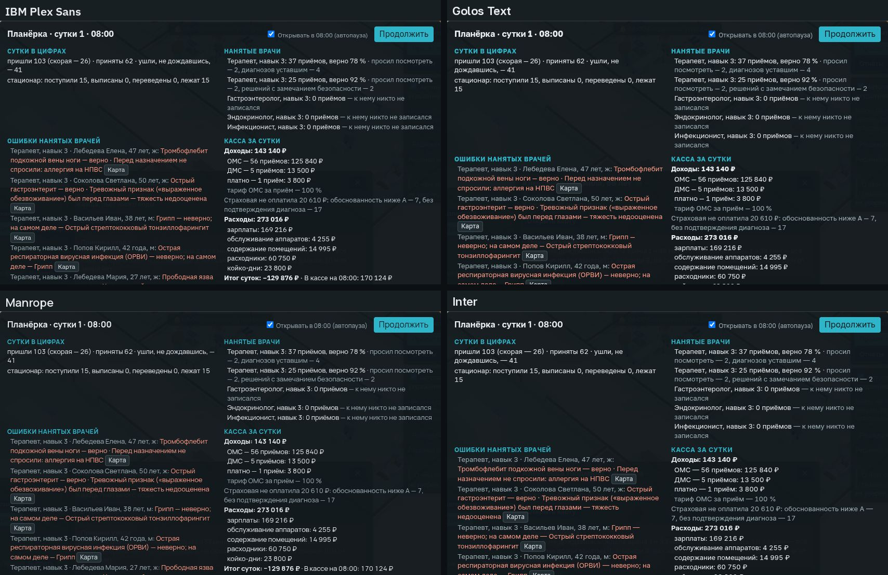
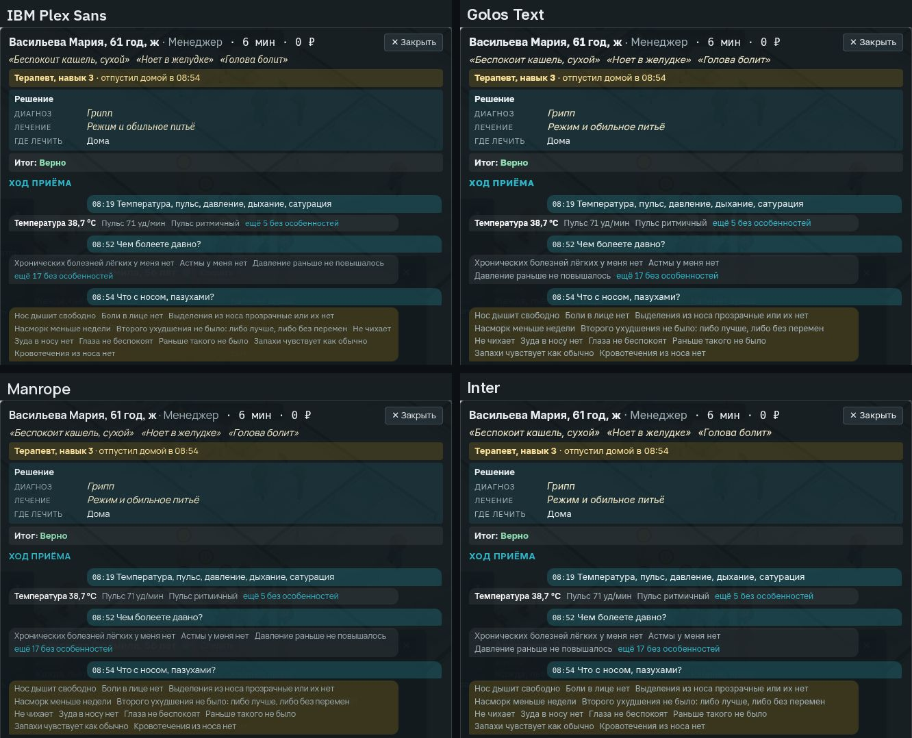
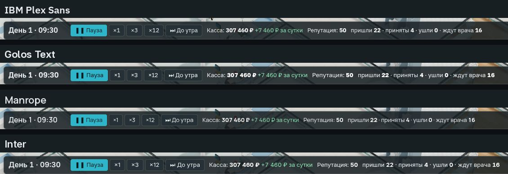
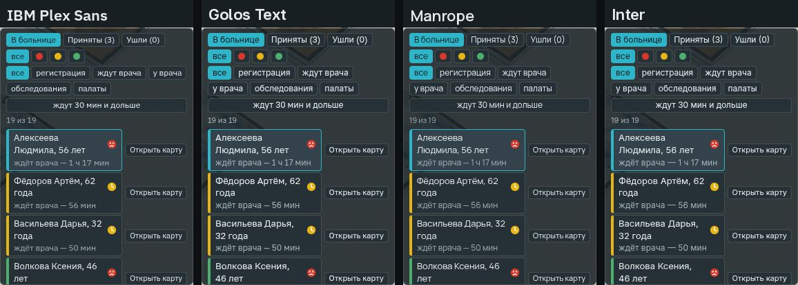

# Гарнитура: кандидаты на выбор

Отчёт агента, 25.10.2026. Решение владельца #68 («вариант 2»): своя гарнитура под марку сразу, а не Onest на время;
кандидаты с лицензиями (SIL OFL) — отдельным вопросом ([`../specs/2026-10-aaa-polish.md`](../specs/2026-10-aaa-polish.md),
«Решения владельца», 1). Проба — [`spikes/fonts`](../../spikes/fonts/README.md): откуда файлы, как проверено, как
повторить. Здесь — коротко и что выбрать. Выбор владельца 25.10.2026 (#107, «вариант 1») — **IBM Plex Sans**.

## Что нужно игре

- **Лицензия SIL OFL**: шрифт можно встроить в игру и продавать её; с игрой — текст лицензии и строка авторства.
- **Кириллица** целиком, с «ё», кавычками «», знаком № и **знаком рубля ₽** — касса, планёрка, найм.
- **Табличные цифры**: у часов, кассы и таблиц планёрки все цифры одной ширины, и строка не дёргается, когда они
  меняются.
- **Свой курсив**: жалобы больного и диагноз в карте набраны курсивом. Без своего курсива браузер просто наклоняет прямые
  буквы.
- **Плотность**: в карте больного и на планёрке много текста; чем уже строка, тем меньше переносов.
- **x-высота** — высота строчных букв: чем она больше, тем лучше читается текст в 12–13 пикселей.

## Что проверено

Двенадцать гарнитур из Google Fonts; файлы и лицензии — из их хранилища на GitHub, первоисточника. Это интерфейсные
гротески с кириллицей, шрифт студии Onest — для сравнения, и Unbounded — для заголовков. Все — под OFL; кириллица, «ё»,
₽ и № есть во всех. Каждый шрифт сверен со всеми знаками строк игры и медицинской базы. Значки (☰, ⚙, 🏗) не в счёт:
их заменят рисованные (aaa-polish, Б5). Ширина строки — одна и та же строка карты и кассы, Inter — 100 %.

| Гарнитура | Авторы | Цифры | Курсив | Насыщенность | x-высота | Ширина строки | Нет знаков |
|---|---|---|---|---|---|---|---|
| Source Sans 3 | Paul D. Hunt | табличные сразу | есть | 200–900 | 0,478 | 83 % | — |
| **Manrope** | Mikhail Sharanda | табличные — признак tnum | нет | 200–800 | 0,540 | 91 % | — |
| Commissioner | Kostas Bartsokas | нет табличных | наклон осью | 100–900 | 0,494 | 91 % | ←↑→↓ |
| Fira Sans | Carrois Apostrophe | табличные — tnum | есть | отдельные файлы | 0,531 | 94 % | — |
| Rubik | Hubert and Fischer и др. | табличные — tnum | есть | 300–900 | 0,520 | 95 % | μ ←↑→↓ |
| **IBM Plex Sans** | Mike Abbink, Bold Monday | табличные сразу | есть | 100–700, ширина 75–100 % | 0,516 | 95 % | — |
| Wix Madefor Text | Dalton Maag | нет табличных | есть | 400–800 | 0,492 | 96 % | μ ≈≤≥ |
| Geologica | Monokrom | табличные — tnum | наклон осью | 100–900 | 0,480 | 96 % | ⁹₂ |
| Onest | Dmitri Voloshin, Andrey Kudryavtsev | табличные — tnum | нет | 100–900 | 0,527 | 97 % | μ ⁹₂ |
| **Golos Text** | Alexandra Korolkova, Vitaly Kuzmin | табличные — tnum | нет | 400–900 | 0,530 | 99 % | μ ⁹ |
| **Inter** | Rasmus Andersson | табличные — tnum | есть | 100–900 | 0,546 | 100 % | — |
| Unbounded | NaN | табличные — tnum | нет | 200–900 | 0,566 | 125 % | μ ⁹ |

Жирным — четыре гарнитуры на снимках ниже. Знаков μ, ⁹, ₂ нет у части шрифтов, но они встречаются только в примечаниях к
источникам базы; где их нет, браузер возьмёт системный шрифт.

**Отпали:**

- **Commissioner** и **Wix Madefor Text** — нет табличных цифр: часы и касса будут дёргаться.
- **Source Sans 3** и **Geologica** — самая низкая x-высота, 0,48: мелкий текст карты читается хуже. Source Sans 3 —
  самая узкая, но и самая мелкая.
- **Rubik** — округлый и весёлый, это не тёмный клинический стиль (#69); стрелок нет.
- **Fira Sans** — по плотности и характеру близка к IBM Plex Sans; из двух на снимках — Plex, у него узкое начертание в
  том же файле.
- **Onest** — шрифт студии; вы решили брать свой.
- **Unbounded** — широкий, для заголовков и логотипа; вернёмся к нему вместе с именем марки (№85).

## Как выглядит

Снимки — сама игра в одну и ту же минуту: на странице подменён только шрифт.

**Планёрка** — больше всего текста и цифр. В Plex и Manrope «Касса за сутки» влезает до «Итога», в Golos и Inter
строки переносятся чаще, и итог уходит вниз.

**Карта отпущенного больного**: курсив — жалобы и диагноз; строки «Хода приёма». У Plex и Inter курсив свой, у Golos и
Manrope — наклонённые прямые буквы.

**Верхняя полоса** — часы, касса, счётчики:

**Вкладка «Пациенты»**:

## Четыре варианта

1. **IBM Plex Sans** — Майк Эбинк (IBM) и Bold Monday. Строгий гротеск «человек и машина», как пишут авторы. Цифры
   табличные сразу, курсив свой; в том же файле — узкое начертание до 75 % ширины: им можно набрать плотные таблицы
   без второго шрифта. Минусы: его узнают как шрифт IBM; файлы — 1,1 МБ, для игры на ПК это неважно.
2. **Golos Text** — Александра Королькова и Виталий Кузьмин, ParaType, 2019; сделан по заказу для сайтов
   государственных и социальных служб. Кириллица у него родная, читается легко. Минусы: нет курсива; строка шире на 4 %,
   на планёрке больше переносов; привкус госуслуг.
3. **Manrope** — Михаил Шаранда, 2018. Современный геометрический, самый плотный из четырёх, x-высота высокая. Минусы:
   нет курсива; цифры кассы на снимках светлее и мельче, чем у остальных; характер скорее «приложения», чем больницы.
4. **Inter** — Расмус Андерссон. Самый проверенный шрифт интерфейсов: крупный, ровный, курсив свой. Минусы: самый
   широкий из четырёх, и он везде — своего лица у игры с ним не будет.

## Рекомендация

**IBM Plex Sans.** Табличные цифры и свой курсив без оговорок; он плотный, а для таблиц планёрки и списков у него есть
узкое начертание. Строгий «приборный» характер ложится на тёмный клинический стиль (#69). Заголовки — им же, полужирным;
шрифт логотипа — вместе с именем марки (№85).

## Что дальше

Владелец выбрал IBM Plex Sans 25.10.2026 (#107, «вариант 1»). Сделано в 0.28.0: файлы шрифта — прямой и курсив,
переменные по насыщенности и ширине, нетронутые, с текстом OFL — в `assets/fonts/`, строка с SHA-256 — в
`assets/LICENSES.md` (раздел 5); страница подключает их через `@font-face`, сборка кладёт их и лицензию рядом. Сеть игре
не нужна: шрифт — в сборке. Затем — три размера текста и рисованные значки вместо символов, пункт Б5
[`../specs/2026-10-aaa-polish.md`](../specs/2026-10-aaa-polish.md).
