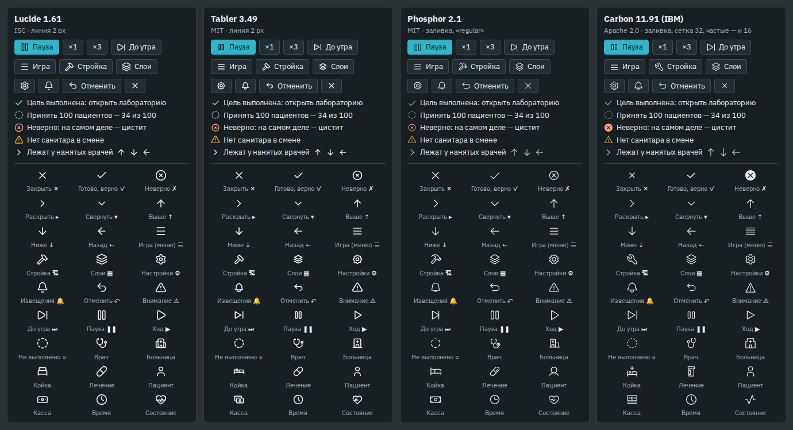
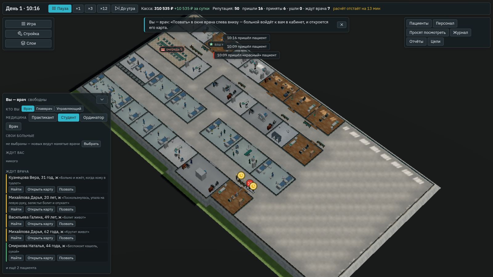
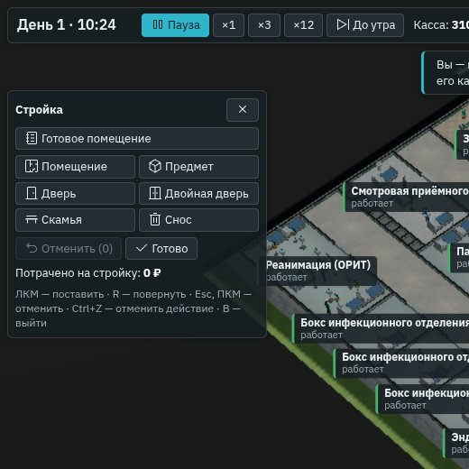

# Значки: кандидаты на выбор

Отчёт агента, 26.10.2026. Выбор владельца того же дня — **Carbon (IBM)** (#139, вариант 1), как рекомендовал агент. Пункт 5 этапа Б из
[`../specs/2026-10-aaa-polish.md`](../specs/2026-10-aaa-polish.md): «значки SVG одной руки вместо символов Юникода». Гарнитура уже выбрана — IBM Plex Sans (#107), тёмный клинический стиль —
основа марки (#69). Проба — [`spikes/icons`](../../spikes/icons/README.md): откуда файлы и как повторить. Здесь — что
выбрать.

## Зачем

Сейчас значки в окне — символы Юникода и эмодзи: ✕ ✓ ✗ ▸ ▾ ↑ ↓ ← ☰ 🏗 ▦ ⚙ 🔔 ↶ ⚠ ⏭ ❚❚ ○ — около двадцати. Они:

- **разной руки** — толщина, размер и высота над строкой у каждого своя;
- **зависят от системы**: эмодзи 🏗 и 🔔 на Windows, в Linux и в Steam Deck выглядят по-разному, а где-то — квадратом;
- **без медицины**: значков врача, койки, лечения и больницы для каталога стройки и карточек среди них нет.

Набор значков одной руки решает все три. Значки — файлы SVG: игра встраивает только нужные, по одной строке на значок.

## Что проверено

Четыре открытых набора с npm, версии закреплены; у всех нужные игре значки есть, медицинские тоже.

| Набор | Лицензия | Значков | Рисунок | Медицина | Чем хорош |
|---|---|---|---|---|---|
| **Carbon** 11.91 (IBM) | Apache 2.0 | 2 640 | заливка, сетка 32; у 68 — ещё и свой рисунок на 16 точек | стетоскоп, больница, койка, лекарство | та же система дизайна IBM, что и шрифт Plex: значки и буквы — одной руки |
| Lucide 1.61 | ISC | 2 171 | линия 2 px, сетка 24 | стетоскоп, больница, койка, таблетка | самый распространённый; ровная линия |
| Tabler 3.49 | MIT | 5 184 линией и 1 054 залитых | линия 2 px, сетка 24 | больше всех: и аппараты, и отделения | самый большой выбор — хватит и на каталог |
| Phosphor 2.1 | MIT | 1 512 в каждом из шести начертаний | заливка, шесть толщин | стетоскоп, больница, койка, таблетка | можно выбрать толщину под марку |

Все четыре лицензии разрешают встроить значки в продаваемую игру; с игрой — текст лицензии и строка в `assets/LICENSES.md`,
как у шрифта и моделей.

## Лист сравнения

Одни и те же места игры в каждом наборе — верхняя полоса, левые инструменты, кнопки, строки целей и предупреждений, и
сетка всех значков с подписью и символом, который сейчас на его месте. Шрифт и цвета — игры, размер — как в игре: 16 точек
на кнопках, 20 — в сетке.

- **Carbon** — плотные и чёткие на 16 точках; у частых значков (стрелки, меню, настройки, извещения, предупреждение,
  пауза) — свой рисунок под этот размер, остальные сжаты с сетки 32. Круг «неверно» — залитый, заметнее прочих. Рядом с
  Plex — одна рука: и шрифт, и значки — IBM.
- **Lucide** и **Tabler** — почти одинаковы: линия 2 px чуть жирнее букв Plex; Tabler богаче медициной.
- **Phosphor** — легче всех, линия тоньше; для тёмного фона на 16 точках — бледноват.

## Рекомендация

**Carbon (IBM)**: он сделан в пару к IBM Plex Sans, плотный и чёткий в размере игры, медицина в нём есть, лицензия
Apache 2.0 разрешает всё, что нужно. Если хочется больше значков на будущее (каталог отделений, аппараты) — Tabler.

## Что сделано

26.10.2026, версия 0.44.0, по выбору владельца (#139, вариант 1):

- **Значки — из пакета `@carbon/icons` 11.91.0**, закреплённого по SHA-256 архива. `node tools/app/icons.mjs --fetch <папка>`
  берёт его с npm (`npm pack`, без установки и скриптов пакета), `node tools/app/icons.mjs <папка>` пишет
  `src/ui/icons.gen.ts` — только нужные игре 21 значок, разметкой путей, — и текст лицензии `assets/licenses/carbon-icons.txt`.
  Рисунок — на 16 точек, где он у набора есть (10 значков), иначе сетка 32.
- **Своих значков три** — дверь, двойная дверь и скамья для инструментов стройки: таких в наборе нет. Нарисованы кодом в
  его рисунке — сетка 32, заливка, линии в 2 точки.
- **`Icon` в `src/ui/icons.tsx`** — значок цвета текста, 16 точек на линии букв; для чтения с экрана скрыт, подпись — рядом
  или в `title`.
- **Что заменено:**
  - верхняя полоса — пауза, «До утра», стрелка репутации;
  - слева — «Игра», «Стройка», «Слои», инструменты стройки, «Готовые помещения», «Отменить», «Готово»;
  - все крестики «Закрыть», «Назад» экрана начала и энциклопедии, «Настройки»;
  - в карточке помещения — есть и нет нужного;
  - в окне врача — раскрыть и свернуть, «в ряду», выполненное, «хуже»;
  - в «Целях» — сделано и не сделано, шаги порядка стройки.

  В подсказке строки «Приняты» вместо ✓ ≈ ✗ — слова итога («Верно», «Почти: та же тактика», «Неверно»). Стрелки в тексте
  («кабинет → палата», «↑5» у настроения) остались: это буквы шрифта Plex, а не значки.
- **Лицензия** — раздел 6 `assets/LICENSES.md`; текст Apache 2.0 сборка кладёт в `dist/assets/licenses/`.
- **Проверки:**
  - `tools/test/icons.test.ts` — лицензия и её SHA-256, только пути SVG в `icons.gen.ts`, ни одного прежнего символа в
    коде окна;
  - сценарий в браузере, часть 1 — значки в игре и в стройке на месте, по 16 точек, символов Юникода и эмодзи в тексте
    окна нет.
