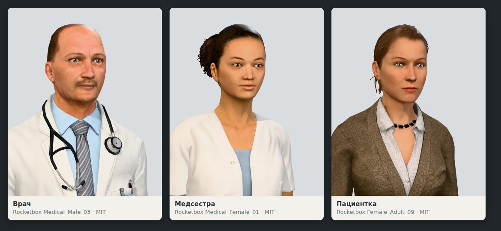
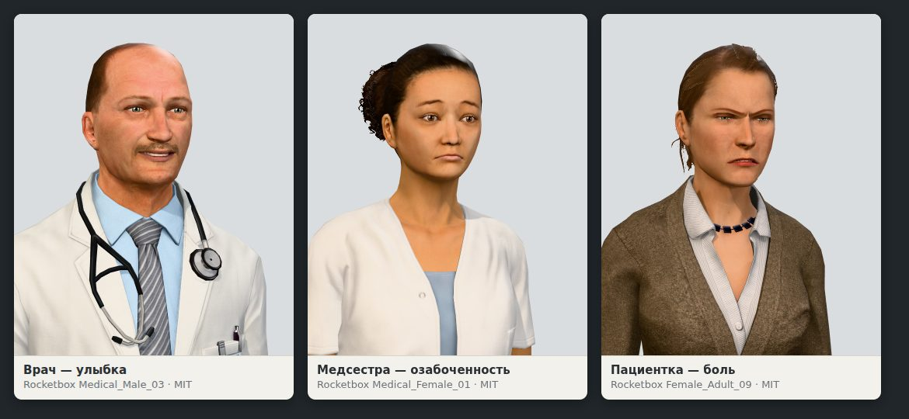
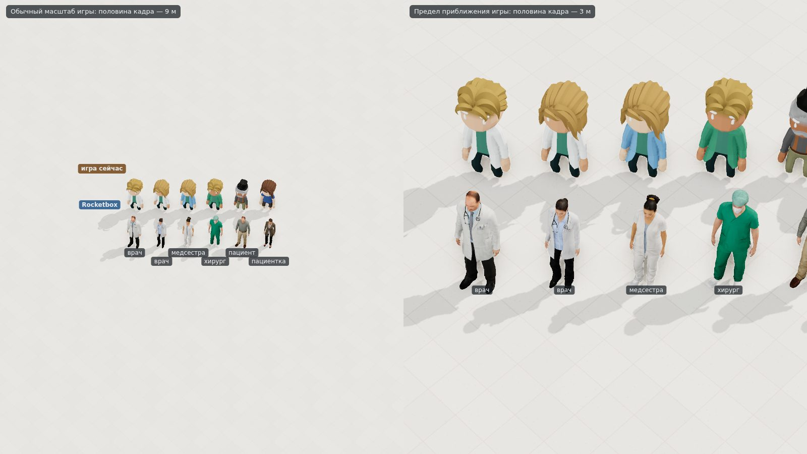
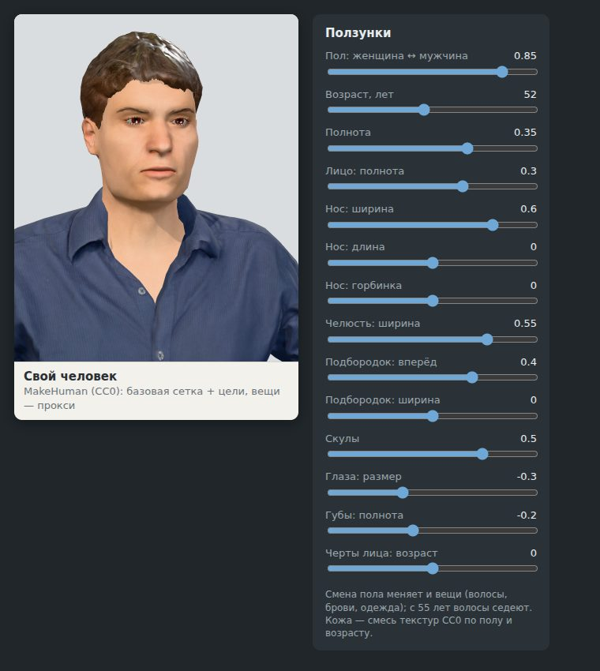
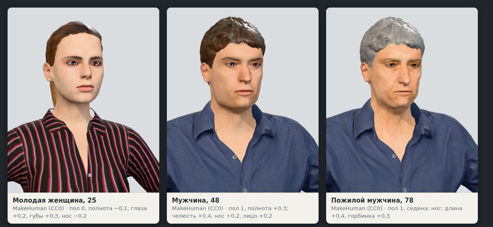

# Реалистичные люди и редактор лица: проба и предложение

Отчёт агента, 24.10.2026. Просьба владельца в тот же день: «поищи в интернете нет ли более реалистичных не мультяшных
персонажей»; «открывать карточку персонажа (врача, пациента) и видеть там более реалистичного персонажа. Хотя бы лицо»;
«редактор лица… не мультяшный, а более реалистичный, с регуляторами, чтобы можно было персонажей кастомизировать и
создавать своих (врачей, себя, медсестёр и т. п.)».

Проба — [`spikes/realistic-people`](../../spikes/realistic-people/README.md): источники с лицензиями и суммами, как
запустить, замеры, риски и оценки по дням. Здесь — коротко и что выбрать.

## Что нашлось

Бесплатных источников реалистичных людей с лицензией, которая позволяет продавать игру, два:

- **Microsoft Rocketbox** — 115 готовых людей с фототекстурами, среди них 8 медиков; у лиц — 175 форм для выражений.
  Лицензия **MIT**: можно всё, в титрах и в файле лицензий — строка авторства и текст лицензии.
- **MakeHuman** — параметрический человек: одна сетка и «цели» — сдвиги под пол, возраст, полноту, нос, челюсть и так
  далее. Это и есть ползунки. **Данные — CC0** (можно всё); **код — AGPL**, его брать нельзя: проба читает файлы своим
  кодом.

Людей и редакторы из других игр брать нельзя. Платные наборы, редакторы с лицензией под свой движок и генераторы людей —
отдельный разговор (ADR студии 0020, [`2026-10-3d-generators.md`](2026-10-3d-generators.md)).

## Как это выглядит

**Лицо в карточке — Rocketbox.** Вблизи это люди, а не куклы: морщины, щетина, складки ткани.

**Выражения** читаются сразу — улыбка, тревога, боль:

**На карте** — сзади люди игры, спереди Rocketbox; слева обычный масштаб, справа — предел приближения:

На обычном масштабе человек — около 80 точек ростом, лица не видно. Кто есть кто, видно только по одежде: хирург в
зелёном, а врач и медсестра оба в белом. Рядом с мультяшными людьми и мебелью реалистичные смотрятся из другой игры:
менять — так всех, и обстановку следом.

**Редактор — MakeHuman.** 14 ползунков (пол, возраст, полнота, нос, челюсть, подбородок, скулы, глаза, губы); лицо
меняется сразу, на каждое движение (2,8 мс):

Механизм работает, а вид — «из 3D-редактора»: кожа гладкая, как пластик, волосы — шлем, больничной одежды в бесплатных
наборах нет.

## Три пути

| Путь | Что видит игрок | Работы агента | Главный риск |
|---|---|---|---|
| **А.** Rocketbox для всех | реалистичные люди на карте и лица в карточках; свой человек — выбор облика из библиотеки (~30 видов) и цвета волос, кожи, одежды; ползунков нет | 8–11 дней, выбор облика — ещё 2–3 | одни и те же лица у 200 пациентов; набор начала 2010-х |
| **Б.** MakeHuman для всех | ползунки у всех: свой человек на карте тот же, что в редакторе; пациенты без повторов | 4–6 недель и больничная одежда генератором (ADR 0020) | вид «из 3D-редактора»; тело тяжёлое для карты |
| **В.** Rocketbox на карте, редактор MakeHuman — для портрета своих | реалистичные люди на карте; редактор с ползунками — только для портрета | 8–11 + 6–8 дней | свой человек в карточке не похож на себя на карте |

## Предложение агента

**Путь А, а ползунки — решить, когда люди будут в игре.** Первая просьба — реализм и лицо в карточке; путь А даёт их за
две недели с малым риском и не исключает редактора потом. Свой человек в пути А — не ползунки, а выбор облика: один из
~30 людей библиотеки, цвет волос, кожи и одежды, имя. Он один и тот же на карте и в карточке.

Ползунки MakeHuman сейчас проигрывают Rocketbox в реализме, а «свой человек и на карте» стоит 4–6 недель с риском. Если
редактор с ползунками нужен обязательно — путь Б, но тогда реализм ниже, чем у Rocketbox на снимках выше.

С любым путём:

- **MIT** — строка авторства Rocketbox в титрах и текст лицензии рядом с `assets/LICENSES.md`;
- **красный крест** на бейдже одного из врачей набора — охраняемая эмблема; перерисовать;
- **цвета должностей** — либо перекраска текстур, либо одежда набора (белые халаты, зелёные костюмы хирургов);
- **мебель и оборудование** рядом с реалистичными людьми выглядят игрушечнее — их подъём (генераторы по ADR 0020) —
  отдельная задача.

## Вопросы владельцу

1. **Путь:** А, Б или В? Предложение — А, выбор облика для своих людей, ползунки — решить позже.
2. **Лица в карточке** — у всех пациентов или только у персонала и своих людей?
3. **Цвета должностей** — оставить свои (медсёстры голубые, хирурги зелёные), то есть перекрашивать текстуры, или принять
   одежду набора?
4. **Мебель и оборудование** — следом в тот же реализм?
5. **MakeHuman** — можно ли брать пакеты сообщества под CC-BY (лучшие волосы — под CC-BY) или только CC0?
