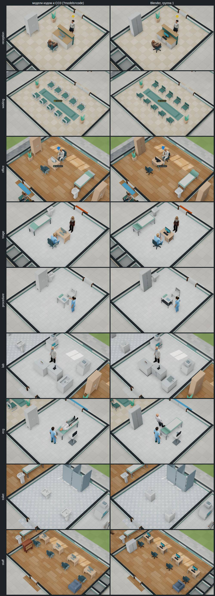
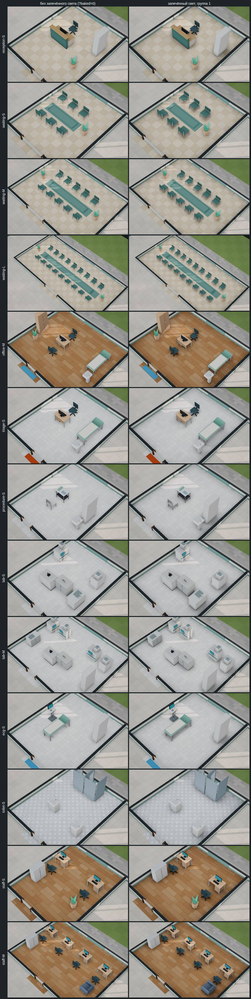

# Модели Blender, группа 1 «Амбулатория»

Отчёт от 31.10.2026 к [спецификации части 2](../specs/2026-11-blender-2.md) (решение владельца
[#178](https://github.com/Nefeste/bolnitsa/issues/178), вариант 3: аппараты и мебель — Blender, группами, каждая сразу по
умолчанию). Модели — версия 0.57.0, запечённый свет — 0.58.0.

## Коротко

1. **18 моделей помещений сценария 1** — регистратура, ожидание, кабинет врача, сортировка, процедурная, лаборатория, ЭКГ,
   санузел, ординаторская, скамьи в коридоре — собраны скриптом `blender/ambulatory.py` и стоят в игре по умолчанию. Прежние
   модели кодом и CC0 — по ключу `?models=code`.
2. **Все в бюджете** `blender/budgets.json`: от 156 треугольников у стула до 768 у стойки регистратуры. Вместе — 280 КБ
   сжатых файлов.
3. **Город не стал тяжелее:** треугольников мебели 58 580 → 58 286, вещей — 237 → 213 (монитор стола и кабинка санузла —
   части одной модели), вызовов отрисовки — на 1–9 меньше. Загрузка мебели и первый кадр — те же.
4. **Нашлась и исправлена ошибка раскладки:** в готовых помещениях стол стоял к сотруднику то лицом, то спиной (в образце
   регистратуры — спиной, в городе — лицом). Теперь стол рядом с местом сотрудника всегда повёрнут к нему; у стойки
   регистратуры кодом панель тоже была обращена к регистратору — исправлено.
5. **Сборка повторяется до байта:** два запуска `build.py` и `blender-pack.mjs` дали одни и те же 18 файлов.
6. **Запечённый свет, 0.58.0:** у всех 13 образцов помещений сценария 1, в игре по умолчанию, 0,93 МБ. Попутно найдена и
   исправлена ошибка: свет образцов M и L не ложился ни на одно помещение — сверялся размер из плана, а у помещения стройки
   там всегда наименьший размер.

## Лист сравнения

Поликлиника, 11:00, без пациентов, качество «высокое»: слева модели кодом и CC0 (`?models=code`), справа — Blender
(`node tools/app/blender-sheet.mjs`).

## Модели

| Модель | Вместо | Треугольников / бюджет | Частей | Файл, КБ |
|---|---|---:|---:|---:|
| `counter` | стойка регистратуры кодом | 768 / 2000 | 9 | 27 |
| `desk` | стол Kenney и монитор с клавиатурой | 428 / 900 | 8 | 20 |
| `office_chair` | кресло Kenney | 316 / 600 | 6 | 16 |
| `waiting_chair` | стул зала ожидания Kenney | 180 / 400 | 3 | 9 |
| `chair` | стул Kenney | 156 / 400 | 3 | 7 |
| `bench` | скамья Kenney | 236 / 400 | 3 | 10 |
| `lounge_chair` | кресло ординаторской Kenney | 224 / 800 | 4 | 12 |
| `toilet` | унитаз Kenney и стенки кабинки кодом | 680 / 900 | 6 | 19 |
| `couch` | смотровая кушетка кодом | 468 / 700 | 4 | 13 |
| `bookcase` | шкаф Kenney | 296 / 500 | 4 | 11 |
| `low_cabinet` | шкаф KayKit | 312 / 600 | 4 | 12 |
| `sink` | раковина Kenney | 172 / 400 | 4 | 10 |
| `sink_wc` | раковина санузла Kenney | 216 / 400 | 5 | 11 |
| `lab_sink` | мойка Kenney | 436 / 600 | 6 | 17 |
| `lab_bench` | лабораторный стол кодом | 656 / 1500 | 11 | 30 |
| `analyzer` | анализатор кодом | 540 / 1000 | 8 | 21 |
| `procedure_table` | процедурный столик кодом | 480 / 1200 | 5 | 17 |
| `ecg` | электрокардиограф кодом | 432 / 1500 | 9 | 22 |

- **Мебель вместо моделей наборов** собрана в размер места каталога; игра ставит её в настоящий размер, а не вписывает:
  на столе стоит монитор выше места, вписанный стол сплющивался бы. Материалы названы как у моделей наборов («wood»,
  «carpet»), поэтому перекраски каталога — белая мебель, обивка зала ожидания и ординаторской — ложатся на них по имени.
- **Аппараты вместо моделей кодом** стоят в осях своего места, габарит — как у модели кодом (тест: не дальше 6 см).
- **Сиденья** — на высоте `SEAT` (0,38 м): по ним игра сажает людей (`seatOf`), тест сверяет.
- **Экраны светятся** — у стола, стойки регистратуры, анализатора и электрокардиографа (материал «screen»).

## Замер

«Авто-бенч» без окна (`npm run bench:headless -- --qualities low,high --secs 5`, второй прогон — `--keys models=code`):
город, 11:00, 54 человека, 1280×720, Chromium 141, программный WebGL, 4 ядра. Один прогон каждого.

| | Модели кодом и CC0 | Blender, группа 1 |
|---|---:|---:|
| Треугольников мебели и аппаратов | 58 580 | 58 286 |
| Вещей мебели | 237 | 213 |
| Треугольников в кадре, «низкое»: общий / крупный план | 240 464 / 201 773 | 239 876 / 202 494 |
| То же, «высокое» | 289 001 / 379 139 | 288 420 / 381 771 |
| Вызовов отрисовки, «низкое»: общий / крупный план | 185 / 114 | 183 / 105 |
| То же, «высокое» | 216 / 118 | 214 / 117 |
| Загрузка мебели и аппаратов, мс | 113 | 107 |
| Загрузка всего, мс | 5003 | 4914 |
| Первый кадр после запуска, мс | 6447 | 6303 |

- **В городе группа 1 почти не меняет треугольников:** стулья и кресла легче наборных (кресло — 316 против 588), а стол и
  стойка — тяжелее, но вместе с монитором, который раньше был отдельной моделью.
- **Кадр здесь меряет процессор** (программный WebGL) и шумит — поэтому его нет в таблице; решающий замер — у владельца
  «Авто-бенчем» в окне игры, с `--models code` и без.

**Отклик стройки О2** ([спецификация демо](../specs/2026-11-demo.md), «Ощущение — числами»: от щелчка по участку до готового
помещения на карте) — путь демо в сценарии в браузере (`npm run e2e -- --only 32`), по два прогона подряд на `main` (модели
кодом и CC0) и на этой ветке, по три помещения в прогоне:

| | Модели кодом и CC0 (`main`) | Blender, группа 1 |
|---|---|---|
| О2, мс | 869, 1026, 1032; 929, 781, 715 — медиана 899 | 1017, 940, 729; 884, 94, 832 — медиана 884 |
| О6, загрузка сценария, с | 9,4; 9,3 | 9,1; 9,6 |

- **О2 — в пределах разброса** (критерий спецификации — не хуже на 10 %). 94 мс — выброс: помещение появилось быстрее
  кадра, такого не было ни в одном другом прогоне; медиана без него — 884.
- Цель демо — О2 ≤ 500 мс — не выполнена и до группы 1: без видеокарты кадр около 250 мс, а помещение появляется через кадр
  после пересчёта сцены. Перемерить на ПК владельца.

## Запечённый свет, 0.58.0

Свет на полу готовых помещений группы — затенение и мягкие тени от светильников, запечённые в Cycles (`blender/room.py`), —
теперь у всех 13 образцов помещений сценария 1 и в игре по умолчанию; `?baked=0` (у Electron — `--baked 0`) его выключает.

Лист: каждый образец поставлен готовым помещением без людей в пустом здании, как его ставит игрок; слева — `?baked=0`,
справа — по умолчанию (`node tools/app/blender-sheet.mjs --light`).

| Образец | Пол, точек | Файл, КБ | Запекание, мин |
|---|---|---:|---:|
| регистратура S | 320×384 | 57 | 2,6 |
| ожидание S | 320×384 | 62 | 3,2 |
| ожидание M | 512×384 | 89 | 4,5 |
| ожидание L | 768×384 | 127 | 7,7 |
| кабинет врача M | 448×384 | 67 | 4,7 |
| сортировка S | 320×384 | 56 | 2,7 |
| процедурная S | 320×384 | 46 | 2,8 |
| лаборатория S | 320×384 | 59 | 4,3 |
| лаборатория M | 448×384 | 76 | 6,3 |
| ЭКГ S | 320×384 | 50 | 2,7 |
| санузел S | 320×384 | 61 | 3,5 |
| ординаторская S | 320×384 | 56 | 2,6 |
| ординаторская M | 512×384 | 94 | 6,9 |
| **Всего** | | **901** | **54,5** |

- **Запекание** — по четыре образца разом на 4 ядрах, время — каждого; всё вместе — около 15 минут. Оценка спецификации —
  около часа в один поток.
- **В образце — настоящие модели группы**, поставленные так же, как их ставит окно; кабинки санузла — декор окна. Цветок —
  горшком: коробкой во всё место под ним на полу выходил чёрный квадрат (первый лист, исправлено).
- **Ложится на готовое помещение, поставленное как есть:** тот же тип, те же стороны и вещи на местах образца, при любом
  повороте. Тест ставит каждый образец готовым помещением, как игрок, при четырёх поворотах; лист — то же в окне игры. В
  поликлинике и в городе свет лёг на все 13 помещений группы.
- **Нашлась и исправлена ошибка сверки.** Свет сверял размер помещения из плана, а у помещения стройки ПК там всегда
  наименьший размер типа: зал ожидания M в плане — «S». Поэтому свет образцов M и L — залов ожидания M и L, лаборатории M,
  ординаторской M — не ложился ни на одно помещение: ни в поликлинике, ни в городе, ни у игрока. Теперь сверяются стороны
  помещения (`bakedRooms`). Тест ошибку не видел: он брал план шаблонов «Анамнеза», где размер — из образца; теперь он
  ставит помещение тем же путём, что игра (`addReady` → `planOfSite`). Прежний вывод черновика отчёта — «в поликлинике
  залы ожидания и ординаторская растянуты» — был этой же ошибкой.
- **Что видно:** мягкая тень у ножек и под сиденьями, у стен и под столешницами. Кадр листа со светом темнее в среднем на
  2–2,7 уровня из 255; темнее на 6 уровней и больше — 12–16 % точек кадра. Тени от вещей группы слабее, чем у рентгена
  пилота: вещи низкие и свет над ними.
- **Размер:** +0,93 МБ (картинки уже сжаты) — как оценивала спецификация. По оценке спецификации на группы 2–4 за все
  четыре группы выйдет около 2,6 МБ вместе с моделями — больше предела +2 МБ. Поэтому у группы 2 — сначала проба 32 точек на
  метр: файл вчетверо меньше, а тени мягкие (решение агента 11 в спецификации).

**Замер света.** «Авто-бенч» без окна (`npm run bench:headless -- --qualities low,high --secs 5`, с `--keys baked=0` и
без): город, 11:00, 54 человека, 1280×720, программный WebGL, 4 ядра. По два прогона попеременно: без света, со светом,
ещё раз — чтобы первый не мерил холодный кэш диска.

| | Без света (`?baked=0`) | Со светом |
|---|---:|---:|
| Помещений со светом в городе | 0 | 13 — от 9 образцов |
| Вызовов отрисовки, общий план, «низкое» / «высокое» | 183 / 214 | 192 / 223 |
| Текстур на видеокарте, «низкое» / «высокое» | 135 / 142 | 144 / 151 |
| Загрузка мебели и аппаратов, мс | 149; 135 | 144; 170 |
| Загрузка всего, мс | 5252; 4728 | 4910; 5357 |
| Первый кадр после запуска, мс | 6633; 6024 | 6200; 7034 |

- **Вызовов отрисовки +9 на общем плане:** одна сетка на образец, а не на помещение. Крупным планом — +2…5: сетки вне
  кадра отсекаются (тот же кадр со светом и без, на одной странице). Треугольников — +26: 13 полов по два.
- **Нашлось при замере:** первая версия давала +26 вызовов. Пол каждого помещения был двусторонним, а прозрачный
  двусторонний материал three.js рисуется в два прохода. Двусторонность не была нужна: поворот образца — настоящий
  поворот, и пол всегда смотрит вверх (тест). Теперь — одна сторона и одна сетка на образец.
- **Загрузка:** свет грузится вместе с моделями, а не перед ними, — 13 картинок по 46–127 КБ. Загрузка мебели выросла на
  10–35 мс; загрузка всего и первый кадр — в пределах разброса прогонов (±0,5 с).
- **Кадр** в программном WebGL меряет процессор — в таблице его нет. Решающий замер — «Авто-бенч» у владельца с
  `--baked 0` и без.

**Отклик стройки О2 и загрузка О6** — путь демо (`npm run e2e -- --only 32`), по два прогона попеременно на `main` (модели
группы 1 без света) и на этой ветке. В пути демо строятся регистратура, зал ожидания M и свой кабинет — все три готовые и
теперь со светом (зал M — только после исправления сверки).

| | `main` | Со светом |
|---|---|---|
| О2, мс | 934, 1050, 869; 890, 755, 726 — медиана 880 | 1053, 877, 801; 834, 845, 842 — медиана 844 |
| О6, загрузка сценария, с | 7,7; 8,7 | 9,0; 8,2 |

- **О2 и О6 — в пределах разброса** (критерий спецификации — не хуже на 10 %).
- **Запекание повторяется до байта:** процедурная S перезапечена в одиночку (154,5 с) — тот же файл.

## Решения агента

Решения 7–11 спецификации (`docs/specs/2026-11-blender-2.md`): модель Blender — в настоящий размер; стол рядом с местом
персонала — к нему и в готовом помещении; стойка регистратуры кодом исправлена; свет группы 1 — вторым PR (0.58.0); у
группы 2 — сначала проба света в 32 точки на метр, чтобы четыре группы уложились в +2 МБ.

## Журнал проверок

1. 31.10.2026 — `bpy` 4.5.15 поставлен заново (контейнер новый); модели пилота пересобрались до байта.
2. Модели группы 1 собраны: все в бюджете (`build.py` модель сверх бюджета не пишет).
3. Первый лист «было / стало» — в игре всё на местах, ошибок в консоли нет.
4. Тест нашёл, что стол вписывался в высоту места вместе с монитором и сплющивался → модель Blender встаёт в настоящий
   размер.
5. Экран стола смотрел от врача → расчётом найдено: в осях стола сотрудник — на +z; монитор, клавиатура и ящики
   перевёрнуты к нему, панель стойки — к посетителю.
6. В регистратуре поликлиники стойка всё равно стояла к регистратору спиной: у готового помещения поворот из образца →
   правило в `layoutOf`: стол рядом с местом персонала — к нему.
7. Повторяемость: два запуска сборки и сжатия — одинаковые SHA-256 всех 18 файлов.
8. `npm test` — 1172 из 1172; сценарий в браузере целиком — без ошибок в консоли и запросов наружу; «Авто-бенч» — таблица
   выше.
9. Свет, 0.58.0: 13 образцов запечены, по четыре разом. На первом листе под цветами — чёрные квадраты: цветок стоял
   коробкой во всё место → горшок, шесть образцов перезапечены.
10. Лист образцов в пустом здании: свет не лёг на 4 из 13 — образцы M и L → сверка по сторонам помещения, тест ставит
    образец, как игра. В поликлинике и в городе — 13 помещений из 13.
11. «Авто-бенч»: +26 вызовов отрисовки на 13 помещений — двусторонний прозрачный пол рисовался в два прохода → одна
    сторона и одна сетка на образец: +9.
12. Повторяемость света: процедурная S перезапечена — тот же файл до байта; О2 и О6 — как на `main`.
13. `npm test` — 1176 из 1176.
