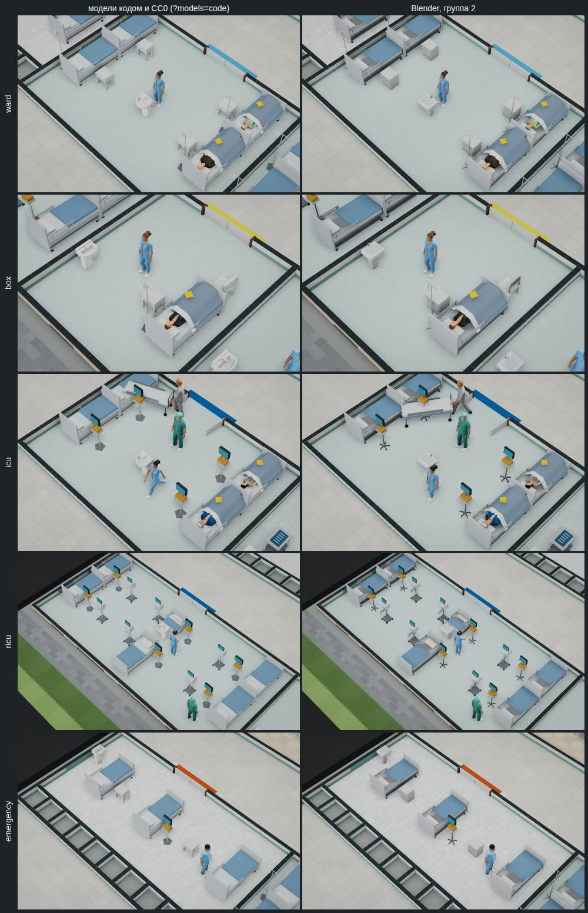
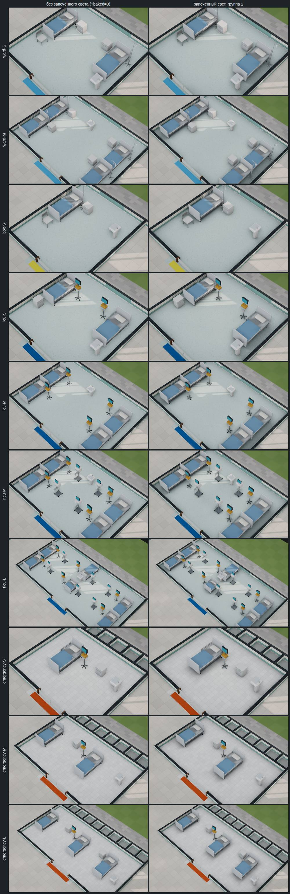

# Модели Blender, группа 2 «Стационар»

Отчёт от 01.11.2026 к [спецификации части 2](../specs/2026-11-blender-2.md) (решение владельца
[#178](https://github.com/Nefeste/bolnitsa/issues/178), вариант 3: аппараты и мебель — Blender, группами, каждая сразу по
умолчанию). Версия 0.59.0. Группа 1 — [отчёт](2026-11-blender-1.md).

## Коротко

1. **Четыре модели стационара** — кровать, монитор с дефибриллятором, тумбочка и аппарат ИВЛ — собраны скриптом
   `blender/stationary.py` и стоят в игре по умолчанию: в палате, боксе, ПИТ, реанимации и приёмном. Прежние модели кодом
   и CC0 — по ключу `?models=code`.
2. **Кровать и монитор пилота доведены до бюджета:** кровать — 1144 треугольника вместо 4872, монитор — 512 вместо 1016.
   Части те же, что у пилота: стойка капельницы `iv` и `iv_bag` — только в палате и боксе, борта, матрас, подушка, одеяло;
   у монитора светится экран. Четыре модели вместе — 104 КБ сжатых файлов; у пилота одни кровать и монитор были 365 КБ без
   сжатия.
3. **Запечённый свет десяти образцов** — палата S и M, бокс S, ПИТ S и M, реанимация M и L, приёмное S, M и L — в 32 точки
   на метр, 0,26 МБ. Лист в окне игры: свет лёг на каждый образец, поставленный готовым помещением.
4. **Город тяжелее на 25,7 тыс. треугольников мебели** (58,6 → 84,3 тыс.) — почти всё дают 28 кроватей, по 1144 вместо
   332 у модели кодом; с кроватью пилота было бы +127 тыс. Вызовов отрисовки — +12, загрузка мебели — +70 мс, и то и другое
   — от света, модели не прибавляют ни того ни другого.
5. **Сборка повторяется до байта:** модели группы 2 и образец света пересобраны — те же файлы.

## Лист сравнения

Город, 11:00, без новых пациентов, качество «высокое»: слева модели кодом и CC0 (`?models=code`), справа — Blender
(`node tools/app/blender-sheet.mjs --group 2`). В поликлинике коек нет, поэтому лист группы 2 снят в городе.

## Модели

| Модель | Вместо | Треугольников / бюджет | Частей | Файл, КБ |
|---|---|---:|---:|---:|
| `bed` | кровать кодом (пилот — 4872 треугольника) | 1144 / 1200 | 13 | 41 |
| `monitor` | монитор кодом (пилот — 1016) | 512 / 800 | 7 | 23 |
| `bedside` | тумбочка Kenney | 212 / 400 | 6 | 12 |
| `ventilator` | аппарат ИВЛ кодом | 568 / 1500 | 10 | 28 |

- **Как кровать уложилась в бюджет.** Сетка затенения — только у матраса и одеяла (0,4 м), у остальных частей её нет;
  скругление — у деки, изголовья, подушки и одеяла, а не у каждой планки; колёса — восьмигранные. Высота постели — та же
  (`lieTop`, 0,56 м): по ней игра кладёт людей.
- **Те же файлы, что у пилота** (`bed.glb`, `monitor.glb`): модели группы их заменили и сжаты, как все модели части 2.
  Пилот (`?models=blender`) теперь добавляет только рентген — его переделает группа 3.
- **Аппараты** стоят в осях своего места, габарит — как у модели кодом: тест сверяет с допуском 6 см. У аппарата ИВЛ
  экран над корпусом и шланги к больному — там же, где у модели кодом.
- **Тумбочка** — в размер места каталога; материалы «wood» и «woodDark», как у модели набора: каталог перекрашивает её в
  белое, как прежнюю.

## Запечённый свет

| Образец | Пол, точек | Файл, КБ | Запекание, с |
|---|---|---:|---:|
| палата S | 192×192 | 19 | 62 |
| палата M | 256×192 | 26 | 79 |
| бокс S | 160×192 | 15 | 42 |
| ПИТ S | 192×192 | 18 | 72 |
| ПИТ M | 256×192 | 26 | 71 |
| реанимация M | 256×192 | 32 | 95 |
| реанимация L | 384×192 | 45 | 127 |
| приёмное S | 192×160 | 17 | 43 |
| приёмное M | 256×160 | 27 | 62 |
| приёмное L | 320×160 | 33 | 73 |
| **Всего** | | **259** | **724** |

- **Запекание** — по два образца разом на 4 ядрах, время — каждого; всё вместе — около 6 минут. 32 точки на метр, как у
  группы 1 (решение агента 11).
- **В образце — модели групп**, поставленные так, как их ставит окно: кровать, монитор, тумбочка, аппарат ИВЛ и раковины
  группы 1. Стойка капельницы — только у кровати палаты и бокса (`iv` в образце). В реанимации L одна койка стоит в одной
  клетке: игра рисует её вдвое короче, так же и в образце (`short`).
- **Что видно:** мягкая тень под кроватями и тумбочками, у ножек мониторов и аппаратов ИВЛ, у стен. Кадр листа со светом
  темнее в среднем на 2,1–3,2 уровня из 255; темнее на 6 уровней и больше — 11–15 % точек. Тень заметнее, чем у мебели
  амбулатории: кровати большие.
- **Лист света** строит образцы в пустом здании на уровне «Спокойно»: реанимация L стоит 1,02 млн ₽, а касса пустого здания
  на «Обычно» — 1,2 млн, после предыдущих образцов её не хватало. На вид уровень не влияет.

## Замер

«Авто-бенч» без окна (`npm run bench:headless -- --qualities low,high --secs 5`, второй вид — `--keys models=code`): город,
11:00, 54 человека, 1280×720, программный WebGL, 4 ядра. По два прогона попеременно: модели кодом, Blender, ещё раз.

| | Модели кодом и CC0 | Blender, группы 1 и 2, со светом |
|---|---:|---:|
| Треугольников мебели и аппаратов | 58 580 | 84 292 |
| Вещей мебели | 237 | 213 |
| Треугольников в кадре, «низкое»: общий план | 238 668; 240 437 | 290 120; 291 812 |
| То же, крупный план | 199 242; 202 875 | 255 340; 257 264 |
| То же, «высокое»: общий / крупный план | 289 001 / 386 464; 418 957 | 340 469 / 438 033; 457 902 |
| Вызовов отрисовки, «низкое»: общий / крупный план | 183; 185 / 103; 112 | 195; 197 / 120; 123 |
| То же, «высокое» | 216 / 126; 129 | 228 / 134; 136 |
| Загрузка мебели и аппаратов, мс | 123; 119 | 206; 232 |
| Первый кадр после запуска, мс | 5909; 6164 | 6354; 6642 |

- **Треугольники.** Мебели — +25,7 тыс., в кадре на общем плане — +51 тыс.: мебель рисуется ещё и в карту теней. Почти всё
  — кровати (28 в городе): +812 треугольников каждая; мониторы (11) — +412, аппараты ИВЛ (6) — +328, тумбочки (17) — на 26
  легче наборных. По оценке спецификации по бюджетам город после группы 2 был бы 130,7 тыс.; модели легче бюджета.
- **Вызовы отрисовки и загрузка — от света, не от моделей.** Проба в одной странице: свет в городе лежит на 22 помещениях,
  14 сеток — по одной на образец; без света вызовов на общем плане на 14 меньше, крупным планом — на 4–7. Загрузка мебели
  по три раза каждого вида: модели кодом — 86–140 мс, Blender без света — 106–124, со светом — 178–200. Модели группы 2 её
  не меняют; свет — +70 мс: 23 картинки и 23 описания образцов. Предел спецификации — +150 мс за четыре группы; если группы
  3–4 его превысят — описания образцов одним файлом и свет не ждать до первого кадра.
- **Путь демо** (О2, О6) — сценарий 1, помещений стационара в нём нет; образцов света он грузит столько же, сколько город, —
  те же 70 мс к загрузке мебели.
- **Кадр** здесь меряет процессор — его в таблице нет. Решающий замер — «Авто-бенч» у владельца, с `--models code` и без.

## Решения агента

Решение 12 спецификации (`docs/specs/2026-11-blender-2.md`): кровать и монитор группы 2 — в тех же файлах, что у пилота;
пилот (`BLENDER`) — только рентген.

## Журнал проверок

1. 01.11.2026 — `blender-sizes.ts` пишет места кровати, монитора и аппарата ИВЛ (`codes`; у ИВЛ — по записи аппарата
   `eq.ventilator`) и образцы группы 2 с `iv` и `short`.
2. Модели собраны: все в бюджете. Лист «было / стало» в городе — всё на местах, ошибок в консоли нет.
3. Тест: кровать — с частями пилота, в палате и боксе — со стойкой капельницы, в ПИТ — без; экраны монитора и ИВЛ
   светятся; габарит — как у модели кодом.
4. Свет: 10 образцов запечены. Лист света в пустом здании сначала упал: на реанимацию L не хватило кассы → уровень
   «Спокойно» и понятная ошибка вместо таймаута; свет лёг на все 10.
5. «Авто-бенч» города, по два прогона попеременно: треугольников мебели 58 580 → 84 292, вызовов отрисовки +12, загрузка
   мебели +80…110 мс → проба в одной странице: модели — без прибавки, свет — +70 мс к загрузке и +14 вызовов.
6. Повторяемость: четыре модели и образец «бокс S» пересобраны — те же файлы до байта.
7. `npm run typecheck` — без ошибок; `npm test` — 1176 из 1176; сценарий в браузере целиком — 415 проверок, без ошибок в
   консоли и запросов наружу (в части 33 — обход палаты с кроватями группы 2).
