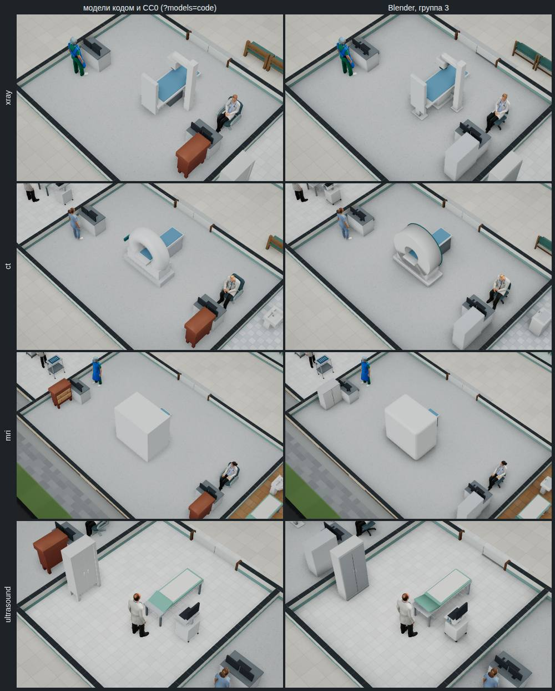
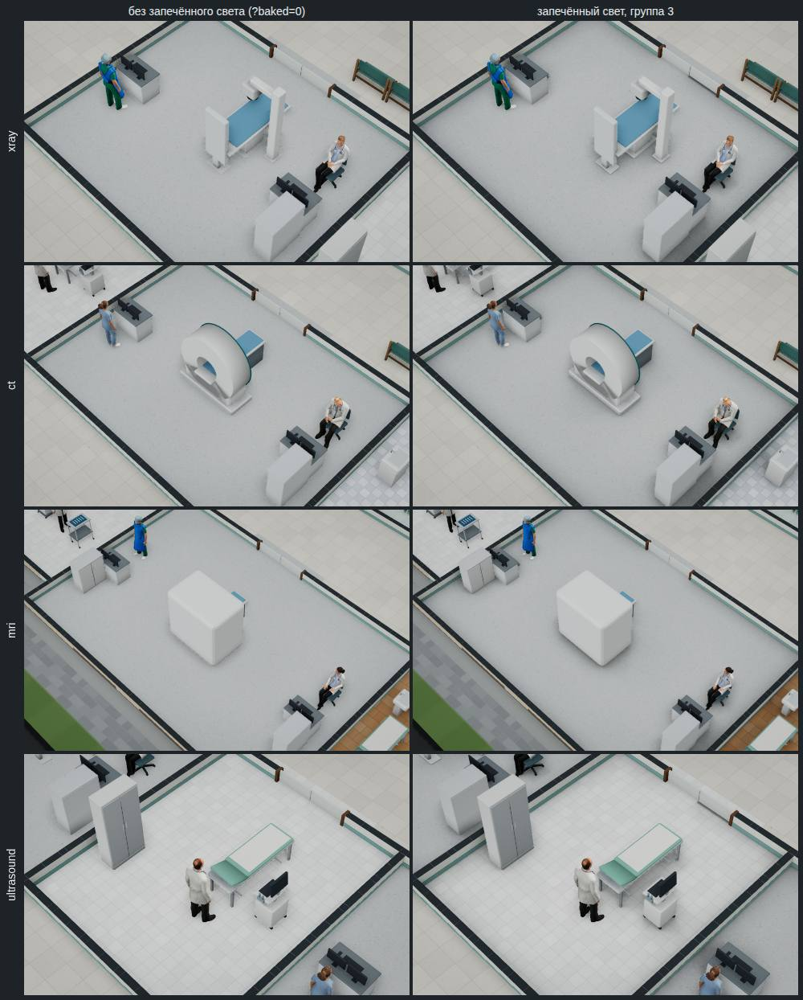

# Модели Blender, группа 3 «Диагностика»

Отчёт от 01.11.2026 к [спецификации части 2](../specs/2026-11-blender-2.md) (решение владельца
[#178](https://github.com/Nefeste/bolnitsa/issues/178), вариант 3: аппараты и мебель — Blender, группами, каждая сразу по
умолчанию). Версия 0.60.0. Группы 1 и 2 — [отчёт 1](2026-11-blender-1.md), [отчёт 2](2026-11-blender-2.md).

## Коротко

1. **Пять моделей кабинетов диагностики** — рентген, КТ, МРТ, аппарат УЗИ и пульт — собраны скриптом
   `blender/diagnostics.py` и стоят в игре по умолчанию: в рентген-кабинете, кабинетах КТ, МРТ и УЗИ. Прежние модели кодом —
   по ключу `?models=code`.
2. **Рентген — модель пилота как есть:** 3392 треугольника при бюджете 3400; тот же файл `xray.glb`, теперь сжатый — 56 КБ
   вместо 176. КТ — 1268 треугольников, МРТ — 1516, при бюджете 4000 у каждого.
3. **Стол — на высоте постели игры:** верх ложа КТ, МРТ и рентгена — там же, где у моделей кодом (`lieTop`), с допуском
   3 см: на эту высоту игра кладёт пациента.
4. **Запечённый свет четырёх образцов** — рентген M, КТ M, МРТ L, УЗИ S — в 32 точки на метр, 86 КБ. Свет рентген-кабинета
   M пилота переснят: в образце теперь модели групп, а не коробки, — 20 КБ вместо 71.
5. **Ключи пилота сняты** (решение агента 13): у пилота не осталось своих моделей и света, и `?models=blender` с `&baked=1`
   больше ничего не добавляли.
6. **Файлы Blender весят столько же, сколько до группы 3** — 1,19 МБ: четыре новые модели и три образца уравновесило сжатие
   рентгена и 32 точки на метр у его света. Сборка повторяется до байта.
7. **Город тяжелее на 7,5 тыс. треугольников мебели** (84,3 → 91,8 тыс. после группы 2), почти половина — рентген пилота.
   Вызовов отрисовки — +4–6, это свет четырёх новых образцов.
8. **Свет 27 образцов удлинял загрузку мебели на 100 мс** — сверх предела спецификации. Теперь он грузится после моделей,
   вместе с людьми (решение агента 14): загрузка мебели — около +50 мс к моделям кодом, первый кадр — тот же.

## Лист сравнения

Город, 11:00, без новых пациентов, качество «высокое»: слева модели кодом и CC0 (`?models=code`), справа — Blender
(`node tools/app/blender-sheet.mjs --group 3`). Кабинетов диагностики в поликлинике нет, поэтому лист снят в городе.

## Модели

| Модель | Вместо (треугольников) | Треугольников / бюджет | Частей | Файл, КБ |
|---|---|---:|---:|---:|
| `xray` | рентген кодом (140); модель пилота | 3392 / 3400 | 8 | 56 |
| `ct` | КТ кодом (632) | 1268 / 4000 | 8 | 30 |
| `mri` | МРТ кодом (156) | 1516 / 4000 | 7 | 33 |
| `us` | аппарат УЗИ кодом (200) | 456 / 2000 | 8 | 23 |
| `console` | пульт кодом (84) | 420 / 800 | 5 | 16 |

- **КТ:** кольцо гентри на корпусе у изголовья, тоннель — выше стола; стол на тумбе уходит в тоннель; на гентри — пульт с
  экраном и голубая полоса. Части для механик — `gantry`, `table`, `pad`, `screen`.
- **МРТ:** магнит — скруглённый куб у изголовья, тоннель — тёмная труба с рамкой у входа, стол на тумбе выходит из тоннеля к
  ногам. Части — `magnet`, `bore`, `table`, `pad`. С общего плана города видна задняя сторона магнита — так же, как у модели
  кодом.
- **Аппарат УЗИ** — тележка с панелью и клавиатурой, датчики в держателе сбоку, монитор на стойке экраном к врачу.
- **Пульт** — стол с тумбой, два монитора и клавиатура. Стоит в оси места со сдвигом к стене (`CODE_SHIFT`, −0,18 м), как
  модель кодом. В каждом кабинете рентгена, КТ и МРТ их два, в городе — шесть.
- **Как уложились в бюджет.** Кольцо гентри и тоннель — гладкие трубы из 32 и 24 граней по кругу, а сетка затенения — только у
  больших плоских граней (0,4 м), как у группы 2. Бюджет КТ и МРТ использован на треть: эти аппараты в больнице по одному.
- **Габарит** каждой модели — как у модели кодом, с допуском 6 см: у КТ, МРТ и пульта — точно, у рентгена — на 3–4 см шире
  (модель пилота), у аппарата УЗИ — на 3 см (держатель датчиков; сначала было 5,5 см — держатель подвинут к панели).

## Запечённый свет

| Образец | Пол, точек | Файл, КБ | Запекание, с |
|---|---|---:|---:|
| рентген M | 224×192 | 19 | 72 |
| КТ M | 256×192 | 22 | 72 |
| МРТ L | 320×224 | 30 | 121 |
| УЗИ S | 160×192 | 15 | 40 |
| **Всего** | | **86** | **305** |

- **Запекание** — по два образца разом на 4 ядрах, время — каждого; всё вместе — меньше трёх минут.
- **Рентген-кабинет M переснят.** У пилота в образце вместо вещей стояли коробки (стол — крышка на ножках, кресло — сиденье
  со спинкой), и запекался он в 64 точки на метр — 71 КБ. Теперь в нём модели групп, как их ставит окно: два пульта, кресло,
  шкаф и рентген; 32 точки на метр — 20 КБ. Места вещей те же — описание образца не изменилось до байта.
- **Лист света снят в городе**, а не в пустом здании, как у групп 1 и 2: МРТ L стоит 4,63 млн ₽, а касса пустого здания на
  «Спокойно» — 2,5 млн и 0,5 млн в долг. Все четыре образца в городе стоят как есть. Лист проверяет, что свет лёг на каждый
  кабинет, а с `?baked=0` — ни на один; что образцы ложатся на готовые помещения при всех поворотах — проверяет тест.
- **Что видно:** мягкая тень под столами КТ, МРТ и рентгена, вокруг магнита, у пультов и шкафов, у стен. Кадр со светом
  темнее в среднем на 2,0–3,5 уровня из 255; темнее на 6 уровней и больше — 12–20 % точек.

## Замер

«Авто-бенч» без окна (`npm run bench:headless -- --qualities low,high --secs 5`, второй вид — `--keys models=code`): город,
11:00, 54 человека, 1280×720, программный WebGL, 4 ядра. Две пары прогонов попеременно — до переноса света, третья — после
(решение агента 14; треугольники и вызовы от него не зависят).

| | Модели кодом и CC0 | Blender, группы 1–3, со светом |
|---|---:|---:|
| Треугольников мебели и аппаратов | 58 580 | 91 812 |
| Вещей мебели | 237 | 213 |
| Треугольников в кадре, «низкое»: общий план | 240 464 | 306 980 |
| То же, крупный план | 198 803; 198 005 | 271 613; 267 193 |
| То же, «высокое»: общий / крупный план | 289 001 / 369 431; 390 700 | 355 517 / 452 126; 460 185 |
| Вызовов отрисовки, «низкое»: общий / крупный план | 185 / 103; 102 | 201 / 117; 108 |
| То же, «высокое» | 216 / 128; 125 | 232 / 133; 137 |
| Загрузка мебели и аппаратов, мс: до переноса света | 111; 118 | 333; 288 |
| То же, после | 247 | 214 (свет — 861, вместе с людьми) |
| Первый кадр после запуска, мс: до / после | 5829; 6205 / 9040 | 6564; 7614 / 8647 |

- **Треугольники.** Мебели — +7,5 тыс. к группе 2 (84 292 → 91 812): рентген +3252 (модель пилота против 140 треугольников
  у модели кодом), МРТ +1360, шесть пультов — по +336, КТ +636, аппарат УЗИ +256. В кадре на общем плане — +15–17 тыс. к
  группе 2: мебель рисуется ещё и в карту теней. Проба `blender-catalog.ts` считает город после трёх групп в 90,3 тыс.;
  по бюджетам спецификации было бы 147,3 тыс.
- **Вызовы отрисовки** — +4–6 к группе 2 (195–197 → 201 на общем плане «низкого»): свет четырёх новых образцов, по одной
  сетке на образец. Модели не прибавляют ни одного.
- **Загрузка мебели.** В первых двух парах она выросла до 288–333 мс (у группы 2 — 206–232). Проба в одной странице: дело не в
  том, что окно ждёт свет, — картинки образцов разбираются в том же потоке, что и модели, и 27 образцов удлиняют загрузку
  моделей примерно на 100 мс. Теперь свет грузится после моделей, вместе с людьми (решение агента 14): люди грузятся
  2,5–4 с, и поток в это время больше ждёт рабочих.
- **Проба после переноса** — по 6 раз каждого вида попеременно, две страницы подряд: загрузка мебели — модели кодом
  120–196 мс (середина 130), Blender без света 150–248 (179), Blender со светом 145–266 (177); свет — 0,46–0,88 с, пока
  грузятся люди; люди и загрузка целиком — те же в пределах шума. До переноса — 89–110, 125–163 и 221–238 мс. Предел
  спецификации — +150 мс за четыре группы; сейчас около +50.
- **Первый кадр** в третьей паре — дольше у обоих видов: контейнер в это время был медленнее (люди грузились 4,4 с вместо
  2,5–3,3). Сравнивать его можно только внутри пары.
- **Кадр** здесь меряет процессор — его в таблице нет. Решающий замер — «Авто-бенч» у владельца, с `--models code` и без.

## Решения агента

Решения 13 и 14 спецификации (`docs/specs/2026-11-blender-2.md`):

- **Ключи пилота сняты.** Группа 3 взяла последнюю модель пилота и пересняла его свет, и `?models=blender` (`--models
  blender`) с `?baked=1` (`--baked`) больше ничего не добавляли. Они убраны вместе с `BLENDER` в `catalog.ts` и 64 точками
  на метр в `blender/room.py`. Модели кодом и CC0 остаются под `?models=code`, свет выключает `?baked=0`. Проба
  `tools/app/blender-catalog.ts` теперь считает модели групп, а не пилота.
- **Свет грузится после моделей, вместе с людьми** — запасной ход из отчёта группы 2. Время света в «Авто-бенче» —
  отдельно, `load.light`. Описания образцов одним файлом не понадобились.

## Журнал проверок

1. 01.11.2026 — `blender-sizes.ts` пишет места рентгена (по записи аппарата `eq.xray_digital`), КТ, МРТ, УЗИ и пульта
   (`codes`) и образцы группы 3; рентген-кабинет M пилота стал образцом группы 3.
2. Модели собраны: все в бюджете, габарит — как у моделей кодом. Держатель датчиков УЗИ выступал на 5,5 см при допуске
   6 см → подвинут к панели, 3 см.
3. Лист «было / стало» в городе — всё на местах, ошибок в консоли нет.
4. Свет: 4 образца запечены. Лист света в пустом здании не построил МРТ L — не хватило кассы → лист группы 3 снимает город и
   проверяет, что свет лёг на каждый кабинет; лёг на все четыре.
5. Ключи пилота сняты: `BLENDER`, `?models=blender`, `?baked=1`, 64 точки на метр в `room.py`.
6. Тест: рентген — с частями пилота; у КТ и МРТ — части для механик; верх ложа — высота постели игры; экраны КТ, УЗИ и
   пульта светятся; свет рентген-кабинета M не ложится на кабинет КТ M; в городе свет лёг на все четыре кабинета
   диагностики.
7. Повторяемость: пять моделей и образец «УЗИ S» пересобраны — те же файлы до байта.
8. «Авто-бенч» города, две пары попеременно: треугольников мебели 58 580 → 91 812, вызовов +16, загрузка мебели +170…220 мс
   — сверх предела. Проба в одной странице: модели — +20…40 мс, свет — +100 мс, потому что его картинки разбираются вместе с
   моделями → свет грузится после моделей, вместе с людьми; проба после — +50 мс, третья пара «Авто-бенча» — без прибавки.
