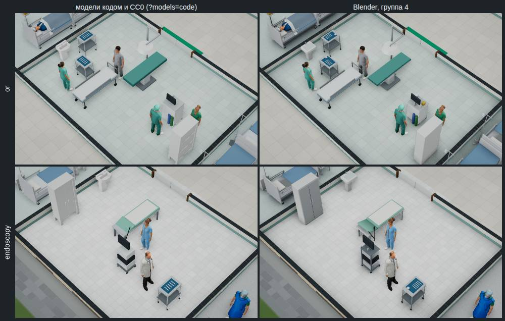
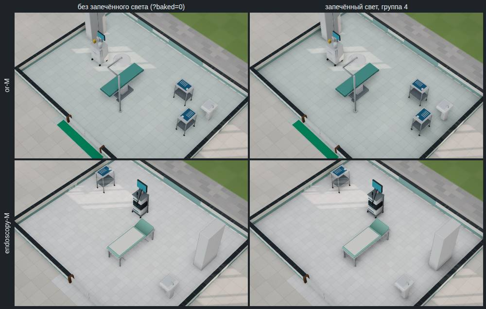

# Модели Blender, группа 4 «Операционная и эндоскопия»

Отчёт от 01.11.2026 к [спецификации части 2](../specs/2026-11-blender-2.md) (решение владельца
[#178](https://github.com/Nefeste/bolnitsa/issues/178), вариант 3: аппараты и мебель — Blender, группами, каждая сразу по
умолчанию). Версия 0.61.0. Группы 1–3 — [отчёт 1](2026-11-blender-1.md), [отчёт 2](2026-11-blender-2.md),
[отчёт 3](2026-11-blender-3.md).

## Коротко

1. **Четыре модели операционной и эндоскопии** — операционный стол с лампой, наркозный аппарат, инструментальный столик и
   эндоскопическая стойка — собраны скриптом `blender/surgery.py` и стоят в игре по умолчанию. С ними аппараты и мебель
   всех помещений — из Blender; прежние модели кодом и CC0 — по ключу `?models=code`.
2. **Все в бюджете, и с запасом:** стол — 948 треугольников при 3000, наркозный аппарат — 1116 при 2500, столик — 396 при
   800, стойка — 568 при 2000. Пациент ложится на стол на той же высоте, что раньше (`lieTop`, 0,9 м).
3. **Нашлась ошибка в свете всех групп, и она исправлена.** Образец операционной вышел с двумя наркозными аппаратами вместо
   аппарата и стола: образцы строились не тем путём, каким помещение ставит игрок. Проба по всем образцам показала, что у
   15 из 27 часть вещей была повёрнута иначе, чем в игре, или проём шире. Свет сверялся только по местам вещей и ложился,
   но тени от этих вещей лежали не с той стороны.
4. **Повёрнутое готовое помещение теперь то же самое, только развёрнутое.** Вещи без стены рядом и угловые смотрели по
   сторонам света, а не по образцу: в повёрнутой палате тумбочки и раковина стояли иначе, чем в той же палате без поворота.
   Правила поворота теперь считаются в осях образца (решение агента 15).
5. **Свет ложится строже:** в описании образца — стены, проёмы и повороты вещей, и свет ложится только туда, где всё как в
   образце. 15 образцов перезапечены, 2 новых — операционная M и эндоскопия M (решение агента 16).
6. ЗАМЕР-КОРОТКО

## Лист сравнения

Город, 11:00, без новых пациентов, качество «высокое»: слева модели кодом и CC0 (`?models=code`), справа — Blender
(`node tools/app/blender-sheet.mjs --group 4`).

## Модели

| Модель | Вместо (треугольников) | Треугольников / бюджет | Частей | Файл, КБ |
|---|---|---:|---:|---:|
| `or_table` | операционный стол кодом (264) | 948 / 3000 | 8 | 29 |
| `anesthesia` | наркозный аппарат кодом (296) | 1116 / 2500 | 14 | 41 |
| `instrument_table` | инструментальный столик кодом (272) | 396 / 800 | 6 | 16 |
| `endoscope` | эндоскопическая стойка кодом (224) | 568 / 2000 | 9 | 25 |

- **Операционный стол:** тяжёлое основание, колонна, ложе из четырёх секций — голова, спина, сиденье, ноги — с мягким
  верхом и боковыми шинами. Лампа — на стойке у ног, купол над серединой ложа. Части для механик — `table`, `pad`, `lamp`.
- **Наркозный аппарат:** корпус с ящиками к анестезиологу, рабочая поверхность, испаритель и ротаметры, мех в прозрачной
  колбе (`bellows`), баллоны сзади, монитор на мачте и шланги дыхательного контура сбоку.
- **Инструментальный столик:** стальной верх и полка, на верху — стерильная салфетка, инструменты и чаша.
- **Эндоскопическая стойка:** тележка с тремя блоками, монитор на мачте экраном к врачу и эндоскоп на шнуре (`scope`) —
  рукоятка и вводимая трубка свисают сбоку, к кушетке.
- **Габарит** каждой модели — как у модели кодом, с допуском 6 см; у стола лампа на стойке шире модели кодом на 4 см (её
  основание).

## Запечённый свет

| Образец | Пол, точек | Файл, КБ | Запекание, с |
|---|---|---:|---:|
| операционная M | 256×192 | 23 | 78 |
| эндоскопия M | 224×192 | 18 | 66 |

- **В образце** — модели групп, поставленные так, как их ставит окно: стол с лампой, наркозный аппарат, столики, стойка,
  кушетка, шкафы и раковины групп 1 и 2. Лампа на стойке даёт тень от стойки и купола.
- **Лист света** ставит каждый образец готовым помещением в пустом здании на уровне «Спокойно» и проверяет, что свет лёг:
  лёг на оба. Кадр со светом темнее в среднем на 2,0–2,1 уровня из 255; темнее на 6 уровней и больше — 12–13 % точек.

## Что было не так со светом групп 1–3

Образцы строились помещением «Анамнеза» (`oneRoom` в `blender-sizes.ts`), а игра ставит готовое помещение ПК
(`addReady`). У них по-разному повёрнуты часть вещей и по-разному стоит дверь. Свет сверялся с помещением только по местам
вещей и ложился, но тени части вещей лежали не там, где вещь. Перезапечены 15 образцов:

| Образец | Что было не так |
|---|---|
| ожидание S | стулья повёрнуты иначе |
| ожидание M, L | стулья повёрнуты иначе; дверь шире на 1–2 клетки |
| процедурная S, лаборатория S и M | стол повёрнут иначе |
| реанимация L | короткая койка повёрнута иначе |
| рентген M | пульт повёрнут иначе; дверь |
| КТ M, МРТ L | пульт повёрнут иначе |
| ЭКГ S, палата S и M, бокс S, УЗИ S | вторая клетка двойной двери — с другой стороны |

И второе: **в повёрнутом помещении** вещь без стены рядом и угловая смотрели по сторонам света, а не по образцу. В городе
палаты, боксы, ПИТ, реанимация, приёмное, операционная и эндоскопия повёрнуты на пол-оборота — и тумбочки, раковины,
мониторы, наркозный аппарат, эндоскопическая стойка стояли в них к образцу «спиной». Теперь правила поворота считаются в
осях образца (решение агента 15), и повёрнутое готовое помещение — то же самое, только развёрнутое. Тест готовых помещений
проверяет это для всех 29 образцов каталога при четырёх поворотах.

**Свет ложится строже** (решение агента 16): в описании образца — клетки стен и дверей и куда смотрит каждая вещь, и
`bakedRooms` сверяет и их. Где помещение не такое, как образец, — света нет, остаётся GTAO. В городе таких одно: зал
ожидания L с дверью в четыре клетки из образца «Анамнеза» (готовый — в две). Свет теперь лежит в городе на 27 помещениях
(было 26: прибавились операционная и эндоскопия, ушёл зал ожидания L), в поликлинике — на всех 13.

## Замер

ЗАМЕР2

## Решения агента

Решения 15 и 16 спецификации (`docs/specs/2026-11-blender-2.md`):

- **Повёрнутое готовое помещение — то же самое, только развёрнутое.** `placeTemplate` (`src/engine/hospital/site.ts`)
  применяет правила поворота к вещам в осях образца и поворачивает результат вместе с помещением; без поворота — всё как
  было. Вторая клетка двойной двери в городе (`siteOfPreset`) — по тому же правилу, что у готового помещения (`readyDraft`).
  Движок от поворота вещи зависит только у длинных (вторая клетка) — у них он не изменился.
- **Образцы света — готовые помещения, и свет сверяет стены, проёмы и повороты вещей** (`roomOf` в
  `tools/app/blender-sizes.ts`, `bakedRooms` в `src/render/baked.ts`, `write_sample` в `blender/build.py`).

## Журнал проверок

1. 01.11.2026 — `blender-sizes.ts` пишет места стола и наркозного аппарата (по записям аппаратов), инструментального столика
   и эндоскопической стойки; образец операционной вышел с двумя наркозными аппаратами — путь `oneRoom` ставит на все места
   шаблона первый подходящий аппарат.
2. Проба всех 27 образцов против готовых помещений при четырёх поворотах, города и поликлиники: у вещей без стены и угловых
   поворот — по сторонам света; в городе вторая клетка двойной двери — с другой стороны → правила поворота в осях образца,
   дверь города — как у готового помещения. После: все готовые помещения при всех поворотах, город и поликлиника — как
   образцы, кроме зала ожидания L города (дверь в четыре клетки).
3. Тест готовых помещений: при любом повороте каждый предмет в осях образца — на той же клетке и смотрит туда же. Без
   правки движка он падает (бокс S, поворот 1).
4. Модели собраны: все в бюджете, габарит — как у моделей кодом.
