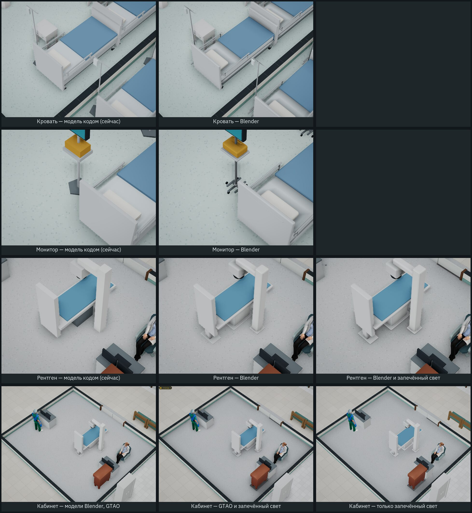

# Пилот Blender: модели аппаратов и запечённый свет

Отчёт от 30.10.2026, задача [#175](https://github.com/Nefeste/bolnitsa/issues/175).

Устав предлагает такой порядок выбора графики: сначала скрипты в репозитории, потом CC0, генераторы — последними
([Nefeste/gornitsa#19](https://github.com/Nefeste/gornitsa/issues/19), `docs/11-new-games.md`, «Графика и звук из
скриптов»). Пилот проверяет первый путь на трёх вещах из списка пилота генераторов
[#15](https://github.com/Nefeste/bolnitsa/issues/15) — кровати, мониторе у кровати и рентген-аппарате, — а также запекает
свет одного готового помещения. Скрипты лежат в [`blender/`](../../blender/README.md), паспорта файлов — в
[`assets/LICENSES.md`](../../assets/LICENSES.md), раздел 8.

## Коротко

1. **Blender работает в облачной среде без экрана — как модуль Python** (`bpy` 4.5.15 LTS с PyPI, его выпускает Blender
   Foundation). Скачанную программу Blender среда агента запускать не даёт (§1). Скрипты те же, что для программы: у
   владельца или в CI они пойдут как `blender --background --python blender/build.py`.
2. **Три модели собраны скриптами из частей.** Размеры взяты из игры, а не на глаз: файл `blender/sizes.json` пишет код
   игры, и тест сверяет его с ней. Имя узла `.glb` совпадает с именем части. Игра уже читает две части:
   - `screen` — экран светится;
   - `iv` — стойка капельницы, она есть только у кровати в палате и боксе.
3. **Свет рентген-кабинета запечён в Cycles:** затенение и мягкие тени от светильников. Это серая картинка-множитель на
   полу. Она ложится на каждый такой кабинет при любом повороте помещения.
4. **Повторный запуск даёт те же файлы до байта.** Для этого пришлось исправить порядок граней после скругления рёбер (§4).
5. **Цена.** Треугольников у моделей в 10–24 раза больше, чем у моделей кодом. В кадре городской больницы их вдвое больше:
   240 тыс. → 510 тыс. на общем плане. Вызовов отрисовки почти столько же: 185 → 187. Кадр «Авто-бенча» здесь меряет
   процессор контейнера, а не видеокарту, — перемерить у владельца (§5).
6. **Сравнить с CC0 и с генератором не с чем.** Больничного оборудования в наборах CC0 нет. Пилот генераторов (#15) ещё не
   начат: аккаунты Tripo и Meshy заводит владелец. На листе сравнения поэтому три столбца: модель кодом (сейчас), Blender,
   Blender с запечённым светом.
7. **Рекомендация: Blender — основной путь для аппаратов и мебели.** Генераторы — только для того, что скриптом не сделать
   (мягкие и живые вещи), и только после их пилота. Вопрос владельцу — [#178](https://github.com/Nefeste/bolnitsa/issues/178);
   **решение владельца 31.10.2026 — вариант 3, смесь, где Blender — основной путь** (§6).

В игре модели Blender включаются ключами: `?models=blender`, а свет кабинета — `&baked=1`; у Electron —
`--models blender --baked`. Без ключей всё как было, пока владелец не выбрал путь.

## 1. Blender в облачной среде

- **Программа.** Скачана Blender 5.2.3 LTS для Linux с blender.org: `blender-5.2.3-linux-x64.tar.xz`, SHA-256
  `78486c018b4443efe5e75ab54c290ed8c15abafd249b862c2c9ce2530a918eec`. Запустить её не дала проверка безопасности среды
  агента: она не пускает выполнять программы, скачанные из сети. Это правило среды, а не сбой Blender.
- **Обход.** Пакет `bpy` с PyPI — Blender как модуль Python. Его выпускает Blender Foundation, ставится он через `pip`, в
  нём тот же Cycles и тот же экспорт glTF. Пакеты есть у версий до 5.0.1. Закреплена **4.5.15**: это ветка LTS, а у
  5.2 LTS пакета нет. Python в контейнере — 3.11.15; `build.py` откажется работать, если версия другая.
- **Скорость** — на процессоре, без видеокарты. Все три модели собираются за несколько секунд (рентген — 1,2 с). Свет
  кабинета запекается 3 мин 40 с в один поток. Поток один нарочно: при нескольких затенение в цвете вершин выходило
  разным от запуска к запуску (§4).
- **У владельца** те же скрипты пойдут в программе Blender 4.5 LTS:
  `blender --background --factory-startup --python blender/build.py -- bed monitor xray room`. Здесь это не проверено:
  программу запустить нельзя.

## 2. Модели из частей

| Вещь | Части (узлы `.glb`) | Треугольников: Blender / кодом | Файл |
|---|---|---|---|
| Кровать | `wheels`, `casters`, `frame`, `deck`, `mattress`, `headboard`, `footboard`, `pillow`, `blanket`, `rail_left`, `rail_right`, `iv`, `iv_bag` | 4872 (без капельницы 4512) / 400 | 283 КБ |
| Монитор с дефибриллятором | `base`, `wheels`, `stand`, `shelf`, `defib`, `body`, `screen` | 1016 / 100 | 74 КБ |
| Рентген | `table`, `pad`, `column`, `arm`, `tube`, `collimator`, `detector`, `plate` | 3392 / 140 | 176 КБ |

- **Размеры — из игры.** Их считает `tools/app/blender-sizes.ts` и пишет в `blender/sizes.json`. Оттуда берутся:
  - сколько клеток занимает вещь (длинные — две, `isLong`);
  - высота постели (`LIE_TOP`): на неё ложится человек;
  - габарит нынешней модели кодом;
  - где у кровати палаты стойка капельницы (`IV_AT`);
  - палитра больницы (`PALETTE`).

  Тест `tools/test/blender.test.ts` проверяет, что файл совпадает с игрой и что габарит модели Blender отличается от
  габарита модели кодом не больше чем на 6 см. Первый прогон теста нашёл, что опорная плита колонны рентгена шире на
  9 см. Плиту сузили.
- **Что добавлено к модели кодом:**
  - скруглённые рёбра (фаска в Blender, обычно в один сегмент, у матраса и подушки — в три);
  - мелкие части: колёсные вилки, борта, ручки спинок, пульт на колонне, тубус трубки;
  - затенение, запечённое в цвет вершин. Это лучи Cycles на 0,35 м вокруг, по 256 на точку.

  Чтобы затенение не растекалось по большой грани, грани коробок разбиты сеткой не крупнее 0,2 м — без этого верх
  матраса выходил серым. Затенение — множитель от 0,35 до 1: в игре поверх него работает ещё GTAO, без нижнего предела
  углы темнели бы дважды.
- **Части — для механик.** Имя части — идентификатор: по нему игра покажет, спрячет или подсветит часть. Стойку капельницы
  она уже прячет вне палаты и бокса. Борта кровати и подвижная трубка рентгена названы для механик, которых пока нет.

## 3. Запечённый свет: рентген-кабинет M

- **Сцена — помещение, как его строит игра.** Это рентген-кабинет M без поворота, все данные из `blender/sizes.json`:
  - стены по клеткам плана с проёмом двери, высота стен как в игре;
  - четыре панели светильников там же, где их ставит `lamps.ts`;
  - предметы: рентген — модель пилота, столы с мониторами, стул и шкаф — коробками своего размера.
- **Что запекается** (`blender/room.py`):
  - затенение (AO, 0,6 м, 256 лучей);
  - тени от светильников (SHADOW, 128 лучей), дважды — со стенами и вещами и без них.

  Частное двух запеканий теней — только та тень, что падает от вещей. Затухания света от панелей в нём нет: его рисует
  игра. Итог — множитель `(0,5 + 0,5·AO)·(0,55 + 0,45·свет)`, серая картинка 448×384 (64 точки на метр). PNG пишет свой
  код, без даты и имени программы, поэтому файл повторяется до байта.
- **В игре** (`src/render/baked.ts`) картинка ложится плоскостью на пол с умножением цвета. Кладётся она на каждое
  помещение того же типа и размера, где вещи стоят на местах образца, при любом повороте (`bakedRooms`). В городской
  больнице рентген-кабинет повёрнут на 180° — свет лёг и туда. Если игрок переставил вещи, тени уже не от тех предметов,
  и запечённого света там нет — только GTAO.
- **Сравнение с GTAO.** GTAO затеняет только то, что в кадре, в разрешении экрана, и меняется вместе с камерой. У
  светильников игры теней нет совсем. Запечённый свет даёт:
  - мягкие тени под столом, стулом и шкафом;
  - тень рентгена от панелей;
  - тёмную полосу у стен.

  Всё это не зависит от камеры. Снимки — на листе сравнения (§5): «GTAO», «GTAO и запечённый свет», «только запечённый
  свет».
- **Цена:**
  - один образец — один тип и размер помещения;
  - каждое следующее помещение — ещё около 4 минут запекания и 70 КБ;
  - стены и сами вещи затенены по-прежнему только GTAO.

## 4. Паспорта и повторяемость

- **Паспорт каждого файла** — в `assets/LICENSES.md`, раздел 8: скрипт, версия Blender, SHA-256. Тест сверяет файлы с
  таблицей.
- **Повторяемость до байта.** Сначала два запуска давали разные `.glb`: геометрия та же, а порядок граней другой.
  Скругление рёбер (`bmesh.ops.bevel`) выдаёт грани в порядке, который зависит от адресов в памяти.

  Исправлено в `Part.build` (`blender/common.py`): сетка части пересобирается в каноническом порядке. Каждая грань
  начинается с наименьшей вершины, грани отсортированы, вершины пронумерованы по первому появлению, треугольники — веером.
  Затенение в цвете вершин при нескольких потоках тоже менялось в последних знаках (порядок сложения), поэтому Cycles
  работает в один поток. Теперь два запуска дают те же SHA-256 у всех пяти файлов (журнал, п. 6 и 7).

## 5. Лист сравнения

| | CC0 (Kenney, KayKit) | Генератор (#15) | Модель кодом (сейчас) | Blender |
|---|---|---|---|---|
| Кровать, монитор, рентген | нет в наборах | пилот не начат: аккаунты заводит владелец | есть | есть |
| Треугольников (кровать / монитор / рентген) | — | — | 400 / 100 / 140 | 4872 / 1016 / 3392 |
| Права | CC0 | условия службы, отметка ИИ в Steam, журнал генерации | свои | свои |
| Повторяется до байта | файл как есть | нет | да | да |
| Правка | — | новая генерация | правка кода | правка скрипта |

**Сцена и кадр** — «Авто-бенч» без окна (`node tools/app/bench.mjs --qualities low,high --secs 5`, второй прогон — с
`--keys "models=blender&baked=1"`). Условия:
- город, 11:00, 54 человека, 1280×720, без vsync;
- по 5 с на общий и крупный план после 3 с прогрева;
- Chromium 141, программный WebGL (SwiftShader), 4 ядра.

| | Модели кодом | Blender и запечённый свет |
|---|---|---|
| Треугольников мебели и аппаратов (237 вещей) | 58 580 | 193 328 |
| Треугольников в кадре, «низкое»: общий / крупный план | 240 464 / 200 879 | 509 787 / 473 428 |
| То же, «высокое» | 289 001 / 377 698 | 558 501 / 665 677 |
| Вызовов отрисовки, «низкое»: общий / крупный план | 185 / 108 | 187 / 119 |
| То же, «высокое» | 216 / 119 | 218 / 131 |
| Кадр, «низкое», общий план: среднее / p95, мс | 112 / 20 | 161 / 316 |
| Кадр, «низкое», крупный план | 75 / 311 | 304 / 469 |
| Кадр, «высокое», общий план | 457 / 2450 | 345 / 1806 |
| Кадр, «высокое», крупный план | 743 / 1429 | 937 / 1792 |
| Загрузка мебели и аппаратов, мс | 118 | 220 |
| Первый кадр после запуска, с | 4,9 | 5,5 |
| Память JS, МБ | 122 | 152 |

- **Треугольников вдвое больше:** проход теней рисует мебель ещё раз.
- **Вызовов отрисовки почти столько же.** Модели Blender сливаются в те же сетки, что и модели кодом: цвет вершин сливается
  вместе с ними. Добавляются плоскость запечённого света и светящийся экран, на крупном плане — ещё около десятка.
- **Кадр здесь считает процессор.** В программном WebGL каждый треугольник рисует процессор, и замер шумит:
  - единичные кадры по 6–10 с — сборка шейдеров и уборка памяти;
  - на «высоком» общем плане Blender вышел даже быстрее.

  Рост на «низком» качестве (p95 общего плана — 20 → 316 мс) говорит, что процессору треугольников стало больше, а не каким
  будет кадр на видеокарте. Решающий замер — у владельца, тем же «Авто-бенчем» в окне игры, с ключами и без:
  `--bench --qualities low,high --models blender --baked`.

Лист сравнения снят отдельным прогоном: город, 11:00, без пациентов, «высокое». В кадре рентген-кабинета треугольников
242 891 с моделями кодом и 512 387 с Blender, вызовов — по 83.

## 6. Что выбрать

Вопрос владельцу — [#178](https://github.com/Nefeste/bolnitsa/issues/178). Варианты: Blender, генераторы или смесь.

Рекомендация агента — **Blender как основной путь** для аппаратов и мебели:

- права свои;
- файл повторяется;
- стиль один с остальной игрой: та же палитра, те же размеры;
- на странице Steam нет отметки об ИИ;
- части модели служат механикам.

Генераторы — для того, что скриптом выходит плохо (ткани, растения, мелкий беспорядок), и только после их пилота (#15).
Запечённый свет — для готовых помещений, где важен вид: палаты, операционная, рентген. Остальные остаются на GTAO.

**Решение владельца 31.10.2026** (#178): «вариант 3» — смесь:
- аппараты, мебель и всё, где у модели есть части для механик, — Blender, и это основной путь;
- ткани, растения и мелкий декор — генераторы, если их пилот (#15) покажет, что они лучше.

Порядок — по рекомендации:
- сейчас только Blender — аппараты и мебель для среза и демо;
- генераторы — позже, отдельным вопросом;
- запечённый свет — для готовых помещений, где важен вид.

Что делать дальше — спецификация части 2 (каталог вещей, порядок по группам, бюджет треугольников и загрузки, свет готовых
помещений), потом модели группами, каждая сразу по умолчанию. Спецификация —
[`../specs/2026-11-blender-2.md`](../specs/2026-11-blender-2.md).

## Решения агента

1. **`bpy` вместо программы Blender** — программу среда агента запускать не даёт (§1). Переделать: те же скрипты в
   программе Blender 4.5 LTS.
2. **Версия 4.5.15 LTS** — у 5.2 LTS нет пакета `bpy`, 5.0 — не LTS. Переделать: `VERSION` в `blender/build.py` и
   пересборка; файлы изменятся.
3. **Затенение — в цвете вершин, без текстур.** Не нужны развёртка и память под текстуры. Сцена игры сливает предметы в
   несколько больших сеток, и цвет вершин сливается вместе с ними (`Batch.addColored`).
4. **Модели и свет — только по ключу.** По умолчанию остаются модели кодом, пока владелец не выбрал путь.
5. **Свет запечён только на пол, плоскостью-множителем.** Карты освещения на все поверхности не делались: стены и вещи
   остаются на GTAO, а сцена — теми же сетками.
6. **`.glb` пилота не сжаты meshopt**, в отличие от моделей CC0: всего 533 КБ. Сжать — шагом сборки, если путь выбран.
7. **Запечён один кабинет** — рентген M: в нём тяжёлый аппарат с тенью, и в городской больнице он повёрнут, так что
   поворот проверен на деле.

## Журнал проверок

1. 30.10.2026 — скачанная программа Blender 5.2.3 не запущена: среда агента не даёт выполнять скачанные программы.
   `bpy` 4.5.15 из `pip` работает: Cycles на процессоре, экспорт glTF.
2. `blender/sizes.json` совпадает с игрой — тест `blender.test.ts`.
3. Модели: у каждой части своё имя узла, в каждой части есть затенение — тест.
4. Габарит модели Blender не дальше 6 см от модели кодом — тест. Первый прогон: опорная плита колонны рентгена шире на
   9 см → сужена до 0,3 м.
5. Повторяемость моделей. Первые запуски давали разные `.glb` (порядок граней после скругления) → каноническая
   пересборка сетки → два запуска, одинаковые SHA-256.
6. Повторяемость света. Два запуска `build.py room` дали одинаковые SHA-256 картинки и образца. После того как сузили
   плиту, свет запечён заново (`cf99cd1c…`). Ещё один запуск всего — `build.py bed monitor xray room` — дал те же SHA-256
   у всех пяти файлов; свет запекался 3 мин 42 с.
7. Свет на полу, первая версия: темнел весь пол (затухание света от панелей), а тень шкафа была смещена — шкаф в игре
   прижат к стене (`back`). Исправлено: частное «со стенами и вещами / без них», габарит шкафа с прижатием.
8. Свет ложится на рентген-кабинет M при всех четырёх поворотах, на кабинет КТ — нет; в городской больнице — на её
   рентген-кабинет (поворот 180°) — тест.
9. Кровать в палате — со стойкой капельницы, в ПИТ — без неё; цвет вершин — с затенением — тест.
10. В игре: лист сравнения снят в самой игре (город, 11:00). Модели Blender стоят в палате, ПИТ и рентген-кабинете,
    свет лёг на рентген-кабинет (`baked: 1`), ошибок в консоли нет ни в одном из пяти прогонов листа.
11. Сцена и кадр — «Авто-бенч» без окна, с ключами и без (§5). Треугольников в кадре ×2,1, вызовов отрисовки +2…+12,
    загрузка мебели 118 → 220 мс, первый кадр 4,9 → 5,5 с; ошибок в консоли нет. Кадр в программном WebGL шумит — решающий
    замер на видеокарте владельца.
12. Без ключей игра прежняя: полный сценарий в браузере — 388 проверок, ошибок в консоли нет, запросов наружу нет;
    `npm test` — 1145 из 1145.
