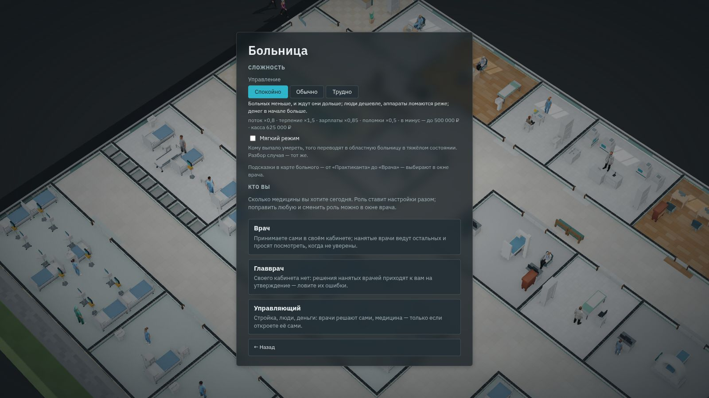
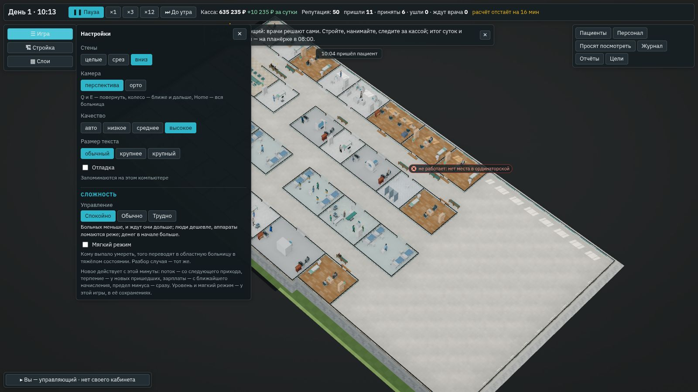

# Сложность: ось «Управление» и мягкий режим

**Состояние:** спецификация, 26.10.2026 — предложение агента. Владелец в тот же день принял все три предложения
(#135–#137) — [«Решения владельца»](#решения-владельца): таблица ниже — начало, которое правит симулятор; уровень
меняют в любой момент; мягкий режим по умолчанию выключен. Часть 1 — движок — сделана, версия 0.40.0
([«Часть 1: как сделано»](#часть-1-как-сделано)); деньги на уровнях идут против уровня — вопрос владельцу #151. Часть 2 —
окно — сделана, версия 0.41.0 ([«Часть 2: как сделано»](#часть-2-как-сделано)).
Основа:
- геймдизайн §10 «Сложность» ([`../08-game-design.md`](../08-game-design.md)): две оси — «Медицина» и «Управление» — и
  мягкий режим;
- путь к 1.0, этап Б: «Сложность по двум осям, мягкий режим (§10)» — в срезе ([`2026-10-v1.md`](2026-10-v1.md));
- ось медицины уже сделана — [`2026-10-doctor-mode.md`](2026-10-doctor-mode.md), «Сложность (ось медицины)»;
- сценарий 1 рассчитан на «Обычно» ([`2026-10-scenario-1.md`](2026-10-scenario-1.md), «Чего здесь нет»).

## Зачем

- **Срез играют люди со стороны** (цель этапа Б — час без подсказок от нас). Новичку в жанре нужен спокойный уровень,
  знатоку — трудный; сейчас больница для всех одна.
- **Ось медицины есть, оси управления нет.** Подсказки в карте — от «Практиканта» до «Врача»; поток, терпение, зарплаты и
  деньги — одни для всех.
- **Мягкий режим «Анамнеза» уже в движке,** но в окне его не включить.

## Что есть сейчас

По разбору кода 26.10.2026:

- **Ось медицины** — переключатель в окне врача и в шапке карты: «Практикант», «Студент», «Ординатор», «Врач»; по умолчанию
  «Студент». Это настройка окна, а не движка: меняет только подсказки в карте ваших больных.
- **Числа управления** — общие для всех игр:

  | Что | Где | Сейчас |
  |---|---|---|
  | поток сами | `content/hospital/inflow.yaml`, `walkIn` | 2,5 человека в час на кабинет терапевта |
  | поток по записи | там же, `booked` | 2 в час на специалиста |
  | скорая | там же, `ambulance` | 4 машины в сутки на место смотровой |
  | терпение | движок, `PATIENCE` | «зелёные» — 60–150 минут, «жёлтые» — 120–180; стоя — вдвое меньше |
  | зарплаты | `content/hospital/roles/*.yaml`, `salary` | вилка должности по навыку: терапевт — 3 500–6 500 в сутки |
  | поломки | `content/hospital/equipment/*.yaml`, `breakdown` | 0,5–1,5 % в рабочий день на аппарат, ремонт — 2 % цены |
  | предел минуса | `content/hospital/money.yaml`, `overdraft` | касса платит стройку до −300 000; ниже — кредит банка |
  | касса начала | `content/hospital/economy.yaml`, `sandbox.budgets` | пустое здание — 1 200 000 (`normal`); есть ещё `modest` 600 000 и `generous` 2 500 000 «Анамнеза» |

- **Терпение в движке ещё зависит от уровня «Анамнеза»** (`patienceOf`: «Практикант» и «Студент» ×1,5, «Ординатор» ×1,2),
  но поток для ПК идёт на уровне «Врач» — ×1: уровень карты движок не трогает. Режимы «Анамнеза» так и остаются.
- **Мягкий режим** — команда движка `soft`: кому выпало умереть, того вместо этого переводят в областную больницу в тяжёлом
  состоянии; оценки разбора те же. В итогах суток — «переведены в тяжёлом состоянии». В окне переключателя нет.

## Что предлагаем

### Ось «Управление»

Три уровня — «Спокойно», «Обычно», «Трудно». «Обычно» — как сейчас. Числа — в записи `content/hospital/difficulty.yaml`,
множителями к нынешним; в геймдизайне §10 — та же таблица. Стартовые числа — предложение агента, их правит симулятор
экономики по критериям ниже.

| Что | Спокойно | Обычно | Трудно |
|---|---|---|---|
| поток — сами, по записи, скорая | ×0,8 | ×1 | ×1,2 |
| терпение пришедших | ×1,5 | ×1 | ×0,75 |
| зарплаты — и рынок, по которому судят о зарплате | ×0,85 | ×1 | ×1,15 |
| поломки аппаратов | ×0,5 | ×1 | ×1,5 |
| предел минуса | 500 000 | 300 000 | 150 000 |
| касса начала в песочнице | 2 500 000 | 1 200 000 | 600 000 |

- **Поток и терпение** — сколько людей приходит и сколько они ждут; это и есть нагрузка, с которой играет новичок.
  «Спокойно» ×1,5 — то же, что «Студент» в «Анамнезе».
- **Зарплаты** — с рынком вместе: на «Трудно» людям платят больше, но и ждут они больше; настроение от уровня не меняется.
- **Касса начала** — три бюджета песочницы «Анамнеза», они уже в базе. Готовая больница начинает с той же доли бюджета,
  что сейчас.
- **Не меняется:** цены приёма и обследований, страховая, репутация, медицина, навык нанятых врачей, время.

### Мягкий режим

Как в «Анамнезе» и в движке: вместо смерти — перевод в областную больницу в тяжёлом состоянии, оценки разбора те же, в
итогах — спокойной строкой. Переключатель — рядом с уровнем управления, не зависит от него.

### Где выбирают

- **Экран начала, второй шаг** — там, где «Кто вы»: «Управление» — три кнопки, «Мягкий режим» — галочка. По умолчанию —
  «Обычно», мягкий режим выключен (решение владельца #137).
- **В игре** — «Игра» → «Настройки»: и уровень, и мягкий режим, в любой момент и в обе стороны (решение владельца #136).
  Новое действует с этой минуты: поток — со следующего прихода, терпение — у новых пришедших, зарплаты — с ближайшего
  начисления, предел минуса — сразу.
- **В сохранении** — уровень и мягкий режим: поля движка `meta.manage` и `meta.soft`. Поле новое и необязательное — номер
  схемы тот же; старые сохранения — «Обычно».
- **Сценарий 1** — на уровне игрока; цели и касса сценария подобраны на «Обычно» и остаются теми же.
- **Ось медицины** — как есть: в окне врача и в шапке карты.

## Чего здесь нет

- Сложность сценариев 2–8 и испытаний (этапы Г–Д); достижения по уровню — с клиентом Steam (этап Д).
- Оси медицины не касается: точность обследований и подсказки в карте — как сейчас.

## Решения владельца

26.10.2026 владелец ответил «вариант 1» на все три вопроса — как рекомендовал агент:

1. **Числа «Управления»** ([#135](https://github.com/Nefeste/bolnitsa/issues/135)) — таблица выше как начало; точные
   числа правит симулятор экономики по критериям ниже. Были ещё варианты «мягче» (×0,9 и ×1,1) и «только поток и
   терпение».
2. **Уровень в игре** ([#136](https://github.com/Nefeste/bolnitsa/issues/136)) — в любой момент в «Настройках», в обе
   стороны: застрявшему нужен выход, а не новая игра. Для достижений Steam (этап Д) — предложение агента из вопроса:
   запоминать самый лёгкий уровень, на котором шла игра.
3. **Мягкий режим по умолчанию** ([#137](https://github.com/Nefeste/bolnitsa/issues/137)) — выключен: медицина
   настоящая, и исход тоже; галочка — на экране начала и в «Настройках».

## Части работы

1. **Движок.** `meta.manage` — `calm`, `normal`, `hard`; команда `manage`; множители из `difficulty.yaml` — к потоку, терпению,
   зарплатам и рынку, поломкам, пределу минуса; касса начала — по уровню. Только поток для ПК: режимы «Анамнеза» — те же
   до байта.
2. **Окно.** Второй шаг экрана начала — уровень и мягкий режим; «Настройки» — то же в игре; строка сохранения — уровень.
3. **Замеры.** Симулятор экономики — каждая больница на трёх уровнях (`--manage calm,normal,hard`), критерии ниже.
4. **Документы и сценарий в браузере** — выбор на экране начала, смена в «Настройках», перевод вместо смерти.

## Критерии

Для симулятора экономики (нанятые врачи, 7 суток, зёрна 1–3; амбулатория, районная, городская, поликлиника):

- **«Спокойно»:** уходят, не дождавшись, не больше 5 % пришедших; касса ни разу не ниже нуля; стройка амбулатории
  окупается быстрее, чем на «Обычно».
- **«Обычно»:** как сейчас — числа в [`2026-10-economy.md`](2026-10-economy.md) и [`2026-10-scenario-1.md`](2026-10-scenario-1.md),
  часть 4.
- **«Трудно»:** уходят 10–20 %; без кредита — касса ни разу не ниже предела минуса; за 7 суток стройка не окупается.

## Проверки

- **Тесты движка:** множители — на каждом уровне; «Обычно» — то же, что сейчас, до байта; режимы «Анамнеза» — золотые
  тесты зелёные; тот же ход при шаге часов в 1 и 15 минут; уровень и мягкий режим — в сохранении; смена уровня командой —
  с этой минуты.
- **Симулятор экономики** — критерии выше.
- **Сценарий в браузере:** экран начала — «Спокойно», игра — меньше пришедших; «Настройки» — «Трудно»; мягкий режим —
  в итогах «переведены в тяжёлом состоянии».

## Проверка по обещаниям студии

- **Без давления:** «Спокойно» и мягкий режим — для тех, кому напряжение не нужно; уровень не продаётся и ничего не
  открывает.
- **Медицина** — та же база и тот же разбор на любом уровне.
- **Деньги, сеть, данные** — не тронуты.

## Часть 1: как сделано

Сделано 26.10.2026, версия 0.40.0: ось «Управление» в движке, по таблице владельца (#135). Окна ещё нет (часть 2): уровень
задают начало игры и команда.

- **Запись `content/hospital/difficulty.yaml`** — «Спокойно» и «Трудно». «Обычно» — числа базы как есть, его в записи нет:
  одно число не живёт в двух местах. Сборка базы проверяет, что «Спокойно» ни в чём не труднее «Обычно», «Трудно» — ни в
  чём не легче, и что у каждого есть отличие (`difficultyErrors` в `tools/content/load.ts`).
- **Уровень смены** — `meta.manage` (нет — «Обычно», так играли до него), числа — `src/engine/shift/manage.ts`. Только в
  потоке для ПК: в сменах «Анамнеза» — всегда «Обычно».
- **Где действует:**
  - поток — сами, по записи, скорая — на множитель, в часе потока (`flowRate`);
  - терпение — у пришедшего, на множитель; жребий тот же;
  - зарплаты — при начислении (`wageOf`, `wagesOf` с процентом уровня): касса суток, деньги по помещениям, выходное
    пособие, учёба, неоплаченная смена больного. У человека — зарплата «Обычно», по ней судят о рынке: настроение от
    уровня не меняется;
  - поломки — доля утреннего жребия того же аппарата;
  - предел минуса — стройка из кассы и кредит банка;
  - касса начала — бюджет песочницы уровня (`startCash`); готовая больница — его доля. Касса сценария 1 — его, на любом
    уровне.
- **Команда `manage`** — с этой минуты: зарплаты и содержание до неё записаны по прежнему уровню; тот же уровень — ничего
  не меняется; в сменах «Анамнеза» — ничего. Начало игры — `newFlowShift(…, { manage, soft })` и сообщение `start` потока
  расчёта: уровень и мягкий режим.
- **Сохранение** — `meta.manage` новое и необязательное: номер схемы тот же, старые сохранения — «Обычно».

### Пробы

Симулятор экономики (`bun tools/sim/economy.ts --manage calm,normal,hard`): нанятые врачи, 7 суток, зёрна 1–3.

| Больница | Уровень | Пришли за 7 суток | Ушли, не дождавшись | Прибыль за 7 суток, ₽ | Касса не ниже, ₽ |
|---|---|---|---|---|---|
| амбулатория | Спокойно | 182 | 2,4 % | 149 141 | 2 121 000 |
| амбулатория | Обычно | 217 | 10,0 % | 164 476 | 821 000 |
| амбулатория | Трудно | 251 | 18,8 % | 165 136 | 221 000 |
| районная | Спокойно | 389 | 0,4 % | 421 413 | 1 632 320 |
| районная | Обычно | 484 | 3,5 % | 497 646 | 333 360 |
| районная | Трудно | — | — | сразу не строится | — |
| городская | Спокойно | 681 | 4,5 % | 575 807 | 537 465 |
| городская | Обычно | 835 | 9,7 % | 606 661 | 225 464 |
| городская | Трудно | 981 | 15,5 % | 626 322 | 89 345 |
| поликлиника | Спокойно | 539 | 0,0 % | 621 212 | 624 960 |
| поликлиника | Обычно | 668 | 1,9 % | 771 339 | 299 960 |
| поликлиника | Трудно | 786 | 7,4 % | 841 229 | 149 960 |

Сценарий 1 «Амбулатория» (касса сценария — 600 000 на любом уровне): ушли 3,0 % на «Спокойно» и 14,5 % на «Трудно»; цель
«Пять суток с кассой в плюсе» — к 6-м суткам на всех трёх уровнях.

Критерии:

- **«Спокойно»** — ушли не больше 5 % везде ✓; касса ни разу не ниже нуля ✓; **стройка окупается быстрее — нет** ✗.
  Цены приёма от уровня не зависят, а людей приходит на пятую часть меньше; зарплаты в амбулатории — четверть выручки, и
  даже вдвое дешёвые люди не покрыли бы потерю больных. За неделю «Спокойно» зарабатывает на 3–20 % меньше «Обычно».
- **«Трудно»** — ушли 15–19 % в амбулатории и городской ✓, в поликлинике — 7 % (у неё запас кабинетов); касса не ниже
  предела −150 000 ✓; за 7 суток не окупается ✓. Районная (866 600) сразу не строится: касса начала 600 000 и предел —
  меньше её цены; её строят по частям. Зарабатывает «Трудно» столько же или больше «Обычно»: больных больше, а запас
  мощности у больниц есть.

Таблица — как решил владелец: уровни заметно различаются нагрузкой. Пойти ли за уровнем и деньгам (оплата приёма ×1,1 на
«Спокойно» и ×0,9 на «Трудно» — по прикидке тогда «Спокойно» зарабатывает больше «Обычно» в амбулатории, районной и
городской) — вопрос владельцу [#151](https://github.com/Nefeste/bolnitsa/issues/151).

### Проверки части 1

- `tools/test/difficulty.test.ts`: числа уровней — как в геймдизайне §10, «Обычно» — числа базы; сборка ловит уровень не в
  ту сторону и уровень без отличий; «Обычно» — до байта как без уровня, команда «Обычно» ничего не меняет; поток — больше
  на «Трудно», меньше на «Спокойно», множитель решает; терпение — те же пришедшие, каждый во столько раз терпеливее;
  зарплаты — платят по уровню, у людей те же; поломки — тот же жребий, доля на множитель; предел минуса — стройка и
  кредит; смена уровня — с этой минуты; тот же ход при шаге часов в 1 и 15 минут; мягкий режим с начала; в сменах
  «Анамнеза» уровня нет.
- Замер движка — [`../reports/2026-10-engine-speed.md`](../reports/2026-10-engine-speed.md), «Ось «Управление» (0.40.0)».

## Часть 2: как сделано

Сделано 26.10.2026, версия 0.41.0: выбор сложности в окне — экран начала, «Настройки», строка сохранения.

- **Второй шаг экрана начала** — раздел «Сложность» над «Кто вы»:
  - «Управление» — «Спокойно», «Обычно», «Трудно»; под кнопками — что уровень меняет и его числа из базы: поток,
    терпение, зарплаты и поломки множителями, предел минуса и касса начала этой больницы;
  - галочка «Мягкий режим» и строка о том, что она делает; ниже — где выбирают подсказки в карте: в окне врача;
  - по умолчанию — «Обычно», мягкий режим выключен (#137); карточка роли начинает игру с выбранной сложностью.
- **У сценария — свой второй шаг:** та же «Сложность» и «Начать», без «Кто вы» — в сценарии вы «Врач». Кассы в числах
  уровня нет: цели и касса сценария — те же на любом уровне.
- **Ключи адреса** — `?manage=calm|hard` и `?soft=1`, в Electron — `--manage calm` и `--soft`. Выбор открывает страницу
  заново с ними, как роль; «Обычно» и выключенный мягкий режим — без ключей. «Новая игра» и загрузка из меню ключи
  снимают: у сохранения сложность своя — из снимка движка.
- **«Настройки» в игре** — внизу раздел «Сложность»: те же кнопки и галочка, в любой момент и в обе стороны (#136), —
  команды движка `manage` и `soft`. Движок считает новое с этой минуты; окно — сразу: предел минуса у кассы и зарплаты в
  карточках.

  
- **Зарплаты в окне — как их платят на уровне** (`Game.paid`, то же округление, что у `wageOf` движка):
  - найм в карточке помещения и «Нанять в резерв»;
  - карточка человека: зарплата и рынок, «Поднять зарплату», цена учёбы, выплата при увольнении;
  - строка «С персоналом» у призрака готового помещения, «Поднять зарплату» на планёрке.

  Энциклопедия показывает вилку должности «Обычно»: она — и до игры, без уровня.
- **Сохранение:** шапка файла берёт `manage` и `soft` из снимка движка. Строка сохранения — «Городская больница · Трудно,
  мягкий режим · своё · записано …»; старые сохранения — «Обычно».

### Проверки части 2

- `npm run typecheck` — без ошибок; `bun test` по файлам — 78 файлов, 1029 тестов, 0 падений.
- Сценарий в браузере — все 27 частей зелёные, 345 проверок, ошибок в консоли и запросов наружу нет. Первый полный прогон
  упал на одной проверке новой части: подсказка кассы пишет «500 000» с неразрывным пробелом, а проверка сравнивала с
  обычным. Проверку поправили, часть 27 прошла заново. Новая часть 27
  ([`tools/app/e2e-difficulty.mjs`](../../tools/app/e2e-difficulty.mjs)), 12 проверок:
  - второй шаг: «Сложность» над «Кто вы», «Обычно» и выключенный мягкий режим, числа уровня;
  - «Спокойно» с мягким режимом открывает игру с `manage=calm&soft=1`: в движке тот же уровень, касса начала — как на
    экране, предел минуса — 500 000 ₽, найм в карточке — ×0,85;
  - «Трудно» в «Настройках» — с этой минуты: предел 150 000 ₽, зарплаты в карточке ×1,15 / 0,85, мягкий режим снят;
  - строка сохранения — «Городская больница · Трудно ·».

  Часть 24 (сценарий 1) проверяет второй шаг сценария: «Обычно», без «Кто вы» и без кассы.
