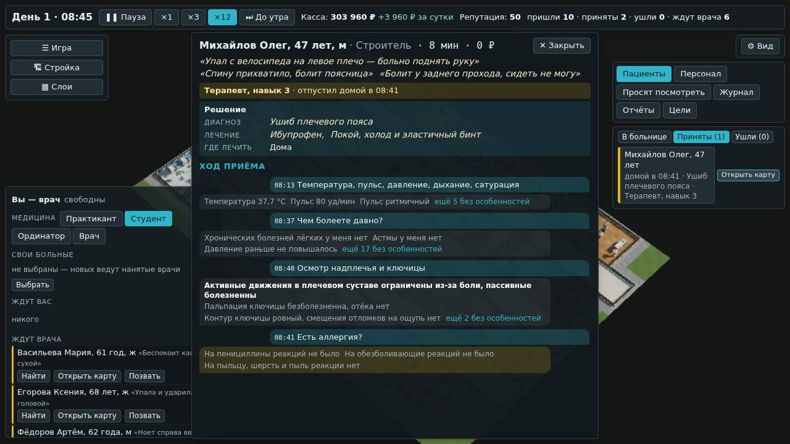
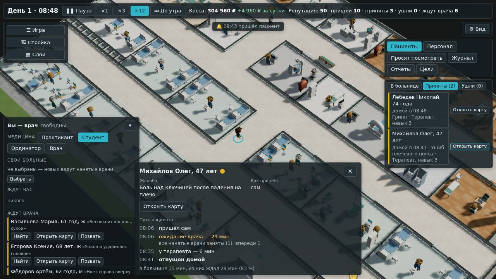

# Карта ушедшего: диагноз и назначенное

**Состояние:** сделано, версия 0.7.1, 18.10.2026 — [«Как сделано»](#как-сделано). Основа — замечание владельца 18.10.2026
после 0.7.0 (ниже — его словами). Как это сделать — предложения агента.

## Что сказал владелец

«У отпущенных домой всё равно должна быть доступна Карта, чтобы видеть, какой диагноз и что назначил врач.»

## Почему так было

- **Приём нанятого врача уходил из состояния при закрытии** — так решено ради скорости и размера сохранения
  ([`2026-10-engine-speed.md`](2026-10-engine-speed.md), ч. 2, «Ушедшие выгружаются в журнал»). От больного оставалась
  строка журнала дня: кто вёл, диагноз, место. Лечения, вопросов, ответов и результатов в ней нет — карту строить не
  из чего.
- Поэтому:
  - в карточке ушедшего на плане «Открыть карту» не было;
  - у строк «Ушли» кнопка была (0.6.0), но карта не открывалась;
  - открытая карта больного нанятого врача закрывалась сама, когда врач его отпускал.
- **Списка принятых и ушедших не было.** Вкладка «Пациенты» показывала тех, кто в больнице, и «Ушли» — тех, кто ушёл,
  не дождавшись.

## Как будет

### Карта ушедшего хранится сутки — как его путь

- **Кто ушёл из состояния, остаётся в «картах ушедших»** (`s.past`) целиком: жалобы, вопросы и ответы, осмотры и
  результаты, решение врача. Это отпущенные домой, направленные в стационар, увезённые скорой, ушедшие, не дождавшись.
- **Срок — сутки после ухода, и не больше 600 последних** — те же числа, что у пути пациента
  ([`2026-10-flow-ui.md`](2026-10-flow-ui.md): `KEEP`, `MAX_DONE`). Пока виден путь, открывается и карта.
- **Движок их не перебирает и не меняет:** кладёт при уходе и там же убирает старые — по часам ухода. Те же зерно и
  команды дают тот же хэш при любом шаге времени.
- **В сохранении — тоже:** после загрузки карты те же. Поле новое и необязательное — номер схемы не меняется: в
  сохранении 0.7.0 карт ушедших нет, и игра идёт дальше.
- **Цена** — в разделе [«Как сделано»](#как-сделано): размер записи и снимка, скорость движка.

### Где открыть

- **Карточка ушедшего на плане.** Он идёт к выходу или уже ушёл — карточка с путём; в ней «Открыть карту».
  «Взять случай» в ней нет.
- **Вкладка «Пациенты» → «Приняты».** Третья кнопка — между «В больнице» и «Ушли». В списке — приняты и ушли за
  сутки: домой, в стационар, на скорой. Последние 50, новые сверху; на кнопке — сколько всего за сутки.
  - Строка: «Михайлов Олег, 47 лет — домой в 08:41 · Ушиб плечевого пояса · Терапевт, навык 3».
  - Щелчок по строке — карточка ушедшего с путём; «Открыть карту» — его карта.
  - Ваши приёмы — тоже («· вы»); их карта — ваш разбор, как в «Закрытых» окна врача.
- **Открытая карта** больного нанятого врача не закрывается, когда врач его отпустил: в ней появляется решение.
- **Карты уже нет** (ушёл больше суток назад) — строка в окне врача: «Карты уже нет: больной ушёл больше суток назад».

### Что в карте

- **Шапка** — кто вёл и чем кончилось: «Терапевт, навык 3 · отпустил домой в 08:41». Другие исходы: «направил в
  стационар», «вызвал скорую», «перевёл в другую больницу».
- **«Решение»** — над «Ходом приёма»: «Диагноз», «Лечение», «Где лечить». Это те же слова, что в вашей правой колонке.
  Названия нажимаются — «Что это?» из базы.
- **«Ход приёма»** — как у больного в больнице (0.6.0): вопросы и ответы, осмотры и результаты, по времени.
- **Карта для чтения:** часы идут, действий нет. Сроков в ней нет — сроки идут, пока больной в больнице.
- **Оценки и разбора у приёма нанятого врача нет** — как прежде (решение владельца 16.10.2026, «на ПК оценку считаем
  только приёмам, которые провёл игрок»).
- **Ушедший, не дождавшись,** — жалобы и то, что успели узнать на сортировке; в шапке — «Больного уже нет в больнице».
- **Лежащий у нанятого врача** — как прежде: обход со сменой лечения; «Решения» нет, обход его показывает.

## Чего здесь нет

- **Разбора и оценки приёма нанятого врача** — по решению владельца 16.10.2026.
- **«Ушли» по-прежнему собирает окно** из извещений. После загрузки сохранения этот список пуст, как и был, хотя карты
  этих людей в сохранении есть. Собирать «Ушли» из карт ушедших — отдельная задача, если понадобится.

## Проверки

- **Движок:**
  - отпущенный нанятым врачом уходит из `s.patients`, его карта — в `s.past`, с решением и результатами;
  - строка журнала и путь — как были;
  - сутки и 600 соблюдаются: старше — убраны;
  - при шаге 60 и 13 с — те же карты;
  - в сменах «Анамнеза» поля нет.
- **Поток расчёта:**
  - карта отпущенного — шапка «отпустил домой в …», решение (диагноз, лечение, место), ход приёма; ни сроков, ни
    «Взять»;
  - открытая карта не закрывается, когда врач отпустил;
  - «Приняты» — новые сверху, не больше 50, ваши тоже; уходят в окно, только когда список изменился;
  - после сохранения и загрузки — та же карта и тот же список;
  - ушедший, не дождавшись, — карта без решения, «Больного уже нет в больнице».
- **Сценарий в браузере, часть 11:**
  - дождаться отпущенного домой;
  - «Пациенты» → «Приняты» → «Открыть карту»: решение, ход приёма, часы идут;
  - щелчок по строке — карточка ушедшего: «Открыть карту» без «Взять случай», и из неё — та же карта.
- **Бенч движка** — `bench.ts --mode flow --quick` до и после; снимок к 18:00.

## Как сделано

- **Движок** (`src/engine/shift/engine.ts`, `keepCard`): `evict` кладёт ушедшего в `s.past` — `{ t, p }` по порядку
  ухода — и убирает старше суток и сверх 600. Поле — в `ShiftState` (`types.ts`, `PastPatient`).
- **Поток расчёта** (`src/sim/doctor.ts`):
  - `cardView` ищет больного в состоянии, затем в картах ушедших;
  - у закрытого нанятым врачом (кроме лежащего) — `decided`: диагноз, лечение, где лечить;
  - шапка — `T.doctor.lead.released`;
  - `cardKey` ушедшего не меняется: карта такая, каким он ушёл;
  - `seenList` — «Приняты»: из карт ушедших и ваших закрытых в состоянии; к окну — `seen` в срезе, когда список
    изменился.
- **Окно:**
  - `src/app/game.ts` — строки «Приняты»;
  - `src/ui/flow.tsx` — третья кнопка вкладки;
  - `src/ui/doctor/Dock.tsx` — карточка ушедшего: только «Открыть карту»;
  - `src/ui/doctor/Card.tsx` — блок «Решение»;
  - `src/app/doctor.ts` — «Карты уже нет».

**Цена** (Bun, без `--smol`, тихая машина):

- **Карта** — 4,7 КБ в среднем у городской больницы, 8,7 КБ у больниц бенча, 9 КБ у поликлиники. Четыре пятых — правда о
  болезни (из неё строятся ответы) и ответы с результатами.
- **Игровые больницы:** городская при 12 в час к 18:00 — 107 карт, +0,5 МБ снимка; поликлиника — около 90 ушедших за
  сутки, +0,8 МБ. Сжатый файл — на десятую часть этого.
- **Большая больница бенча** (200 одновременно, 685 человек в здании к 18:00) — 600 карт: снимок 6,3 → 11,2 МБ, файл
  0,68 → 1,17 МБ, запись 0,20 → 0,31 с, чтение 0,09 → 0,14 с. Цель геймдизайна — файл до 5 МБ.
- **Движок не стал медленнее:** `bench.ts --mode flow --quick`, до (`79bd0be`) и после по очереди, два круга — весь день
  до 18:00 при нагрузке 50–300 от +2,6 до −4 %, а одна версия от круга к кругу расходится до 8 %
  ([`../reports/2026-10-engine-speed.md`](../reports/2026-10-engine-speed.md), «Повторный замер: карта ушедшего»).
- **Ход больницы тот же до бита:** без `s.past` состояние до и после совпадает (три зерна, 34 часа); у бенча — те же
  приёмы и ушедшие.
