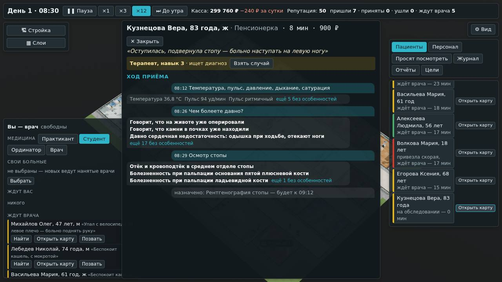

# Игра владельца 18.10: пауза — для решений, карта у любого, камера за человеком

**Состояние:** сделано, версия 0.6.0, 18.10.2026 — [«Как сделано»](#как-сделано). Основа — четыре замечания владельца
18.10.2026 после игры в `v0.5.0` (ниже — его словами). Как это сделать — предложения агента; владелец 24.10.2026 принял
оба — [«Решения владельца»](#решения-владельца). Исправление 25.10.2026, версия 0.24.1: карта открывалась, пока больной ещё
шёл по коридору, — [«Карта, когда вошёл: исправление»](#карта-когда-вошёл-исправление).

## Что сказал владелец

1. «Когда нажимаешь "Позвать" на пациенте, сразу открывается окно (перегруженное элементами), не дожидаясь, пока
   пациент дойдёт до кабинета. Нужно, чтобы лечение или диагностика начиналась, когда пациент находится у врача. То есть
   пауза ставится только в моменты принятия решений, а остальное время больница "живёт" своей жизнью, и в её работу
   можно и не вмешиваться.»
2. «"Открыть карту" должно быть возможно у любого пациента, а не только у того, который ко мне приходил, даже у тех,
   которые сейчас "лечатся" у других врачей.»
3. «Нужна кнопка, чтобы можно было "закрепить камеру" на пациенте или враче (когда врачи начнут ходить отдыхать в
   ординаторскую или в туалет, чтобы посмотреть, где они идут) или на медсестре (чтобы узнать, где она там с каталкой
   идёт или чем занята).»
4. «В карте должно быть видно, что спрашивал наёмный доктор, что отвечал пациент, какие осмотры и обследования были
   назначены и их результаты.»

## Почему так было

1. **«Позвать» — дело со своей ценой,** как в «Анамнезе»: дорога пациента до кабинета проживалась сразу, за кадр-два, а
   окно тут же открывало карту и ставило паузу. В карте мир стоял всегда — и когда вы читали чужую карту, и когда ждали
   результат.
2. **«Открыть карту» было только у того, кто у вас** в кабинете или на обследованиях. У остальных — «Карта» в
   карточке человека на плане (0.3.0); в строках окна врача и во вкладке «Пациенты» её не было.
3. **«Найти» ставит камеру к человеку один раз** — дальше он уходит из кадра.
4. **Чужая карта собиралась как ваша:** три колонки с неактивными кнопками действий. Вопросы и ответы нанятого врача — в
   левой колонке, результаты — во вкладке «Известно» средней, назначенное и не готовое — штампом в длинном списке, а
   правая — ваш пустой ряд гипотез. Ход приёма в этом не найти.

## Как будет

### 1. Часы стоят только для решения

Правило времени (геймдизайн §2) — по решению владельца: **часы идут всегда и стоят, только когда нужно ваше решение.**
В своей карте по-прежнему каждое действие двигает часы на свою цену: вопрос, осмотр и снимок у постели — решения,
ради которых часы и стоят.

| Момент | Было | Будет |
|---|---|---|
| «Позвать», «Взять случай», «Посмотреть» по просьбе | карта сразу и пауза; дорога — за кадр | карты нет, часы идут; пациент идёт к вам по коридору; в окне врача — «идёт к вам · будет в 10:42» |
| пациент вошёл в кабинет (к привезённому скорой — вы дошли до смотровой) | — | **карта и пауза** |
| вопрос, осмотр, ЭКГ у постели | часы — на цену действия, сразу | так же |
| назначили снимок или кровь, а делать больше нечего — «Ждать» | время до результата проживалось сразу | карта закрывается, часы идут как шли; **вернулся или готов результат, пока он у вас, — карта и пауза** |
| «Отпустить ждать результатов», «Выйти к срочному» | карта оставалась, пауза | карта закрывается, часы идут |
| «Завершить приём» — разбор | пауза до «Закрыть» | так же; «Позвать следующего» — часы идут |
| открыли карту другого пациента — прочитать | пауза | **часы идут**, карта обновляется сама |
| просьба посмотреть, готовы результаты отпущенного, лежащему хуже, планёрка | автопауза | так же |

- **Пауза, которую поставила игра,** игра и снимает: ответили на просьбу, позвали пациента, закрыли свою карту — часы
  идут с прежней скоростью. Паузу, поставленную вами (пробел), игра не снимает.
- **Пока пациент идёт к вам,** вы свободны: стройка, найм, просьбы, чужие карты. В свою карту, пока он не вошёл,
  действия не идут — движок их не примет.
- **«До утра»** останавливается и на «вошёл к вам».

### 2. «Открыть карту» — у любого

- **В каждой строке** окна врача: «У вас в кабинете» (и «идёт к вам»), «Ждут вас», «Ждут врача», «На обследованиях»,
  «Лежат у врачей», «Закрытые»; во вкладке «Пациенты»; в карточке человека на плане («Карта» → «Открыть карту»); в
  просьбах.
- **Чужая карта — для чтения:** часы не стоят, кнопок действий нет. Из неё — «Позвать» (ждёт врача, вы свободны) и
  «Взять случай» (у нанятого врача).

### 3. «Ход приёма» в чужой карте

Одна лента по времени — что было, в том порядке, как было:

- 10:02 «Что беспокоит?» — «Кашель третий день…»;
- 10:05 выслушал лёгкие — хрипы справа внизу;
- 10:06 назначил рентген лёгких — будет к 10:40;
- 10:41 рентген лёгких — что на снимке.

Сверху — кто ведёт и что думает или что решил (как в 0.3.0). У того, кого ещё не принимали, — жалоба и что измерили в
доврачебном. Найденное — жирным, «нет» — свёрнуто, как в своей карте.

### 4. «Следить»

- **В карточке выбранного человека** — пациента, врача, медсестры, любого сотрудника — кнопка «Следить»: камера держит
  его в середине кадра и идёт за ним.
- **Отпускает:** «Следить» ещё раз, Esc, сдвиг камеры мышью или клавишами, общий план, выбор другого человека. Ушёл
  из больницы — камера остаётся там, где он был последним.
- **Сотрудники пока стоят на местах.** Отдых в ординаторской, санузел, каталки — задачи среза (геймдизайн §7,
  «Человек»; §3, «Двойные двери и каталки»); кнопка для них уже работает.

## Движок

Только поток для ПК; смены «Анамнеза» — как были, байт в байт.

- **«Позвать», «Взять случай», «Посмотреть»** не проживают дорогу: пациент ваш и идёт, а в час встречи — событие
  движка «дошёл» и извещение «вошёл к вам». Время дороги — в счёт приёма, как было.
- **Вернулся с обследования в другом кабинете** — то же извещение.
- **«Ждать»** не проживает время: только отмечает шаг («новое» в карте — то, что пришло после него).
- **До встречи** действия приёма — вопрос, обследование, диагноз, лечение, «Завершить» — не идут.

## Чего здесь нет

- **Своя карта «перегружена»** (замечание 1) — её вид не меняется: это отдельная задача, вопрос 1.
- **Отдых и походы персонала** — их пока нет (замечание 3).

## Решения владельца

24.10.2026 владелец ответил «вариант 1» на оба вопроса:

1. **Свою карту — упростить следующей задачей, сначала макет на снимке** (#73) — на одобрение владельца: в середине — та
   же лента «Ход приёма», что в чужой карте; действия — по шагам «Расспрос», «Осмотр», «Обследования», «Решение», открыт
   один шаг.
2. **Карта и пауза, когда пациент вошёл, — всегда,** даже при выключенной автопаузе (#74): вы его позвали.

## Проверки

- Тесты движка: «Позвать» — часы не двигаются, пациент ваш и идёт; до встречи действия приёма не идут; в час встречи —
  «вошёл к вам»; «Взять случай» у нанятого врача — так же, с его кабинета; вернулся с рентгена — «вошёл к вам»; «Ждать»
  — часы не двигаются; смены «Анамнеза» — прежние отпечатки.
- Сценарий в браузере: «Позвать» — карты нет, часы идут, пациент идёт; вошёл — карта и пауза; «Ждать» — карта
  закрылась, часы идут; результат — карта и пауза; «Открыть карту» нанятого врача — часы идут, в ленте вопрос, ответ,
  назначенное и результат; «Следить» — камера идёт за пациентом, сдвиг мышью отпускает.
- Бенч, симулятор экономики — как прежде (в них никого не зовут).

## Как сделано

- **Движок** (`src/engine/shift/engine.ts`, только поток для ПК): `call` и `takeOver` ставят час встречи `meet` и событие
  `reach`, время не проживают; `orderExam` ставит `reach` на час возвращения вашего пациента; `waitResults` только
  отмечает шаг. Событие `reach` даёт извещение `reached`, если пациент ещё ваш и не на другом обследовании; взяли, пока
  он на снимке, — встреча переносится на его возвращение. До встречи команды приёма движок не принимает.
- **Поток расчёта** (`src/sim/`): после «Позвать» карта не открывается, открытая — закрывается; ваш, пока идёт, — в
  строке окна врача «Идёт к вам · будет в 10:42», его карта — для чтения. Карта для чтения пересобирается по событиям, не
  по минутам: её вид стоит около 10 мс.
- **Окно** (`src/app/doctor.ts`): часы держит только своя карта, пока пациент перед вами; «вошёл к вам» и результат
  вашего, пока он у вас, — карта и пауза; «Ждать» — карта закрывается; отпустили — закрывается. Автопаузу на просьбу игра
  снимает сама, когда вы ответили или позвали; скорость, поставленную вами, не трогает. Чужая карта не мешает ни
  клавишам скорости, ни выбору людей на плане, ни планёрке.
- **Карта** (`src/ui/doctor/Card.tsx`): для чтения — уже, лента «Ход приёма», без уровня медицины и «Похоже на».
  «Открыть карту» — в строках окна врача (кнопки строкой ниже имени), во вкладке «Пациенты», в карточке и просьбах.
- **«Следить»** (`src/app/game.ts`, `src/render/view.ts`): камера плавно идёт за человеком; колесо приближает к нему.

**Выяснилось:** дорога через «Городскую больницу» в «спокойном» темпе — до 12 игровых минут: 3 секунды на ×12, полминуты
на ×1. Раньше её проживали разом и не видели.

### Карта, когда вошёл: исправление

Замечание владельца 25.10.2026: «Та же проблема, что и в анамнезе — пациент ещё не дошёл до кабинета, а уже открывается
окно с карточкой для лечения, опроса, обследования».

- **Почему.** Карту открывало извещение движка «вошёл к вам» — в час, который движок считает по дороге. Фигура на карте
  к этому часу не всегда успевала: после обследования в другом кабинете она вставала с кушетки и шла назад обычным шагом
  — срез не говорил ей, к какому часу дойти. Проба: больной на ЭКГ в городской больнице, ×3 — карта открылась, когда
  фигура была в коридоре, в нескольких метрах от двери; карта ставит часы, и больной застывал за дверью. Позвали из зала
  ожидания — успевал: в пробах на ×1, ×3 и ×12 карта открывалась, когда он уже сидел.
- **Срез** (`src/engine/shift/slice.ts`): с обследования больной идёт назад к часу возвращения `out.back` — фигура
  торопится к нему, как и по зову.
- **Окно** (`src/app/doctor.ts`): «вошёл к вам» и результат вашего, пока он у вас, открывают карту, когда фигура больного
  в помещении, где вы принимаете, и уже не идёт; к привезённому скорой — когда и ваша фигура там же. До того часы идут.
  Фигуры на карте нет — карта сразу; фигура не дошла за 5 минут игры (застряла) — тоже сразу.
- **Проверено:** проба на ×1, ×3, ×12, с ЭКГ и с анализом крови, с людьми Rocketbox — карта открывается, когда больной уже
  в кабинете и садится; сценарий в браузере, часть 9: при «Позвать» и при возвращении с ЭКГ фигура в кабинете и не идёт.

