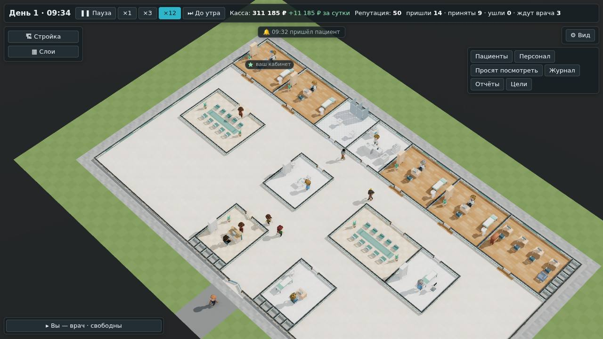

# Больница как настоящая: поликлиника по нормам проектирования

**Состояние:** сделано, 18.10.2026, версия 0.4.0; спецификация — #35, предложение агента; все четыре вопроса владелец
решил 18.10.2026 — [ниже](#решения-владельца). Что вышло и чем проверено — [«Как сделано»](#как-сделано). Третья задача среза: «больница по нормам проектирования» в
[`2026-10-v1.md`](2026-10-v1.md), этап Б. Основа:
- пожелание владельца после игры 17.10.2026: «Саму больницу хорошо бы построить как аналог реальной»
  ([`2026-10-owner-play.md`](2026-10-owner-play.md), «Больница как настоящая»);
- геймдизайн §9: готовые больницы сценариев — по открытым нормам проектирования, без копии конкретного здания и без
  названий ([`../08-game-design.md`](../08-game-design.md));
- готовые помещения ([`2026-10-ready-rooms.md`](2026-10-ready-rooms.md)) — из них больница и строится.

Сценарии Workshop и любые больницы из других игр — не источник (устав, `docs/06-content.md`). Конкретной больницы
владелец не назвал, поэтому строим по нормам.

## Зачем

- **В нынешней готовой больнице** терапевт сидит в 63 м от единственного зала ожидания. С ходьбой в движке это видно:
  четверть дня он ждёт идущих к нему ([`2026-10-walk.md`](2026-10-walk.md)). В настоящей поликлинике так не строят.
- **Сценарий 1 «Амбулатория»** — это и есть срез этапа Б. Ему нужна готовая поликлиника, устроенная как настоящая:
  игрок видит, как должно быть, и учится на ней планировке.

## Источник: свод правил СП 158.13330.2014

«Здания и помещения медицинских организаций. Правила проектирования», с изменениями № 1–7. Это открытый нормативный
документ Минстроя России. Из него берём правила, без чертежей конкретных зданий:

| Что | Норма | Где |
|---|---|---|
| Ожидальные | 5 м² на каждый кабинет или место в кабинете; часть коридора, где ждут, входит в расчёт | п. 6.9.1.11 |
| Где ждут | расширение коридора, «карманы-холлы» при коридорах, система холлов | там же; табл. Б.1 |
| Коридоры поликлиники | 2,0 м, если в них не ждут; 2,8 м, если ждут и кабинеты с одной стороны; 3,2 м — с двух | табл. Б.1 |
| Кабинет врача | ширина не меньше 2,4 м; глубина не больше двух ширин | табл. Б.1 |
| Кабинет врача для приёма взрослых, доврачебный кабинет | 12 м² | табл. В.6 |
| Кабинет врача с аппаратными методами | 18 м² | табл. В.6 |
| Процедурная: забор крови, инъекции | 12 м² | табл. В.6 |
| Ординаторская | 4 м² на врача, не меньше 12 | табл. В.8 |
| Вестибюль поликлиники | 1,5 м² на кабинет, не меньше 18 | табл. В.1 |
| Уборная для посетителей | кабина не меньше 1,1 × 1,6 м | п. 6.5.3 |

Текст пунктов 6.9.1 и таблицы Б.1 прочитан в базе «Кодекс» и на портале «Гарант». Таблицы приложения В — по копии на
сайте проектной организации: официальные базы из контейнера агента недоступны. Числа стоит сверить с официальным
текстом, прежде чем ссылаться на них за пределами игры.

## Масштаб игры

Клетка — 1 м, но мебель крупнее настоящей. Кабинет врача образца M — 6 × 5 м пола, 30 м², а по норме — 12 м². Поэтому
площади один к одному не переносим. Берём **состав, соседство и соотношения**. Правила планировки — предложение агента:

- **Регистратура и доврачебный кабинет — у входа**, по обе стороны вестибюля.
- **Залы ожидания — у кабинетов врачей:** «карман» напротив дверей, не дальше 10 м от двери кабинета. Один зал на два
  кабинета.
- **Мест ожидания — не меньше пяти на кабинет врача** (5 м² по норме — около пяти сидящих). Зал M — 10 мест на два
  кабинета, S — 6 мест на один.
- **Коридор, где ждут, — три клетки шириной,** проходы — от двух.
- **Процедурная, лаборатория и ЭКГ — в центре,** между входом и кабинетами: до них близко из обоих крыльев.
- **Ординаторская и санузел для персонала — вне пути больных.** Санузел для посетителей — у залов.

## Планировка поликлиники

Пустое здание игры (48 × 28 со стенами) и готовые помещения. Тринадцать помещений по нормам, запас площади — под
стройку игрока: рентген, УЗИ, ещё кабинеты.

```
 ################################################
 #КККККК#КККККК#СССС#ЛЛЛЛ#КККККК#КККККК#ООООООО##
 #КККККК#КККККК#СССС#ЛЛЛЛ#КККККК#КККККК#ООООООО##
 #КККККК#КККККК#СССС#ЛЛЛЛ#КККККК#КККККК#ООООООО##
 #КККККК#КККККК#СССС#ЛЛЛЛ#КККККК#КККККК#ООООООО##
 #КККККК#КККККК#СССС#ЛЛЛЛ#КККККК#КККККК#ООООООО##
 ###+######+######+####+####+######+#######+#####
 #··············································#
 #··············································#
 #··············································#
 #·####++###·····###+##····####++####+###·······#
 #·#ЗЗЗЗЗЗЗ#·····#ПППП#····#ЗЗЗЗЗЗЗ#ЭЭЭЭ#·······#
 #·#ЗЗЗЗЗЗЗ#·····#ПППП#····#ЗЗЗЗЗЗЗ#ЭЭЭЭ#·······#
 #·#ЗЗЗЗЗЗЗ#·····#ПППП#····#ЗЗЗЗЗЗЗ#ЭЭЭЭ#·······#
 #·#ЗЗЗЗЗЗЗ#·····#ПППП#····#ЗЗЗЗЗЗЗ#ЭЭЭЭ#·······#
 #·#ЗЗЗЗЗЗЗ#·····#ПППП#····#ЗЗЗЗЗЗЗ#ЭЭЭЭ#·······#
 #·#########·····######····##############·······#
 #··············································#
 #··············································#
 #··············································#
 #···············##+###····##+###···············+
 #···············#РРРР#····#ДДДД#···············+
 #···············#РРРР#····#ДДДД#···············#
 #···············#РРРР#····#ДДДД#···············#
 #···············#РРРР#····#ДДДД#···············#
 #···············#РРРР#····#ДДДД#···············#
 #···············######····######···············#
 #######################ВВ#######################
```

**Обозначения:** К — кабинет терапевта, З — зал ожидания, Р — регистратура, Д — доврачебный кабинет, П — процедурная,
Л — лаборатория, Э — ЭКГ, С — санузел, О — ординаторская; В — главный вход, + — двери, · — коридор.

**Состав:**

| Помещение | Образец | Сколько | Персонал |
|---|---|---|---|
| кабинет терапевта | M | 4 | терапевт; первый — ваш кабинет |
| зал ожидания | M, 10 мест | 2 — по одному на два кабинета | — |
| регистратура, доврачебный кабинет | S | по одному | регистратор, медсестра |
| процедурная, лаборатория, ЭКГ | S | по одному | медсестра, лаборант, медсестра |
| санузел | S | 1 | — |
| ординаторская | M, 4 места | 1 | — |

**Цена** — 567 100 ₽ готовыми помещениями.

**Дороги,** по коридорам, в метрах:
- от входа до регистратуры — 14, от регистратуры до доврачебного — 12;
- от доврачебного до зала — 20–33;
- от зала до двери своего кабинета — 7;
- от кабинета до процедурной — 12–20, до ЭКГ — 6–37, до лаборатории — 7–21.

## Чем это лучше: проба

Те же помещения, но по-разному поставлены залы ожидания (`bun tools/sim/halls.ts`):

- **у кабинетов** — два зала M, по одному на два кабинета, как выше;
- **один зал у входа** — зал L на 18 мест, как в нынешней готовой больнице;
- **два зала у входа** — те же два зала M на 20 мест, у регистратуры: та же посадка, другая дорога.

Поток — 14 в час, больше, чем успевают принять четыре терапевта. Терапевт — в каждом кабинете, как если бы в вашем
принимали вы. Трое суток, зёрна 1–3.

| | Залы у кабинетов | Один зал у входа | Два зала у входа |
|---|---|---|---|
| от зала до двери кабинета, м | 7 | 15–39 | 15–24 |
| ушли за трое суток, зёрна 1 / 2 / 3 | 31 / 34 / 81 | 45 / 38 / 93 | 45 / 32 / 78 |
| ушли всего | 146 | 176 | 155 |
| приняты всего | 1413 | 1382 | 1403 |
| от прихода до вызова к врачу, мин | 29–34 | 29–36 | 28–35 |

**Выгода есть, но скромная.** Против одного зала у входа ушли на 17 % меньше, а приняты на 2 % больше. Против двух залов
у входа с той же посадкой — на 6 % и меньше чем на 1 %: это в пределах разброса зёрен. При потоке от больницы (111–152
в сутки, `--flow 0`) разницы нет: в любом варианте уходят 0–3 в сутки, до вызова к врачу — 17–23 минуты; двое первых в
очереди и так ждут у двери кабинета.

**Почему так.** В движке дорога от зала стоит только времени: лишние 8–32 м — это 5–20 секунд на приём. Терпение вдвое
короче, только когда заняты все места больницы, а не своего зала. Первая проба спецификации — двое суток, одно зерно —
дала «на треть меньше ушедших»; три зерна этого не подтвердили.

**Чтобы планировка значила больше,** ждать сидя или стоя можно считать по своему залу: зал у кабинета полон — пришедший
стоит в коридоре и ждёт вдвое меньше, даже если в другом конце больницы есть места. Это правка потока — решение
владельца 4 ниже.

## Как в игре

- **Начало игры.** Три карточки: «Пустое здание», «Поликлиника» (новая, по нормам) и «Городская больница» (прежняя
  готовая, со стационаром и операционной). Касса поликлиники — как у прежней готовой.
- **План участка — запись базы** `content/hospital/sites/polyclinic.yaml`: готовые помещения в пустом здании игры (тип,
  образец, угол, поворот) и ваш кабинет; люди — на всех должностях, кроме вашей. Строится той же функцией, что команда
  `ready`, которой ставит помещения игрок. Поэтому план проверяют те же правила, и перестраивается он так же. Свой
  участок, здание и входы запись получит, когда они понадобятся сценарию.
- **В сценарии** часть помещений плана отмечается «построит игрок» (`later`), как в больницах «Анамнеза». Сценарий 1
  «открыть лабораторию» — лаборатория `later`. Это — с кампанией, не в этой работе.

## Чего здесь нет

- Перекладки «Городской больницы» по тем же нормам. Предложение — со сценариями 2–8, когда у них будут свои готовые
  больницы.
- Окон, отделений и гардероба: их ещё нет в стройке.
- Санузла для персонала отдельно от пациентов (норма п. 6.5.3): санузел в игре пока один вид.

## Проверки

- **План — тестом.** Строится без ошибок; всё работает, больница открыта. У каждого кабинета зал не дальше 10 м и не
  меньше пяти мест на кабинет. Регистратура и доврачебный кабинет — ближе всего ко входу. Детерминизм — тот же план
  при том же зерне.
- **Симулятор экономики** — сценарий «Поликлиника», 7 суток, три зерна: касса, поток, ушедшие. Проба под нагрузкой —
  против того же плана с одним залом у входа.
- **Сценарий в браузере:** начало «Поликлиника», пациенты приходят и их принимают; снимок.

## Решения владельца

18.10.2026 владелец ответил «да» на все четыре вопроса:

1. **«Поликлиника» — рядом с «Городской больницей»,** а не вместо неё: в городской есть стационар, операционная и скорая,
   на ней проверяют режим врача.
2. **Правила планировки** — залы у кабинетов, пять мест на кабинет, диагностика между входом и кабинетами — **для всех
   готовых больниц кампании** (геймдизайн §9).
3. **Окупаемость за 5 суток остаётся до задачи «Сложность по двум осям»** этапа Б: там ось «Управление» решит, за сколько
   окупается приём на «Обычно» и «Трудно» (геймдизайн §10).
4. **Ждать сидя или стоя — по своему залу,** а не по всей больнице: зал далеко от кабинета — это люди стоя в коридоре, и
   они уходят раньше. Отдельной задачей потока (геймдизайн §5).

## Проверка по обещаниям студии

- **Содержание** — из открытого свода правил, со ссылками на пункты. Ни чужих игр, ни конкретного здания, ни названий.
- **Давление, деньги, сеть, данные** — не тронуты.

## Части работы

1. **План участка в базе:** схема, загрузка и проверка; `siteOfPlan` — больница из готовых помещений; тест плана.
2. **Начало игры:** три карточки; `?hospital=poly` в адресе.
3. **Замеры:** симулятор экономики, проба под нагрузкой.
4. **Документы и снимки:** сценарий в браузере, снимок; геймдизайн §3 и §9 — правила планировки.

## Как сделано

Сделано 18.10.2026 в ветке `claude/real-hospital`, версия 0.4.0. Снимок — из контейнера агента: видеокарты там нет,
WebGL программный.



**База и движок.**
- Новый вид записей базы — `content/hospital/sites/`, номер `site.*`: помещения в пустом здании игры в порядке
  постройки — тип, образец, угол, поворот; `mine` — ваш кабинет. Первая запись — `site.polyclinic`, тринадцать
  помещений выше.
- `siteOfPlan` (`src/engine/hospital/site-plan.ts`) ставит каждое помещение функцией `addReady` — той же, что команда
  стройки `ready`, — и отмечает ваш кабинет (`setOffice`). Люди — на всех должностях, кроме вашей, как в готовой
  больнице: навык 3, зарплата каталога.
- Сборка базы проверяет запись, как готовые больницы: тип и образец есть, ваш кабинет один и это кабинет врача, каждое
  помещение ставится (иначе — номер и причина: `overlap`, `doorTo`…), каждое работает, больница открыта.

**Окно.**
- Экран начала — три карточки: «Пустое здание», «Поликлиника» и «Городская больница» — прежняя «Готовая больница».
- `?hospital=poly` в адресе, `--hospital poly` в Electron.
- Касса поликлиники — 300 000 ₽, как у городской.

**Что выяснилось по ходу.**
1. **Выгода залов у кабинетов скромнее, чем в первой пробе** — таблица в «Чем это лучше».
2. **Поликлиника окупается за 5 суток.** Симулятор экономики (`bun tools/sim/economy.ts --only poly`, 7 суток, зёрна
   1–3; ваш кабинет пустует, принимают три нанятых терапевта):

   | | зёрна 1–3 |
   |---|---|
   | касса в начале → на седьмые сутки, ₽ | 300 000 → 1 094 000 – 1 113 000 |
   | прибыль за 7 суток, ₽ | 794 000 – 813 000 при цене больницы 567 100 |
   | доходы и расходы в сутки, тыс. ₽ | 121–200 и 34–42 |
   | пришли в сутки; ушли | 80–116; 0–5 |
   | репутация на седьмые сутки | 65–70 |

   Критерий симулятора «за 7 суток не окупается целиком» не выполнен. Причина — не планировка, а баланс приёма: у
   поликлиники нет стационара, рентгена и скорой. Районная больница симулятора с теми же тремя терапевтами окупается за
   9 суток только потому, что платит ещё за палаты и рентген. Числа кассы не правились — решение владельца 3.

**Проверки.**
- `npm test` — 733 теста в 48 файлах, все зелёные. Новые — `polyclinic.test.ts` (7): план строится, как поставил бы игрок
  готовыми помещениями (те же стены, двери и вещи, та же цена, люди на тех же должностях); всё работает, больница
  открыта, ваш кабинет — первый; у каждого кабинета зал не дальше 10 м и не меньше пяти мест на кабинет; регистратура и
  доврачебный — ближе всех ко входу; испорченная запись не собирается (чужой пол, дверь в стену, второй ваш кабинет, нет
  ординаторской, нет образца); детерминизм; сутки — пришли больше 50, приняты, ушедших нет. Номер `site.polyclinic` —
  в списке вечных идентификаторов.
- `npm run e2e` — все семь частей зелёные, 106 проверок, ошибок в консоли и запросов наружу нет. Часть 7
  ([`tools/app/e2e-poly.mjs`](../../tools/app/e2e-poly.mjs)): экран начала — три карточки; «Поликлиника» — 13
  помещений работают, ваш кабинет первый, больница открыта; пациентов принимают; снимок выше.
- **Бенч движка** (`bench.ts --mode flow --quick`, `main` и ветка по очереди на одной машине, мс на игровую минуту,
  медиана). Хэши после закрытия дня, приёмы и ушедшие — те же до знака при всех нагрузках: стройка в путь бенча не
  попадает. Время: в первых двух парах ветка шла второй и была на 3–10 % медленнее; база тогда получала поле `sites`
  после сборки, а не в ней, как остальные поля, — так и поправлено. В двух парах, где ветка шла первой: 50 — 37,7 и 45,6
  против 39,2 и 37,1 у `main`; 100 — 69,8 и 72,8 против 69,7 и 70,5; 200 — 146,4 и 154,3 против 149,7 и 156,5; 300 —
  282,8 и 298,8 против 314,8 и 287,5. Разница — в обе стороны и меньше разброса одной стороны.

