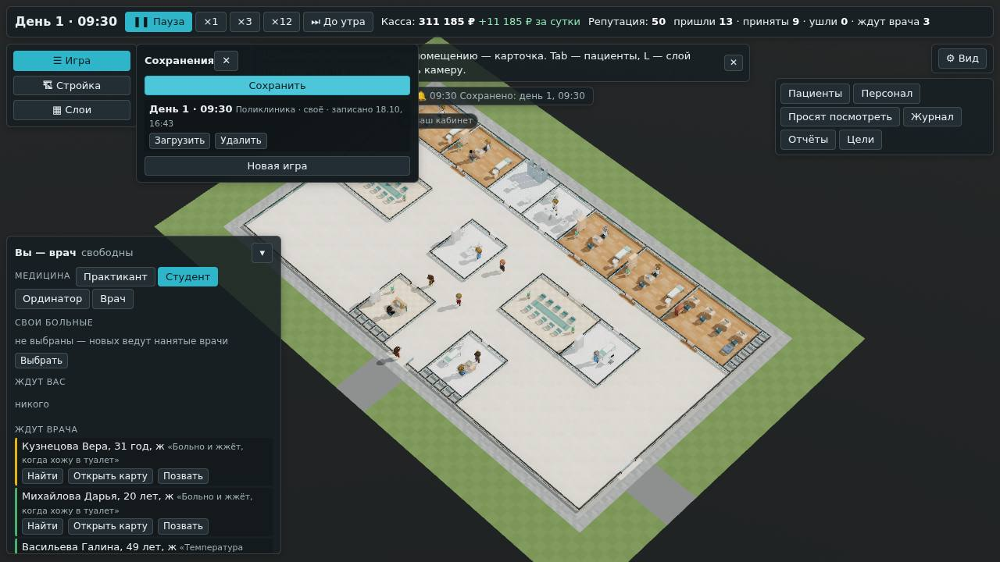

# Сохранения

**Состояние:** сделано, версия 0.7.0, 18.10.2026 — [«Как сделано»](#как-сделано); предложение агента. Основа — геймдизайн §14
«Сохранения» и строка «Сохранения с миграциями (§14)» этапа Б ([`2026-10-v1.md`](2026-10-v1.md)); правило устава —
«сохранение — снимок с версией схемы и миграциями» ([`docs/05-rules.md`](https://github.com/Nefeste/gornitsa/blob/main/docs/05-rules.md),
ADR студии 0004). Пункт 10 плана ([`../07-roadmap.md`](../07-roadmap.md)).

## Зачем

- **Сохранений нет.** Каждый запуск — с начала: владелец играет по тегам и всякий раз строит больницу заново.
- **На воротах среза** люди со стороны играют час (`2026-10-v1.md`) — без сохранения его не прервать.
- **Чем раньше появятся миграции, тем дешевле:** формат состояния меняется в каждой задаче среза.

## Как будет

### Что сохраняется

- **Снимок движка целиком** — больница, стройка, штат, касса, кредит, пациенты, их пути, очереди событий, сутки: всё,
  что движок знает (`ShiftState`). Часы, зерно и случайность — в нём же, поэтому игра после загрузки идёт так же, как шла
  бы без неё.
- **Вид:** камера (где, масштаб, поворот, перспектива), уровень медицины, автопауза.
- **Шапка:** когда сохранено, версия игры, больница, день и час, касса — для списка сохранений.
- После загрузки часы — на паузе: осмотреться.

### Когда

- **Утром, на планёрке в 08:00** — сама; три последних утра.
- **При выходе из игры** — сама, в свою ячейку «Выход» (предложение: иначе «Продолжить» теряет всё с утра).
- **Вручную** — «Сохранить» в меню игры; ячеек сколько угодно, удалить — там же.

### Где и как

- **Файлы** — в папке игры пользователя (Windows: `%APPDATA%\Bolnitsa\saves`); туда же ближе к 1.0 посмотрит облако
  Steam ([ADR 0003](../adr/0003-steam.md)). В браузере (сценарий, разработка) — в хранилище страницы.
- **Сжатые** gzip: большая больница — 9,5 МБ снимка, сжатый — около 1 МБ (бенч, 300 кабинетов к 18:00). Цель
  геймдизайна — до 5 МБ.
- **Пишет поток расчёта:** снимок сериализуется и сжимается там, окно только кладёт байты в файл — кадр не дёргается.
- **Запись не рвёт файл:** сначала временный, потом подмена; утренние — сдвигом трёх ячеек.

### Версия схемы и миграции

- **В каждом файле — номер схемы.** Сейчас 1.
- **Формат изменился так, что старое не читается** — номер растёт, и добавляется шаг миграции со старого номера на новый;
  загрузка проходит все шаги по очереди. Новое необязательное поле номера не меняет: движок читает его отсутствие.
- **Образец сохранения в тестах:** файл этой версии; тест грузит его, проводит через миграции и играет два часа. Забытая
  миграция роняет тест, а не игру человека.
- **Сохранение из более новой версии** не грузится — с понятным словом, файл не трогается.

### Экран

- **Экран начала:** «Продолжить» — самое новое сохранение (день, час, больница); «Загрузить» — все.
- **Меню игры** (кнопка «Игра»): «Сохранить», список сохранений — «Загрузить», «Удалить»; «Новая игра».
- **Утреннее сохранение** — строкой в извещениях: «Сохранено: утро дня 3».

## Чего здесь нет

- **Облака Steam** — ближе к 1.0, через клиент Steam (ADR 0003).
- **Быстрых клавиш** сохранения и загрузки — после интерфейса среза.

## Решения владельца

24.10.2026 владелец ответил «вариант 1» на оба вопроса:

1. **Сохранять и при выходе из игры** — в свою ячейку, «Продолжить» возвращает туда, где вышли (#75).
2. **Утренних — три,** как в геймдизайне (#76).

## Части работы

1. Движок и поток расчёта: номер схемы и цепочка миграций; снимок — в gzip и обратно; загрузка.
2. Окно и оболочка: файлы в Electron и в браузере, утреннее и при выходе, «Продолжить», меню игры.
3. Проверки: сохранить — загрузить — играть дальше: то же состояние, что без сохранения; образец версии 0.7.0;
   повреждённый файл и файл из новой версии; размер и время большой больницы; сценарий в браузере.

## Как сделано

- **Движок** (`src/engine/shift/migrate.ts`): `SAVE_SCHEMA = 1` (с 0.17.0 — 2: шаг 1 → 2 ставит санитаров,
  [`2026-10-orderlies.md`](2026-10-orderlies.md)), `migrate(schema, state)` — шаги по очереди; новее
  нынешней — `newer`, не снимок — `broken`. Снимок движка переживает JSON без потерь: проверено, что в нём нет NaN,
  бесконечностей, Map и Set, и что после сохранения и загрузки полтора дня идут до бита так же.
- **Файл** (`src/sim/packing.ts`): шапка, снимок и вид — JSON, сжатый gzip через CompressionStream. Пишет поток расчёта
  (`pack` в протоколе), открывает окно; ошибки — `SaveError`.
- **Ячейки** (`src/app/saves.ts`): два файла на ячейку — снимок и шапка для списка; утренние `auto-1` … `auto-3`
  сдвигом, `exit`, свои `manual-<n>`. «Диск» — папка Electron (`electron/saves.cjs`: только имена ячеек, запись через
  временный файл) или хранилище страницы (OPFS) в браузере.
- **Окно** (`src/app/game.ts`, `main.tsx`): сохранение в 08:00 — на извещение «планёрка»; при выходе — Electron просит
  страницу сохраниться и закрывает окно, когда она ответит (не ответила за 10 с — всё равно); загрузка — адрес с
  `?load=<ячейка>`, окно открывает себя заново; Electron пускает переходы только внутри `app://game/`. После загрузки
  часы на паузе, камера и уровень медицины — как были.
- **Экран:** «☰ Игра» над «Стройкой» — меню; на экране начала — «Продолжить» и «Загрузить»; испорченное — «Не открыть»
  и снова экран начала.

**Замеры** (Bun, без `--smol`): 200 кабинетов и 1148 пациентов к 18:00 — снимок 9,3 МБ, файл 1,0 МБ, записать 265 мс,
открыть 140 мс; 67 кабинетов и 341 пациент — 3,3 МБ, 0,36 МБ, 91 и 51 мс. Образец версии 0.7.0 — 14 КБ.

**Попутно:** извещение «вошёл к вам» (0.6.0) попадало в ленту извещений строкой «приём закончен» — теперь «Иванова у
вас в кабинете».

