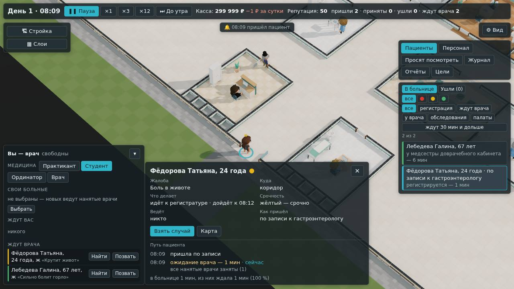

# Специалисты в потоке: своя запись и найм

**Состояние:** часть 1 сделана, 18.10.2026, версия 0.5.0 — [«Как сделано»](#как-сделано); спецификация — #37, предложение
агента; владелец 24.10.2026 принял все три предложения, часть 2 — с пробой ([«Решения владельца»](#решения-владельца)).
Проба направления сделана 25.10.2026 — [«Проба: направление к специалисту»](#проба-направление-к-специалисту): так, как в
вопросе, не лучше; лучше — по второй гипотезе терапевта. Владелец 25.10.2026 выбрал направление по второй гипотезе (#112,
«вариант 2») — [«Решения владельца»](#решения-владельца), 4; это часть 2. Пятая задача среза — пункт 5 плана
([`../07-roadmap.md`](../07-roadmap.md)); владелец 18.10.2026: «продолжай со специалистами в потоке». Основа:
- геймдизайн §7: гастроэнтеролог, эндокринолог и инфекционист «ведут случаи своего отделения»
  ([`../08-game-design.md`](../08-game-design.md));
- «Анамнез», глава 4, часть 59: у специалиста своя запись, к нему записываются с болезнями его профиля
  (`Nefeste/anamnez`, `docs/specs/2026-10-chapter-4.md`). Движок «Больницы» — его копия.

## Зачем

- **В «Городской больнице» три специалиста сидят без дела.** В потоке для ПК к ним никто не записан, а пришедших сами
  они не берут. Их зарплата — 16 500 ₽ в сутки впустую. Планёрка советует: «Замените их терапевтом».
- **Нанять специалиста в своей больнице нельзя.** «Нанять» на месте врача всегда даёт терапевта.
- **Подсказки должностей обещают то, чего нет:** «у его кабинета своя запись — к нему записываются с болью под
  ложечкой, изжогой…». В потоке для ПК записи нет.

## Что есть сейчас

Коротко, по разбору кода:

- **В «Анамнезе» запись есть.** У каждого кабинета — свои 18 мест записи в день. Записанный к специалисту болен
  болезнью его профиля, которую больница принимает. Специалист берёт только своих; терапевт их не берёт, пока специалист
  принимает. У записанного специалист рассуждает с поправкой: болезни профиля у таких больных в 10 раз вероятнее
  (`PROFILE_PRIOR`) — к нему с ними и записываются.
- **Поток для ПК записи не знает.** Сутки начинаются своим потоком: сами, скорая, вернувшиеся. Записанных нет, и три
  проверки движка не пускают к специалисту никого, кроме них.
- **Специалист получает больного, только если вы ответили на просьбу врача «Направить к …».** Тогда он ведёт случай, но
  без поправки профиля.

## Что предлагаем

### 1. Своя запись у специалиста

- **Каждый работающий специалист — свой поток записанных:** в часы приёма, по той же форме часов, что пришедшие сами,
  с той же поправкой на репутацию. Предложение — **2 человека в час** на специалиста, около 19 в сутки при часах приёма
  по умолчанию (проба ниже, вопрос 1).
- **Записанный болен болезнью профиля,** которую больница принимает, — как в «Анамнезе». У него в карточке и в списках —
  «по записи к гастроэнтерологу».
- **Путь — как у всех:** регистратура, доврачебный, зал у кабинета своего специалиста. Ждёт с тем же терпением.
- **Ведёт его специалист** — с поправкой профиля, как в «Анамнезе». Пришедших сами специалист по-прежнему не берёт.
- **Специалиста сегодня нет** — уволен, кабинет закрыт, нет места в ординаторской — к нему не записываются. Кто уже
  пришёл, тех берёт терапевт, как сейчас.
- **Инфекционист — только с боксом.** Больных инфекционного отделения больница принимает, когда работает бокс; без него
  записи к инфекционисту нет — как в «Анамнезе».
- **Только в потоке от больницы.** Авто-бенч, снимки и сценарий в браузере с числами потока (`?flow=6,1`) — без записи:
  та же толпа, что прежде.

### 2. Нанять специалиста

- **В карточке кабинета на месте врача — выбор:** терапевт, гастроэнтеролог, эндокринолог, инфекционист; у каждого —
  зарплата в сутки и подсказка должности. Сначала — из резерва, как сейчас. Место занято — как сейчас: «Уволить», потом
  «Нанять»; врач в кабинете один.
- **Готовое помещение «С персоналом» и поликлиника** — с терапевтом, как сейчас.

### 3. На экране

- «по записи к гастроэнтерологу» — в карточке пациента, во вкладке «Пациенты», в пути пациента.
- В карточке кабинета — кто в нём: «Гастроэнтеролог · навык 3».
- **Планёрка.** Совет «Замените их терапевтом» уходит. Специалист без записи за сутки — с причиной: «к инфекционисту
  записываются, когда работает бокс».

## Проба: сколько записывать

Проба агента: движок с записью, поток от больницы, 7 суток, зёрна 1–3. Две больницы:
- **городская** — терапевт, гастроэнтеролог, эндокринолог, инфекционист, стационар и скорая;
- **поликлиника с двумя специалистами** — терапевт, гастроэнтеролог и эндокринолог; ваш кабинет пустует, врача никто не
  играет.

| Запись в час на специалиста | 0, как сейчас | 1,25 | **2** | 2,5 |
|---|---|---|---|---|
| городская: пришли в сутки, из них по записи | 45, 0 | 94, 34 | **122, 57** | 140, 73 |
| городская: специалист принял в сутки | 0 | 14–17 | **21–26** | 24–31 |
| городская: ушли в сутки, из них записанных | 4, 0 | 6, 1 | **11, 6** | 17, 13 |
| городская: прибыль за 7 суток, тыс. ₽ | 252 | 958 | **1 328** | 1 478 |
| поликлиника: пришли в сутки, из них по записи | 32, 0 | 63, 22 | **82, 36** | 93, 45 |
| поликлиника: ушли в сутки, из них записанных | 2, 0 | 3, 0 | **4, 1** | 6, 4 |
| поликлиника: прибыль за 7 суток, тыс. ₽ | 109 | 408 | **558** | 640 |

Для сравнения поликлиника с тремя терапевтами: 98 в сутки, ушёл 1, прибыль 803 тыс. ₽.

- **При 1,25 специалист полдня без дела**, при 2,5 записанные к нему уходят: в городской — 13 в сутки из 73. **При 2**
  специалист принимает почти как терапевт — 21–26 в сутки против 30–41, — а уходят 6 из 57.
- **Специалист — не про деньги, а про точность.** Заменить терапевта специалистом — меньше больных и меньше прибыли:
  к нему идут только с его болезнями.
- **Точность — та же поправка профиля.** Те же записанные, тот же навык 3, без поправки — так их вёл бы терапевт:

  | Неверный диагноз у записанных, % | с поправкой профиля (специалист) | без неё (как терапевт) |
  |---|---|---|
  | гастроэнтеролог, городская и поликлиника | 5 и 6 | 15 и 15 |
  | эндокринолог, городская и поликлиника | 6 и 6 | 16 и 14 |
  | инфекционист, городская: верно и неверно | 90 и 1 | 68 и 3, ещё 29 — частично |

  Специалист на своих больных ошибается в два-три раза реже терапевта.

## Чего здесь нет

- **Направления** — в части 1. Ни вы своего больного, ни нанятый терапевт не направляют к специалисту, а ответ на просьбу
  «Направить к …» поправки профиля не даёт. Направление по второй гипотезе — часть 2, решение владельца #112.
- **Отделений** (геймдизайн §4) и новых специальностей — невролога (§7).
- **Своей цены приёма специалиста.** Страховая платит за случай, как за приём терапевта; дороже — только зарплата
  специалиста.

## Решения владельца

24.10.2026 владелец ответил «вариант 1» на все три вопроса:

1. **2 записанных в час** на специалиста (#60). Мысль владельца — проверить пробой: «при высокой нагрузке два в час по
   записи, а ещё два без записи в порядке очереди успеют, если 15 минут на пациента. Может, это слишком смелая догадка, и
   просто 2 в час».
2. **На место врача — выбор из четырёх,** как сделано (#61).
3. **Направление к специалисту — частью 2, сначала проба на тех же больных** (#62): лучше ли так, чем решает терапевт или
   вы; не лучше — не делаем. Что пробовать:
   - вы: в карте своего больного — «Направить к …», случай уходит к специалисту со всем, что узнано, и он ведёт его с
     поправкой профиля;
   - нанятый терапевт: когда не уверен, а его ведущая гипотеза — из профиля специалиста, который сегодня принимает, —
     направляет к нему, а не просит вас посмотреть.
4. **Направление по второй гипотезе** ([#112](https://github.com/Nefeste/bolnitsa/issues/112), ответ 25.10.2026 —
   «вариант 2»), по пробе ниже:
   - нанятый терапевт не уверен, а его вторая гипотеза — из профиля специалиста, который сейчас принимает: он направляет
     больного к этому специалисту, а не просит вас посмотреть;
   - вам — «Направить к …» в карте своего больного;
   - специалист ведёт направленного с поправкой профиля, как записанного; силу поправки для направленных подбирает проба —
     нынешняя ×10 подобрана для записанных;
   - в пути больного и в его карте — «направлен к гастроэнтерологу» (к тому, к кому направлен).

## Проба: направление к специалисту

Проба агента 25.10.2026, `bun tools/bench/referrals.ts`, по решению #62: «лучше ли так, чем решает терапевт или вы; не
лучше — не делаем». Больницы — городская (терапевт и три специалиста) и поликлиника с гастроэнтерологом и эндокринологом;
поток от больницы, приём с 08:00 до 20:00. Когда нанятый терапевт просит посмотреть, а гипотеза — из профиля специалиста,
который сейчас принимает, состояние копируется, и у одного и того же больного три исхода из одного мгновения:

- **сам** — «пусть решает сам», как сейчас: просьба без ответа кончается этим же;
- **направить** — нынешний ответ «Направить к …»: специалист рассуждает заново своим навыком;
- **с профилем** — то же, и специалист ведёт его, как записанного к себе: болезни профиля вероятнее (`PROFILE_PRIOR`, ×10).

Первые две строки — правило из вопроса (из профиля ведущая гипотеза терапевта), вторые две — из профиля только вторая
(самая вероятная болезнь второй группы). «Просит» — по правилу базы, как в игре; «любое решение» — терапевт «просит» о
каждом (так направляли бы вы сами, по подозрению), как проба `tools/bench/consults.ts --probe`.

| Кого направлять | больничных дней | больных | неверно: сам / направить / с профилем | не решён к 20:00 с профилем | ждать дольше, мин |
|---|---:|---:|---|---:|---:|
| терапевт просит, ведущая гипотеза из профиля | 40 | 14 | 3 / 3 / 3 | 0 | 23–52 |
| любое решение, ведущая из профиля | 16 | 27 | 2 / 2 / 2 | 2 | 39–41 |
| терапевт просит, вторая гипотеза из профиля | 40 | 8 | 6 / 5 / **2** | 1 | 14–16 |
| любое решение, вторая из профиля | 16 | 32 | 3 / 2 / 1 | **5** | 46–48 |

- **Как в вопросе — не лучше.** Если ведущая гипотеза терапевта уже из профиля, поправка поднимает все болезни профиля
  одинаково и порядок гипотез не меняет: исход у каждого больного тот же, а ждать на 23–52 минуты дольше. И таких мало —
  один на три больничных дня: больные профиля и так записаны к специалисту.
- **По второй гипотезе — лучше, но редко.** Терапевт не уверен, его вторая гипотеза — из профиля. Из шести больных с
  болезнью профиля терапевт ошибся у всех, специалист с поправкой — ни у одного: у трёх верно, у двух частично, шестой к
  20:00 не дождался. У обоих, у кого болезни профиля не было, поправка увела в ошибку: ×10 подобрана для записанных, у
  них болезнь профиля всегда. Неверных — 2 из 8 вместо 6, ждать — на четверть часа дольше; записанные
  к специалисту не страдают: за 40 дней ушло столько же. Один такой больной на пять больничных дней.
- **Направлять всех с подозрением — хуже.** Терапевт, уверенный в своём, обычно прав (91 %), а специалист занят
  записанными: к 20:00 не решены 5 из 32 направленных. Вам — инструмент на редкий случай, не на каждого.
- **Целый день** с каждым правилом: доля неверных у нанятых — та же (6–9 %), ушедших записанных — столько же или на 1–3
  больше.

## Проверка по обещаниям студии

- **Медицина** — та же база: профили специалистов уже есть, новых записей нет.
- **Давление, деньги, сеть, данные** — не тронуты.

## Части работы

1. **Движок:** поток записанных — свой у каждого специалиста; запись начинается и кончается, когда специалиста
   нанимают, увольняют или его кабинет перестаёт работать; найм с должностью. Часть 2 — направление по второй гипотезе
   (решение #112): правило нанятого терапевта, «Направить к …» у вас, поправка профиля для направленных — пробой.
2. **Окно:** выбор должности при найме, «по записи к …», кто в кабинете, планёрка.
3. **Замеры:** симулятор экономики — городская и поликлиника с двумя специалистами, 7 суток, три зерна; бенч движка — без
   изменений: он идёт на числах потока.
4. **Документы и снимки:** геймдизайн §5 (откуда приходят — по записи) и §7 (найм), `content/hospital/inflow.yaml`,
   сценарий в браузере.

## Проверки

- **Тесты:** записанный к специалисту — с болезнью его профиля; его ведёт специалист; терапевт его не берёт, пока
  специалист принимает. Уволили или закрыли кабинет — записи нет, пришедших берёт терапевт. Инфекционист без бокса — без
  записи. Наняли днём — запись с этой минуты. Без потока от больницы записи нет. Режимы «Анамнеза» — те же до байта.
- **Сценарий в браузере:** «Городская больница» — к специалистам идут записанные; нанять гастроэнтеролога в пустой
  кабинет.

## Как сделано

Часть 1 — 18.10.2026, ветка `claude/specialists`, версия 0.5.0, с предложениями из вопросов 1 и 2. Числа и снимки — из
контейнера агента.

**Движок** (`src/engine/shift/engine.ts`, `inflow.ts`, `shift/site.ts`).
- Поток записанных — свой у каждого специалиста, к которому записываются (`capacityOf(…).booked`): в часы приёма, по
  форме `walk`, `inflow.booked` человек в час с поправкой репутации. Записанный — визит «по записи», `to` — номер
  специалиста, основное заболевание — из его профиля, которое больница принимает, как в «Анамнезе». Остальное движок
  уже умел: записанного зовёт только специалист, терапевт его не берёт, пока специалист принимает, а специалист рассуждает
  с поправкой профиля.
- Стройка, найм и увольнение меняют, к кому записываются: к ушедшему запись кончается, к новому начинается с этой
  минуты (`rebook`).
- Только в потоке от больницы: авто-бенч, снимки и `?flow=` идут без записи.
- Команда `hire` — с должностью (`as`): на место врача — терапевт или специалист, сначала из резерва.

**Окно.**
- На месте врача — список «Терапевт — 5 000 ₽ в сутки», «Эндокринолог — 5 500 ₽ в сутки»… и «Нанять»; подсказка
  должности — при наведении.
- «по записи к гастроэнтерологу» — в карточке пациента и в строке «Пациентов»; в пути — «пришёл по записи».
- Планёрка: совета «замените их терапевтом» больше нет. Специалист без записи за сутки — «к нему никто не записался», и
  совет с причиной: к инфекционисту записываются, только когда работает бокс.

**Что выяснилось по ходу.**
1. **Четыре кнопки найма закрывали план.** Карточка помещения растёт снизу вверх, и щелчок по стене кабинета попадал в
   неё — так упал сценарий в браузере. Должности — списком в одну строку, карточка той же высоты.
2. **Занятого врача не увольняют, а специалист со своей записью занят весь приём.** Уволить его можно вечером, когда
   записанные приняты. С терапевтом при сильном потоке так же; правило не менялось.
3. **Городская больница стала другой.** Симулятор экономики, 7 суток, зёрна 1–3: пришли 90–154 в сутки вместо 45 в
   среднем, прибыль за неделю — 1,27–1,43 млн ₽ вместо 0,17–0,35 млн. В дни пика уходят до 26: специалист один на свою
   запись, а терапевт один на всех пришедших сами.
4. **Поликлиника с двумя специалистами** — 56–104 в сутки, прибыль за неделю 534–578 тыс. ₽ при цене 567 тыс.: на грани
   окупаемости за неделю, как поликлиника с тремя терапевтами (решение владельца 3 в
   [`2026-10-real-hospital.md`](2026-10-real-hospital.md): окупаемость — в задаче «Сложность»).

**Проверки.**
- `npm test` — 739 тестов в 49 файлах, все зелёные. Новые — `specialists.test.ts` (6): у каждого специалиста городской своя запись —
  болезнь из профиля, ведёт он, терапевт их не берёт; без потока от больницы записи нет; уволили — к нему не
  записываются, и наутро тоже; инфекционист без бокса — без записи, гастроэнтеролог, нанятый днём, — с этой минуты; найм
  с должностью; детерминизм. В `economy-pc.test.ts` у потока от больницы теперь есть список специалистов с записью.
  Золотые отпечатки, разборы «Анамнеза» и `infer-speed` — те же числа.
- `npm run e2e` — все восемь частей, 110 проверок, ошибок в консоли и запросов наружу нет. Часть 8
  ([`tools/app/e2e-specialists.mjs`](../../tools/app/e2e-specialists.mjs)): в поликлинике «Уволить» терапевта, в списке —
  четыре должности с зарплатой, «Нанять» гастроэнтеролога; к нему записываются — «по записи к гастроэнтерологу» в
  «Пациентах» и в карточке; снимок выше.
- **Бенч движка** (`bench.ts --mode flow --quick`, `main` и ветка по очереди, две пары): хэши после закрытия дня, приёмы
  и ушедшие — те же до знака при всех нагрузках; бенч идёт на числах потока, записи в нём нет. Медиана, мс на игровую
  минуту, `main` против ветки: 50 — 39,0 и 37,8 против 41,3 и 41,8; 100 — 71,2 и 73,4 против 68,3 и 75,1; 200 — 151,6 и
  144,5 против 151,2 и 147,9; 300 — 293,0 и 269,5 против 276,4 и 279,5. На 50 ветка дважды медленнее — перепроверено
  отдельно, три пары по очереди: 37,9, 38,4, 40,4 против 37,7, 37,7, 37,5. Разницы нет.

