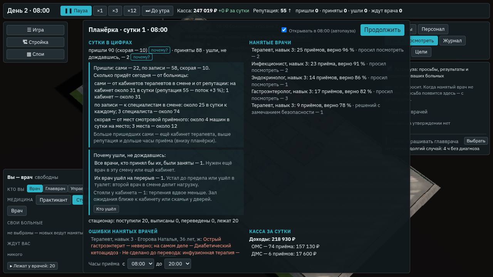

# «Почему?» у цифр планёрки

**Состояние:** часть 1 — сделана, версия 0.38.0 (26.10.2026): «почему?» у пришедших и ушедших на планёрке. Часть 2 —
впереди ([«Часть 2»](#часть-2)).

Основа:
- геймдизайн §11 ([`../08-game-design.md`](../08-game-design.md)): «Везде: подсказка при наведении, «Почему?» у каждой
  цифры»;
- геймдизайн §12, «Планёрка»: сутки в цифрах — пришли, приняты, ушли;
- пункт 6 этапа Б ([`2026-10-aaa-polish.md`](2026-10-aaa-polish.md), «По этапам среза»): «Почему?» у цифр планёрки.

## Зачем

Планёрка говорит: «пришли 110 · приняты 103 · ушли, не дождавшись, — 7». Число видно, а рычага за ним нет:

- пришли — много это или мало и от чего зависит;
- ушли — из-за чего и что с этим делать.

Одна подсказка внизу планёрки отвечает на одно, первое подходящее. Путь каждого ушедшего есть во вкладке «Пациенты», но
по одному человеку сутки не сложить.

«Почему?» отвечает одним щелчком у самого числа:

- кто пришёл и что задаёт поток больницы сегодня;
- почему ушли — по причинам, с тем, что делать с каждой.

## Что было

- **Поток от больницы** ([`2026-10-economy.md`](2026-10-economy.md), «Поток от больницы»; числа —
  `content/hospital/inflow.yaml`):
  - сами — 2,5 человека в час на кабинет нанятого терапевта (нет такого — ваш кабинет), с поправкой на репутацию ±30 %;
  - по записи — 2 в час к специалисту;
  - скорая — 4 машины в сутки на место смотровой приёмного;
  - по часам — форма `day.yaml`, сами и по записи — только в часы приёма.
- **Путь пациента** ([`2026-10-flow-ui.md`](2026-10-flow-ui.md), «Почему ждал»). Причина каждого ожидания записывается,
  когда ожидание началось. У ушедшего первой строкой карточки — «почему ушёл», по последнему ожиданию в общей очереди.
- **Итог суток** — `DaySummary`. В нём пришли, скорая, приняты и ушли — только числа.

## Часть 1: что сделано

Сделано 26.10.2026, версия 0.38.0.

### «Пришли — почему?»

Под строкой «Сутки в цифрах» открывается разбор:

- **Кто пришёл:** сами, по записи, скорая, повторно — по числу каждого вида (`DaySummary.arrivedBy`).
- **Сколько придёт сегодня — от больницы** (`DaySummary.inflow`):
  - **сами** — сколько на кабинет терапевта за сутки и поправка репутации («репутация 61 — поток +5 %»), сколько
    кабинетов в смене и сколько в среднем придёт;
  - **по записи** — сколько к каждому специалисту в смене и сколько всего;
  - **скорая** — сколько машин на место смотровой и сколько всего;
  - **повторно** — кому не помогло лечение: стало хуже, не стало лучше или реакция на лекарство.
- **Как получить больше:** ещё кабинет терапевта, выше репутация, дольше часы приёма.

Прогноз считает движок на планёрке, с репутацией после неё (`inflowDay` в `src/engine/shift/engine.ts`):

- по часам наступивших суток;
- в каждый час — с теми, кто в этот час в смене (`capacityOf` на середину часа);
- по тем же формулам, что сам поток (`walkPerHour`, `bookedPerHour`, `ambulancePerHour`);
- сами и по записи — в часы приёма и пока больница открыта (`siteOpen`).

Это среднее. Пришедшие за сутки отличаются от него на случайность потока: на 30 человек — на 5–6 в обе стороны.

### «Ушли — почему?»

Причину каждого ушедшего движок называет в тот час, когда кончилось терпение (`leaving` в `engine.ts`). Он смотрит
последнее ожидание пути и тех, кто принимает в этот час:

| Причина | Как движок её знает | Что с ней делать |
|---|---|---|
| все врачи, кто принял бы его, заняты | ждал в общей очереди; в смене есть нанятый врач, который взял бы его, — свободный позвал бы сразу | ещё врач в эту смену или ещё кабинет |
| в смене не было врача, который принял бы его | ждал в общей очереди; в этот час такого врача нет: смена кончилась, врача уволили, терапевта нет | врач в эту смену или часы приёма раньше |
| его врач ушёл на перерыв | последнее ожидание — перерыв врача, к которому он записан (`rest`) | второй врач в смене делит нагрузку |
| ждал вас | «свои больные», вы его забрали, ваш больной вернулся с результатами, заданный больной сценария | часть больных — нанятым врачам («Свои больные» в окне врача) |
| другое | пути нет: сохранение до него | — |

К причинам — две добавки:

- **«пока врачи ждали вашего ответа»** — из «все заняты», когда при его приходе или уходе была просьба «Просят
  посмотреть» без ответа. Ждущий ответа врач не зовёт следующего ([`2026-10-consults.md`](2026-10-consults.md));
- **«стояли у кабинета»** — сколько из ушедших стояли у двери, и терпения у них было вдвое меньше
  ([`2026-10-own-hall.md`](2026-10-own-hall.md)). Что делать: зал ожидания ближе к кабинету или скамьи у дверей.

Причины — в `DaySummary.leftBy`. В сумме они дают число ушедших.

**Почему «в смене не было врача» считается в час ухода, а не при приходе.** Путь пишет причину, когда ожидание
началось. Пришедший в 19:40 ждал занятого врача дневной смены, в 20:00 смена кончилась, и ночью его принять некому.
Записать это при приходе нельзя, а это главное, что игроку надо знать: врача в ночь или приём закрыть раньше. Поэтому:

- для планёрки причина — на час ухода;
- в пути она пишется в конец (`End.why`);
- карточка пути добавляет её к первой строке, если она другая: «…все нанятые врачи заняты (1), впереди 3; к часу ухода в
  смене не было врача, который принял бы его».

**Заданные больные сценария** при приходе теперь ждут вас: нанятые врачи их не берут. Раньше путь писал «ни один нанятый
врач не принимает».

**«Кто ушёл»** — кнопка в разборе. Она открывает вкладку «Пациенты», список «Ушли»: путь каждого и почему ушёл. С экрана
планёрки кнопка закрывает его, а часы оставляет на паузе — смотреть список.

### В окне

- У чисел «пришли» и «ушли» — кнопка «почему?». Щелчок открывает разбор под строкой, второй — закрывает. Наведение —
  короткий ответ: «сами — 33, по записи — 64, скорая — 9 — и от чего поток».
- То же — во вкладке «Отчёты», где лежит последняя планёрка.
- Итоги суток из сохранений до 0.38.0 без новых полей: кнопки «почему?» там нет.

Городская больница, планёрка вторых суток: открыты оба разбора (снимок сценария в браузере, часть 5).

### Пробы

Симулятор экономики (`bun tools/sim/economy.ts`) печатает под каждыми сутками строку «почему»:

- пришли по виду;
- прогноз планёрки, которой эти сутки начались;
- ушли по причинам.

Прогон: зёрна 1, 2, 3; 7 суток, у сценария 1 — 10; 26.10.2026. Прогноз — с планёрки, которой начались сутки; пришли —
за те же сутки, в среднем за сутки:

| Больница | Прогноз: сами + по записи + скорая | Пришли | Ошибка суток: медиана, 9 из 10 — до | Ушли: заняты · перерыв | Стояли у кабинета | Из «заняты» — при просьбах |
|---|---|---|---|---|---|---|
| clinic | 31 + 0 + 0 | 31 + 0 + 0 | 12 %, 21 % | 45 · 20 | 0 | 6 |
| district | 63 + 0 + 4 | 64 + 0 + 4 | 9 %, 27 % | 36 · 15 | 0 | 8 |
| city | 32 + 74 + 11 | 32 + 77 + 11 | 8 %, 19 % | 194 · 49 | 200 | 65 |
| poly | 94 + 0 + 0 | 95 + 0 + 0 | 6 %, 16 % | 23 · 15 | 0 | 11 |
| polyspec | 32 + 50 + 0 | 33 + 48 + 0 | 8 %, 22 % | 65 · 27 | 0 | 11 |
| ambulatory | 30 + 0 + 0 | 30 + 0 + 0 | 12 %, 32 % | 58 · 24 | 0 | 12 |

Что видно:

- **Прогноз сбывается в среднем:** за неделю расходится с пришедшими на 0–3 человека в сутки. Отдельные сутки — на
  6–12 % по медиане: это случайность самого потока, отсюда «около».
- **«Все врачи заняты»** — главная причина: 70–80 % ушедших.
- **«Перерыв»** — 20–30 %: врачи устают до предела и уходят отдыхать, хотя их ждут.
- **В городской 200 из 243 ушедших стояли у кабинета:** залы у кабинетов полны, и терпения у этих людей вдвое меньше.
  Это и есть её рычаг — скамьи у дверей и залы ближе.
- **«В смене не было врача»** в этих больницах не встретилось ни разу. К вечеру поток реже, и очередь успевает разойтись
  до пересменки в 20:00; у городской ночью есть терапевт. Эту причину проверяет тест: клиника с одной дневной сменой, а
  поток — 9 в час, больше, чем врач успевает.
- **«Ждали вас»** тоже нет: врача здесь никто не играет, ваш кабинет ведёт нанятый терапевт.

## Чего в части 1 нет

### Часть 2

- **«Почему?» в верхней полосе** — у кассы и репутации, при наведении. На планёрке они уже разобраны: касса по статьям,
  репутация по причинам.
- **«Почему?» у остальных чисел планёрки:** приняты (кто и сколько), стационар — поступили, выписаны, переведены,
  умерли (кто и с картой случая), узкие места (когда и почему).
- **«В смене не было врача» — ночью или днём**: сейчас одна строка.

## Проверки

- `tools/test/economy-pc.test.ts`, «"Почему?" у цифр планёрки»:
  - пришли по виду и ушли по причинам — в сумме числа суток;
  - путь каждого ушедшего — с той же причиной;
  - смена кончилась, а очередь осталась — «в смене не было врача», хотя при приходе все были заняты;
  - поток на сутки — с планёрки, по часам, с теми, кто в смене; за трое суток сбывается в пределах четверти;
  - поток без `auto` — без прогноза; смена «Анамнеза» — без счёта по виду и причин.
- `tools/test/flow-ui.test.ts` — первая строка карточки ушедшего: в смене никого или врач на перерыве.
- Сценарий в браузере, часть 5:
  - «почему?» у пришедших и ушедших — числа итога суток;
  - кнопки открытых разборов подсвечены;
  - «Кто ушёл» с экрана планёрки — «Пациенты» → «Ушли», часы стоят.
- Замер движка — [`../reports/2026-10-engine-speed.md`](../reports/2026-10-engine-speed.md), «"Почему?" у цифр
  планёрки (0.38.0)».

## Проверка по обещаниям студии

- **Честно:** причины — только то, что движок знает; правды о болезни в них нет. Прогноз — среднее по тем же формулам,
  что сам поток, и назван «около».
- **Без давления:** разбор открывает игрок, сам он не всплывает и часы не останавливает.
- **Пути не меняются:** счёт идёт только в потоке для ПК (`s.flow`); режимы «Анамнеза» — байт в байт прежние.
