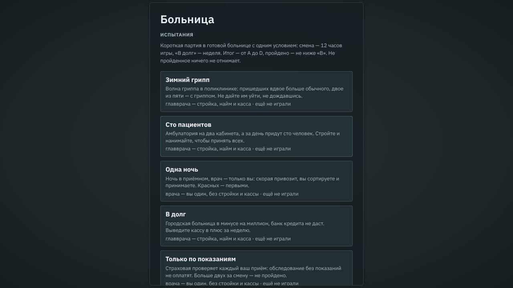
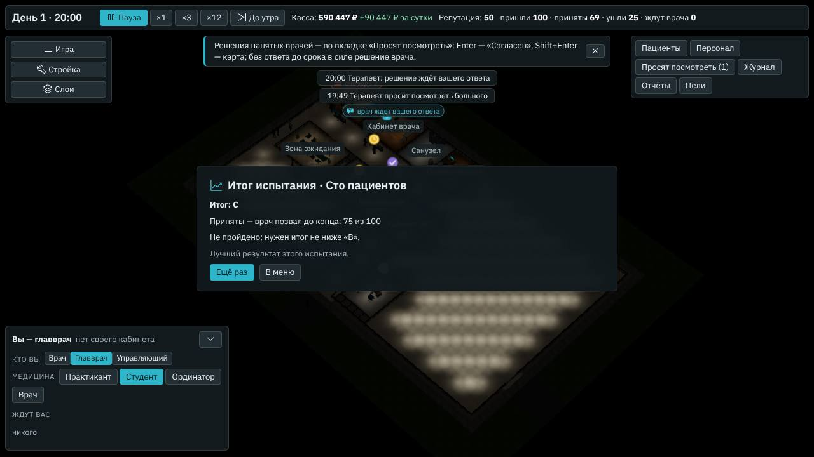
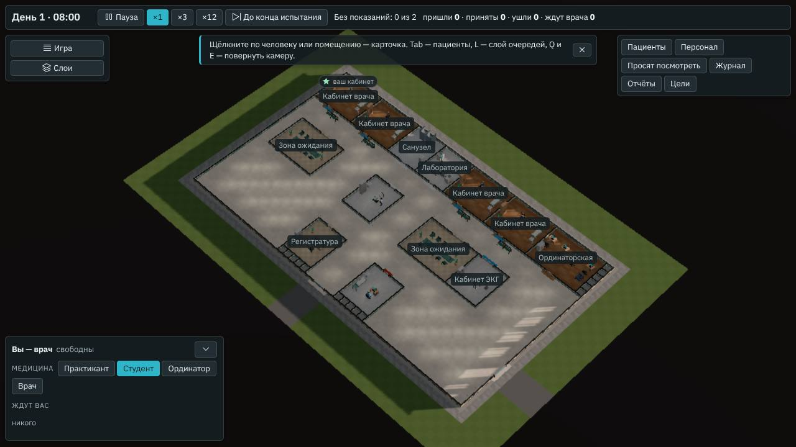

# Испытания

**Состояние:** спецификация и части 1–2, 08.11.2026 — предложение агента. Развилка — какие испытания делаем к 1.0, — решена:
решение владельца 09.11.2026 ([#220](https://github.com/Nefeste/bolnitsa/issues/220)) — вариант 1, шесть из геймдизайна; три
испытания «Анамнеза» — после 1.0. Часть 1 (записи, условия в движке и итог) — версия 0.78.0,
[«Часть 1: как сделано»](#часть-1-как-сделано); часть 2 (окно испытаний) — 0.79.0, [«Часть 2: как сделано»](#часть-2-как-сделано).
Дальше — «Рентген сломался» после техников. Основа:

- геймдизайн §9 «Режимы» ([`../08-game-design.md`](../08-game-design.md)), «Испытания»: «Короткие сценарии на 30–60 минут с
  особым условием, оценкой и личным рекордом: «Зимний грипп», «Рентген сломался», «Одна ночь» (ночь в приёмном, врач —
  только вы), «В долг», «Только по показаниям», «Сто пациентов». В 1.0 — не меньше шести»;
- путь к 1.0 ([`2026-10-v1.md`](2026-10-v1.md)): испытания — этап Д; ворота 1.0, «Содержание» — «не меньше шести
  испытаний»;
- смена врача ([`2026-11-doctor-shift.md`](2026-11-doctor-shift.md)): «Только вы» (`meta.solo`), итог смены от A до D,
  рекорды на компьютере — испытания врача берут их;
- испытания «Анамнеза» @ bed1996 (его `docs/specs/2026-10-challenges.md`, `src/engine/shift/challenges.ts`): «Нелюдимый
  врач», «Земский врач», «Скупой главврач» — условия на смене, выбраны владельцем там (его вопрос 50, Nefeste/anamnez#163).

## Зачем

- **Короткая партия с одним условием.** Кампания учит по шагам и идёт неделями игры; испытание — одна смена: 12 часов игры —
  около 36 минут на ×1, а пока открыта карта, часы стоят. Каждое учит своему: волна больных, пустая касса, ночь одному,
  обследования по показаниям.
- **Есть ради чего переиграть:** итог от A до D и лучший результат каждого испытания — на компьютере, без сети. Не прошёл —
  ничего не потерял.

## Что есть сейчас

- **Поток для ПК** с часами приёма, записью и скорой; множитель потока у уровней «Управления» (`inflow` в
  `content/hospital/difficulty.yaml`); сезон — вес болезни (`season` записи: у гриппа зимой ×3).
- **Готовые больницы:** поликлиника, амбулатория сценария 1 со свободным крылом (`site.ambulatory`), больница сценариев 2–3
  (`site.emergency`), городская и районная (`preset.city`, `preset.district`).
- **Касса** с пределом минуса и кредитом банка на планёрке (`content/hospital/money.yaml`); процент на долг — 0,5 % в сутки.
- **Экспертиза страховой:** обследование, назначенное без показаний, не оплачивают (`indicated` в
  `src/engine/med/policy.ts` — так решает разумный врач; `ShiftPatient.indicated` — только при кассе).
- **Поломки** с утра на сутки (FR-EQ-3, `breakdowns` в `src/engine/shift/engine.ts`). Поломок в работе и техников пока нет —
  они в 1.0 (геймдизайн §3, «Поломки»).
- **Смена врача:** вы — единственный врач, итог по категориям, рекорд по больнице и уровню (`src/sim/shift.ts`,
  `src/app/records.ts`); сортировка привезённых по листу передачи (`meta.sorts`).

## Замер

Проба [`tools/bench/challenges.ts`](../../tools/bench/challenges.ts), 08.11.2026: готовые больницы зимой, первые сутки с 08:00;
никто не играет — все случаи ведут нанятые врачи, в вашем кабинете — нанятый терапевт (как у «Управляющего»); в испытаниях
врача ваши приёмы ведёт «виртуальный врач» (`tools/sim/doctor-player.ts`); зёрна 1–3.

**«Зимний грипп»** — поликлиника, поток выше в разы, волна — вес гриппа зимой ×4 (игровое число):

| Поток | Пришли | С гриппом, без волны и в волну | Ушли, не дождавшись, без волны и в волну |
|---|---|---|---|
| ×1 | 123 | 15 % и 42 % | 0 % и 0 % |
| ×1,5 | 188 | 15 % и 41 % | 18 % и 1 % |
| ×2 | 255 | 14 % и 40 % | 31 % и 15 % |
| ×2,5 | 313 | — и 40 % | — и 27 % |

Грипп принимают быстро: в волну поликлиника справляется с потоком ×1,5. В городской больнице на тот же поток уходят больше
(×2 в волну — 30 %): пришедших сами берут только терапевты, специалисты — записанных.

**«Сто пациентов»** — около ста пришедших сами за часы приёма, без записи и скорой: в поликлинике с четырьмя кабинетами
принимают всех; в амбулатории сценария 1 с двумя — 74–83, уходят 19–30 %; в городской больнице — 73–78 (у специалистов —
только записанные).

**«Одна ночь»** — больница сценариев 2–3, вы один, сами не приходят; ваши приёмы с 08:00 ведёт разумный врач, скорая возит и
днём; ночь — привезённые с 20:00 до 08:00:

| Скорая в среднем за сутки | Привезли ночью | Осмотрены за 15 минут | Дольше всех ждали врача |
|---|---|---|---|
| 1 машина в час | 10–11 | 5–11 из них | 5–46 минут |
| 1,5 | 12–15 | 7–12 | 74–139 |
| 2 | 14–20 | 9–12 | 96–418 |

Разумный врач ставит верный диагноз 60–100 % привезённых ночью, итог суток — A или B.

**«В долг»** — прибыль за сутки со вторых суток, никто не играет: поликлиника 144–159 тысяч ₽, городская 104–144 тысячи,
районная — от −6 до +22 тысяч. С кассой −500 000 ₽ поликлиника выходит в плюс к утру 4–5-х суток, городская — 6–7-х, районная
— ни разу: доходы у неё — 60–88 тысяч в сутки, зарплаты — 80 тысяч (28 человек: операционная бригада днём и ночью, ночные
смены, один кабинет приёма). Но свободной земли у районной нет — игрок мог бы только увольнять. Городская с кассой −1 000 000 ₽
к концу недели — в минусе на 300–430 тысяч, а свободная земля у неё есть.

**«Только по показаниям»** — смена врача в поликлинике, 08:00–20:00; обследования без показаний — платные, не показанные в
момент назначения:

| Как ведёт приём | Приёмов | Ушли, не дождавшись | Без показаний за смену | Минут на приём | Итог смены |
|---|---|---|---|---|---|
| разумный: весь план сразу, отпускает ждать | 20–22 | 0–9 | 3–12 | 28–34 | A, A, B |
| по показаниям: сразу — только показанное сейчас, потом следующее | 16–20 | 2–9 | 0–2 | 29–32 | A, A, A |
| по одному, ждёт результат у себя | 9–14 | 9–18 | 0–3 | 38–70 | B, A, C |
| ленивый: без обследований | 22–29 | 0 | 0 | 15–17 | C, C, C |

**«Рентген сломался»** — сломан с утра на сутки (все аппараты кабинета): в обычные сутки снимок делают 7–10 больным городской
больницы и 2–7 районной; верных у них — 86–100 %, без рентгена — 70–86 % (в районной — 80–100 % и 40–100 %); касса за сутки
— на 31–61 тысячу ₽ меньше в городской и на 9–16 тысяч в районной (снимков нет, ремонт). Испытание на сутки — слабое: больных
со снимком мало, а сделать игроку нечего.

## Что предлагаем

### Экран начала

Под «Песочницей», перед «Для врача», — **«Испытания»** (главное меню геймдизайна, §9). Второй шаг — список: название, условие одной строкой,
лучший результат. Карточка испытания — «Начать». В демо (`?demo=1`) испытаний нет, как и песочницы.

### Шесть испытаний

| Испытание | Чьё | Больница | Время | Условие | Итог от A до D — по |
|---|---|---|---|---|---|
| «Зимний грипп» | главврача | поликлиника | 08:00–20:00 | сами — вдвое больше, грипп — около 40 % пришедших (волна) | доле ушедших, не дождавшись |
| «Сто пациентов» | главврача | амбулатория сценария 1 со свободным крылом | 08:00–20:00 | ровно сто пришедших сами, без записи и скорой | принятым из ста |
| «Одна ночь» | врача | больница сценариев 2–3 | 20:00–08:00 | сами не приходят; скорая — около 1,5 машины в час; сортируете вы | итогу смены врача |
| «В долг» | главврача | городская | 7 суток | касса −1 000 000 ₽; банк кредита не даёт, строить можно и в долг | кассе в конце 7-х суток |
| «Только по показаниям» | врача | поликлиника | 08:00–20:00 | страховая проверяет каждый ваш приём | итогу смены врача; без показаний — не больше двух |
| «Рентген сломался» | главврача | городская | 08:00–20:00 | рентген ломается в работе утром; чинит техник | верным у тех, кому нужен снимок, и кассе |

- **Испытания главврача** — готовая больница со стройкой, наймом и кассой; «Кто вы» — как у готовой больницы. Что делать —
  решает игрок: нанять в резерв и в пустые кабинеты, построить на свободной земле, продлить часы приёма, принимать самому,
  уволить.
- **Испытания врача** — смена врача (`meta.solo`): без стройки и кассы, все пришедшие и привезённые — ваши.
- **Время** — по часам игры; в конце — окно **«Итог испытания»:** оценка, «Пройдено» или «Не пройдено» с правилом, лучший
  результат и новый ли он; «Ещё раз» — то же испытание с новым зерном, «В меню».
- **Пройдено** — итог не ниже «B»; у «Только по показаниям» ещё и без показаний — не больше двух обследований. У «Одной ночи»
  в итоге — сколько красных по шкале вы позвали за 15 минут, для сведения (решение агента 11). Пороги итога — по пробе части
  1; до неё — ориентиры:

| Испытание | A | B | C |
|---|---|---|---|
| «Зимний грипп» — ушли, не дождавшись | до 3 % | до 7 % | до 15 % |
| «Сто пациентов» — приняты из ста | 97 | 90 | 75 |
| «В долг» — касса в конце 7-х суток | от +300 000 ₽ | от 0 | от −250 000 ₽ |

  Без игрока — C или D: в поликлинике в волну уходят 15 %, в амбулатории принимают 74–83 из ста, городская остаётся в долгу.
- **«Только по показаниям»** не запрещает назначать: обследование без показаний назначается, но страховая его не оплачивает
  — в разборе приёма строка «Без показаний: …», вверху карты — «Без показаний: 1 из 2».
- **«Рентген сломался» — после техников:** испытание на сутки слабое (замер), а с поломкой в работе у игрока есть выбор —
  ждать своего техника, вызвать сервис дороже, поставить второй рентген или везти на КТ. Поломки в работе и техники — в 1.0
  (геймдизайн §3), своя спецификация.
- **Рекорд** — на компьютере, по испытанию: оценка, число итога (доля ушедших, принятые, касса, балл смены), дата; лучший —
  по оценке, потом по числу.

## Чего здесь нет

- **Испытания «Анамнеза»** («Нелюдимый врач», «Земский врач», «Скупой главврач») — если владелец не выберет их в развилке.
- Несколько испытаний сразу, выбор больницы, уровня и зерна: испытание — одно условие в одной больнице.
- Таблиц рекордов в сети — никогда; достижения Steam — с клиентом Steam, этап Д ([ADR 0003](../adr/0003-steam.md)).

## Развилка: какие испытания к 1.0 ([#220](https://github.com/Nefeste/bolnitsa/issues/220))

1. **Шесть геймдизайна** (предложение агента): пять — на готовом движке, «Рентген сломался» — когда будут техники.
2. **Шесть геймдизайна и три «Анамнеза»** — условия на смене врача копией его `challenges.ts`: без расспроса, без анализов и
   снимков, 1 500 ₽ на обследования одного больного. Ещё одна часть работы: серые вопросы и обследования с причиной в карте.

**Решение владельца 09.11.2026 ([#220](https://github.com/Nefeste/bolnitsa/issues/220)): вариант 1** — шесть испытаний
геймдизайна к 1.0; три испытания «Анамнеза» — после версии 1.0.

## Части работы

1. **Движок и итог:** записи испытаний (`content/challenges/`: больница, время, поток, волна, касса, правило, пороги),
   `meta.challenge`; волна — доля пришедших сами с гриппом; ровно сто; начало в 20:00; без кредита; показания и без кассы;
   итог и «Пройдено» — `src/sim/challenge.ts`; проба — пороги; режимы «Анамнеза» и поток для ПК без испытания — те же до
   байта. Симулятор экономики играет «Зимний грипп», «Сто пациентов» и «В долг» разумным главврачом — проходимы на «B».
2. **Окно:** «Испытания» на экране начала и второй шаг, «Итог испытания», рекорды; строка «Без показаний» в карте;
   сценарий в браузере.
3. **«Рентген сломался»** — после поломок в работе и техников.
4. **Испытания «Анамнеза»** — если вариант 2.

## Часть 1: как сделано

Версия 0.78.0, 08.11.2026.

- **Записи** — `content/challenges/`, пять: `challenge.flu`, `challenge.hundred`, `challenge.night`, `challenge.debt`,
  `challenge.indicated` (тип `Challenge` в `src/content/types.ts`; идентификаторы — в выпущенных). В записи — больница начала
  (`sites/` или `presets/`), сезон, часы `from` и `to` от 00:00 первых суток, поток (от больницы или свой: сами в час приёма и
  скорая в час), «не больше стольких сами» (`walkIns`), волна (`wave`: болезнь и доля пришедших сами, %), касса, без кредита
  (`loan: false`), свой предел минуса (`overdraft`), сортировка игроком, правило показаний (`unindicated`) и итог (`grade`:
  итог смены врача — или число испытания и пороги A, B, C). Загрузчик проверяет: больница есть, конец позже начала, с
  болезнью волны приходят сами, волна и «не больше» — у своего потока, у испытания врача кассы нет, у главврача она есть,
  сортировка и красные — где есть смотровая приёмного, пороги — по порядку.
- **Движок** (`src/engine/shift/challenge.ts`, `meta.challenge`): `newFlowShift(…, { challenge })` берёт из записи сезон,
  поток, кассу, «вы один» (испытание врача) и сортировку; в первые сутки потоки — с часа `from` (у ночи — с 20:00, днём никого);
  на сотом пришедшем сами поток кончается; у доли пришедших сами генератор берёт болезнь волны (`only`), если она у человека
  бывает, — генератор «Анамнеза» не тронут; банк кредита не предлагает (`offerOf`), а предел минуса — свой (`limitOf` в
  `src/engine/shift/money.ts`: «В долг» строит до −1 500 000 ₽); показания назначенного считают и без кассы. Без испытания — те
  же числа до байта: отпечатки замера движка `9bbf0dc878cc7a6a`, `106ad537cb17b4ef`, `dcdb791936f77591`, `5fb317f6be372181`.
- **Итог** — `src/sim/challenge.ts`: `challengeEnd` — оценка от A до D (итог смены врача или число испытания по порогам) и
  «Пройдено»: не ниже «B», у «Только по показаниям» — и не больше двух обследований без показаний, как их снимает экспертиза
  ОМС (`caseIncome`); у «Одной ночи» — красные по шкале, позванные за 15 минут, для сведения. Конец — `challengeEndAt`: в час
  `to`, а в 08:00 — за секунду до планёрки, она начинает новые сутки. Больница начала — `challengeStart`: «Кто вы» — до ночной
  смены, ночная смена — один раз.
- **Изменено против предложения:** «В долг» — городская больница с кассой −1 000 000 ₽ (решение агента 3); пороги «Зимнего
  гриппа» — 3, 10 и 20 % вместо 3, 7 и 15: у разумного главврача не приняты 4–8 %; у «Одной ночи» нет правила о красных
  (решение агента 11). Разумный главврач пробы строит в 08:00 два кабинета «С персоналом» и ординаторскую: без ординаторской
  новые врачи вытесняют прежних — кабинет работает, только если его врачам есть где отдыхать.

### Проверки части 1

- **Проба** `bun tools/bench/challenges.ts --only engine` (`--plan` — разумный главврач, `--play rational,careful,urgent`), зёрна
  1–3:

| Испытание | Без игрока | Разумный главврач (`--plan`) или «виртуальный врач» |
|---|---|---|
| «Зимний грипп» — не приняты до 20:00 | 22,6–26 %, D | 4,4–8 %, B |
| «Сто пациентов» — приняты из ста | 59–72, D | 98–99, A |
| «В долг» — касса в конце 7-х суток | −304…−432 тысячи ₽, D | +189…+335 тысяч ₽, A и B |
| «Одна ночь» — итог смены врача | — | A, B, A; на 10 зёрнах «красного — сразу» — A или B, все красные в срок — в 6 ночах из 10 |
| «Только по показаниям» — без показаний | — | разумный — 3–12, не пройдено; «по показаниям» — 0–2, A, пройдено |

- **Тесты** (`tools/test/challenges.test.ts`): записи по порядку и больницы начала; поток, сезон и касса — из записи; в волну
  гриппом больны около двух из пяти пришедших сами; сто пришедших — и больше никого; ночью — только скорая и с 20:00; у «В
  долг» нет кредита и стройка до −1 500 000 ₽, а без испытания — кредит и стройка ждёт денег; показания без кассы — только у
  испытания; итог и «Пройдено»; ошибки загрузчика.
- **Замер движка** (`npm run bench -- --mode flow --quick`): отпечатки — те же.

## Часть 2: как сделано

Версия 0.79.0, 08.11.2026.

- **Экран начала:** под «Песочницей», перед «Для врача», — «Испытания» → «Выбрать испытание»; второй шаг — пять испытаний по
  порядку записей: название, условие, чьё оно и лучший итог («лучший: B, приняты 98 — пройдено» или «ещё не играли»); ниже —
  «Кто вы» для испытаний главврача (по умолчанию — «Врач», как везде). Ключи адреса — `challenge` и `role` с новым `seed`
  (`main.tsx`). В демо раздела нет.
- **Испытание:** больница — из записи (`challengeStart` с ролью до ночной смены, `hospitalAt` в `src/app/game.ts`); поток,
  касса и «вы один» — из записи в потоке расчёта; испытание врача — как смена врача: ни стройки, ни кассы, ни роли. «Сложности»
  в «Настройках» нет: уровень — «Обычно». Сохранять можно: испытание — в состоянии (`meta.challenge`).
- **Часы:** поток расчёта начинает «Одну ночь» сразу в 20:00 — часы идут до неё без больных; часы — не дальше конца испытания
  (`endOfIn` в `src/sim/host.ts`, `endAt` в окне); «До утра» — не дальше конца; у испытания врача кнопка — «До конца
  испытания». Итог смены врача в 20:00 у испытания не приходит — у него свой конец.
- **«Итог испытания»** (`src/ui/Challenges.tsx`): оценка, число итога («Не приняты до конца: 4,4 % — врач позвал 241 из 252»,
  «Приняты — врач позвал до конца: 98 из 100», «Касса в конце: 302 416 ₽», «Итог смены врача — балл 2,89 из 3»), у «Одной ночи»
  — красные в срок для сведения, у «Только по показаниям» — обследования без показаний, «Пройдено» или почему нет, лучший
  результат; «Ещё раз» — то же испытание и роль с новым зерном, «В меню». Часы стоят.
- **Рекорды** — `bolnitsa.challenges` в хранилище страницы (`src/app/challenges.ts`): лучший — по оценке, при равной — по числу в
  его сторону; «пройдено» не забывается.
- **«Без показаний: N из 2»** — в верхней полосе вместо кассы у «Только по показаниям»: поток расчёта шлёт, когда закрытых
  приёмов стало больше и число изменилось; больше предела — предупреждением.

### Проверки части 2

- **Тесты** (`tools/test/challenges-window.test.ts`): поток расчёта начинает «Одну ночь» в 20:00, часы не дальше конца, итог — один
  раз, итога смены врача нет; «Без показаний» — с начала; рекорды — лучший по оценке и числу, «пройдено» не забывается,
  испорченное — прочь. Окно «Итог испытания» — двенадцатое со строкой заголовка (`window-head.test.ts`).
- **Сценарий в браузере, часть 42** (`tools/app/e2e-challenges.mjs`): «Испытания» — пять, «ещё не играли»; «Сто пациентов» за
  «Главврача» — `meta.challenge`, поток и касса записи, без «Сложности»; «До утра» — до 20:00, «Итог испытания» и рекорд; «Ещё
  раз»; лучший итог в списке; «Одна ночь» — сразу 20:00, вы один и сортируете вы, «До конца испытания»; «Только по показаниям» —
  «Без показаний: 0 из 2». Часть 7 — карточка «Испытания» на экране начала.

## Решения агента

1. **Испытание — одна смена, 12 часов игры:** около 36 минут на ×1 — в рамке геймдизайна «30–60 минут»; «В долг» — 7 суток:
   их проматывают «До утра», от планёрки к планёрке. Переделать: часы — в записи испытания.
2. **Условия — записи в `content/challenges/`,** как сценарии: новое испытание — запись, а не код. Переделать: условия в
   движке.
3. **Больницы — готовые, уже знакомые игроку,** и у каждого испытания своя: поликлиника для волны, амбулатория для «Ста»
   (поликлиника принимает сто и без игрока), городская для долга — с долгом в миллион она сама не выходит в плюс, а свободная
   земля для стройки у неё есть (у районной её нет). Переделать: больница — строка записи.
4. **Уровень — «Обычно», без выбора:** испытание и есть сложность, рекорд — одна строка на испытание. Переделать: уровень на
   втором шаге и рекорд по уровню, как у смены врача.
5. **Зерно — новое при каждом начале,** как у смены врача: испытание — не головоломка на одних и тех же больных. Переделать:
   зерно в записи.
6. **«Только по показаниям» не прячет и не запрещает:** серая строка «нет показаний» подсказала бы, что полезно, —
   показание и есть польза по уже известному. Страховая отмечает после назначения. Переделать: запрет, как у «Скупого
   главврача» «Анамнеза».
7. **«Сто пациентов» — ровно сто:** иначе итог зависит от удачи потока (замер: 100–106). Переделать: поток в час.
8. **«В долг» — без кредита:** кредит поднимает кассу, не уменьшая долга, и итог по кассе терял бы смысл. Переделать: итог по
   кассе минус остаток кредита.
9. **Волна — доля пришедших сами с гриппом,** игровое число испытания, а не утверждение о настоящих эпидемиях; медицина
   гриппа — та же запись базы.
10. **«Рентген сломался» ждёт техников,** а не идёт первым с поломкой на сутки: замер показал, что такое испытание почти не
    меняет игру.
11. **У «Одной ночи» нет правила «все красные — за 15 минут»:** проба на движке — врач, который зовёт красного сразу, отпуская
    текущего подождать, — опаздывает к нему в 4 ночах из 10: двоих красных привозят почти разом, а больного со своим сроком
    (ЭКГ при боли в груди) движок ставит первым, и отпустить его нельзя. Правило зависело бы от удачи; в итоге — «Красных за
    15 минут: N из M», для сведения. Переделать: правило в записи (`reds`) — частью «Пройдено».

## Проверки

- **Тесты движка:** у каждого испытания — его условие (поток, волна, сто, 20:00, касса, без кредита, показания); без
  испытания — те же числа до байта, отпечатки движка те же.
- **Проба и симулятор:** без игрока — C или D; разумный главврач и разумный врач — не ниже «B».
- **Сценарий в браузере:** экран начала, испытание до «Итога испытания», рекорд после перезагрузки, «Ещё раз».

## Проверка по обещаниям студии

- **Медицина** — та же база и тот же разбор; доля гриппа в волне — игровое число испытания, новых медицинских утверждений нет.
- **Без давления** (устав, [`docs/05-rules.md`](https://github.com/Nefeste/gornitsa/blob/main/docs/05-rules.md#без-давления)):
  у испытаний нет таймера поверх часов игры, серий и наград за каждый день; не пройденное ничего не отнимает.
- **Деньги, сеть, данные** — не тронуты: рекорды — на компьютере, наружу ничего не уходит.
