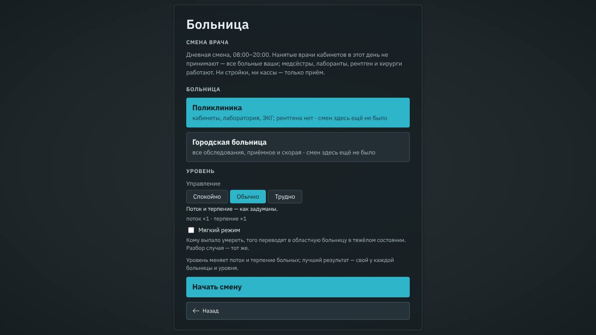
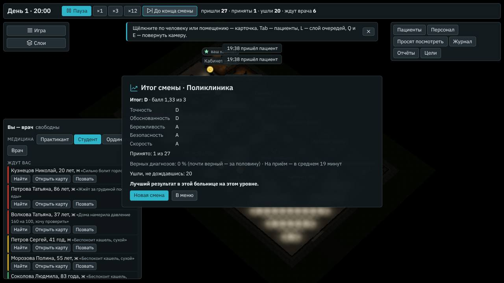

# Смена врача и случай дня

**Состояние:** спецификация, части 1 и 2, 07–08.11.2026 — предложение агента. Часть 1 (движок и итог) — версия 0.72.0,
[«Часть 1: как сделано»](#часть-1-как-сделано); часть 2 (окно смены) — 0.73.0, [«Часть 2: как сделано»](#часть-2-как-сделано);
часть 3 (случай дня) — ниже, как будет. Основа:

- геймдизайн §9 «Режимы» ([`../08-game-design.md`](../08-game-design.md)), «Смена врача и случай дня»: «готовая больница,
  вы — единственный врач приёма (как «Смена» «Анамнеза» с «Кто принимает: только вы»), итог от A до D и рекорд. «Случай
  дня» — один непростой пациент в сутки, одинаковый у всех с той же версией базы (зерно — дата; сети не нужно); любой из
  последних 30 дней можно сыграть когда угодно»;
- путь к 1.0 ([`2026-10-v1.md`](2026-10-v1.md)): испытания, смена врача и случай дня — к 1.0, этап Д;
- «Анамнез» @ bed1996 — берём копией со строкой источника (ADR 0002 устава): «Только вы» (`meta.solo`, его
  `docs/specs/2026-10-solo-shift.md`, ответ владельца на вопрос 16), итог смены по категориям (`src/state/single.ts`),
  случай дня (`src/state/daily.ts`; трудный по мере — ответ владельца на вопрос 56) и мера трудности случая
  (`src/engine/med/difficulty.ts`).

## Зачем

- **Для тех, кто пришёл за медициной.** Без стройки, найма и кассы — только приём: смена на 30–60 минут игры с итогом и
  рекордом, как испытания геймдизайна.
- **Случай дня — повод вернуться, а не обязанность.** Один трудный больной, у всех тот же. Пропущенный день ничего не
  отнимает (устав, «Без давления»): любой из 30 последних дней — когда угодно, серии нет.

## Что есть сейчас

- **Роль «Врач»** ([`2026-10-two-ways.md`](2026-10-two-ways.md), F4): свой кабинет в готовой больнице, нанятые врачи
  принимают остальных.
- **Поток от больницы** ([`2026-10-economy.md`](2026-10-economy.md), `capacityOf` в `src/engine/shift/engine.ts`): сами —
  2,5 человека в час на кабинет нанятого терапевта, а нет нанятых — на ваш кабинет; по записи — к каждому специалисту;
  скорая — по местам смотровой. Когда нанятые врачи не принимают, поток сам становится потоком одного кабинета.
- **Разбор ваших приёмов** — оценки по категориям (`src/engine/med/score.ts`), «Итог» в «Приняты».
- **В «Анамнезе»:** `meta.solo` — пять строк движка: нанятых, кто принимает (`colleaguesOf`), нет, и «ждёт вас» не нужно;
  итог смены — 79 строк чистого кода; случай дня — подбор трудного решаемого больного по зерну дня.

## Замер

Проба [`tools/bench/solo.ts`](../../tools/bench/solo.ts), 07.11.2026: готовые городская больница и поликлиника, дневная
смена 08:00–20:00 первых суток. Принимает один врач — нанятый терапевт навыка 3 в вашем кабинете (врача никто не играет);
других врачей кабинетов нет; медсёстры, лаборанты, рентген, хирурги — как есть. Шесть зёрен.

| За смену | Спокойно | Обычно | Трудно |
|---|---|---|---|
| Городская: пришли (из них по скорой) | 28,8 (7,5) | 35,0 (8,8) | 43,5 (10,2) |
| — принял врач / ушли, не дождавшись | 26,2 / 0,8 | 29,8 / 2,0 | 33,0 / 6,3 |
| Поликлиника: пришли | 21,3 | 26,2 | 33,3 |
| — принял врач / ушли, не дождавшись | 20,0 / 0,7 | 23,2 / 1,5 | 27,3 / 2,8 |

Приём у нанятого врача — медиана 11–15 игровых минут от того, как позвал, до решения; врача ждут — медиана 17–32 минуты.

1. **Смена одного врача — 20–45 больных:** при нескольких игровых минутах на приём это 30–60 минут игры.
2. **Один разумный врач успевает почти всех:** на «Обычно» уходят 1–2, на «Трудно» — 3–6. Новых чисел потока не нужно —
   тот же поток от больницы на один кабинет.
3. **Скорость в итоге — по минутам ваших приёмов**, которые считает карта (`spent`) теми же шагами, что в «Анамнезе», и
   дорогой врача по зданию (её прибавляет «Больница»). Поэтому пороги «Анамнеза» — 25, 40 и 60 минут — сверяет проба части
   1, где разумный врач ведёт ваши приёмы командами карты.

## Что предлагаем

### Экран начала

Под «Кампанией» и «Песочницей» — раздел **«Для врача»**: «Смена врача» и «Случай дня». В демо (`?demo=1`) его нет, как
и песочницы.

### Смена врача

- **Второй шаг:** больница — «Поликлиника» или «Городская больница» — и уровень «Управления», как у песочницы: он
  меняет поток и терпение (геймдизайн §10). «Кто вы» нет — вы «Врач».
- **Смена — дневная, 08:00–20:00.** Нанятые врачи кабинетов в этот день не принимают: к ним не записываются, новых они
  не берут, на карте их кабинеты пусты. Все пришедшие и привезённые — ваши. Медсёстры, лаборанты, рентген, УЗИ, хирурги
  и реаниматологи работают.
- **Без стройки, найма и кассы:** смена — про медицину. Инструментов стройки нет, касса и зарплаты не идут.
- **В 20:00 — «Итог смены»:** точность, обоснованность, бережливость, безопасность, скорость и общая оценка от A до D —
  по вашим приёмам, как в «Анамнезе»; «Принято: N из M», ушли, не дождавшись; лучший результат этой больницы на этом
  уровне — и новый ли он. Кнопки — «Новая смена» и «В меню»; карты принятых открываются из «Приняты», как всегда.
- **Рекорд** — на компьютере, по больнице и уровню: оценка, балл, дата.

### Случай дня

- **Список последних 30 дней,** сегодняшний первым: у сыгранного — оценка. День — по часам компьютера.
- **Больной дня** — трудный и решаемый, у всех тот же при той же версии базы: зерно — дата и номер базы, подбор — как в
  «Анамнезе» (много болезней в ряду у двери, правда — не первая в «Похоже на», разумному врачу расспроса и осмотра мало,
  а с обследованиями он ставит верный диагноз).
- **Где:** городская больница без потока — в ней все обследования; больной дня приходит в ваш кабинет в 08:00, других
  больных нет. Медсёстры, лаборанты и аппараты работают.
- **Итог** — разбор приёма с оценкой; засчитывается первая попытка, переиграть можно. Серии дней нет.

## Чего здесь нет

- **Испытания** (геймдизайн §9: «Зимний грипп», «Рентген сломался», «Одна ночь», «В долг», «Только по показаниям», «Сто
  пациентов») — своя спецификация; итог и рекорд берут из этой.
- Выбор зерна смены, своя больница из сохранения, ночная смена.
- Сеть — никогда: рекорды и случай дня — только на компьютере.

## Части работы

1. **Движок и итог:** `meta.solo` копией «Анамнеза» и смена без стройки и кассы — режимы «Анамнеза» те же до байта;
   итог смены копией `single.ts` в `src/sim/` (окно не видит правды); проба: разумный врач ведёт ваши приёмы командами
   карты — пороги итога.
2. **Окно смены:** раздел «Для врача», второй шаг, «Итог смены» в 20:00, рекорды; сценарий в браузере.
3. **Случай дня:** мера трудности и подбор копией «Анамнеза», список 30 дней, приём, итог; сценарий в браузере.

## Часть 1: как сделано

- **Принимаете только вы** — `meta.solo` (`newFlowShift(…, { solo })`, копия «Анамнеза»): нанятых, кто принимает
  (`colleaguesOf`), нет, «ждёт вас» не нужно (`leftForPlayer`). Поток от больницы сам становится потоком одного кабинета
  (`capacityOf`: ваш кабинет, записи к специалистам нет), скорая — по местам смотровой.
- **Больница готовая:** команды стройки, найма, «Мой кабинет» и отмены отказаны с причиной `shift` («в смене врача больница
  готовая — стройки и найма нет»); закрыть стройку можно. Кассы в смене нет — её не задают (`economy`).
- **Ожидание результатов у себя в кабинете — время приёма.** «Ждать» на ПК не проживает время разом, и в минуты приёма
  ожидание не шло: в пробе врач, что ждёт результаты у себя, принимал 4 больных из 22 и получал за скорость «A». Теперь
  `waitIn` — с какого часа ждёте; со следующим действием приёма ожидание — в `spent` (`resumeVisit`), как в «Анамнезе». Так
  считают и минуты приёма в карте — и в песочнице тоже.
- **Итог** — `src/sim/shift.ts`, копия `single.ts` «Анамнеза»: пять категорий, их веса и пороги; ваши приёмы и на ПК
  остаются в состоянии (`evict` их не трогает), пришедшие — за сутки (`s.summary`).
- **«Виртуальный врач»** — `tools/sim/doctor-player.ts`: ведёт ваши приёмы командами карты, как «Смена» «Анамнеза»; проба
  `bun tools/bench/solo.ts --play rational,patient,lazy,shotgun,one`. Итог смены по шести зёрнам, буквы — по зёрнам:

| Смена врача 08:00–20:00 | Спокойно | Обычно | Трудно |
|---|---|---|---|
| Поликлиника: разумный | AAAAAB | AAAAAB | AAAAAB |
| — ждёт результаты в кабинете | AAABBC | ABBBBB | AAABBC |
| — ленивый | CCCCDD | CCCCCD | CCCCCD |
| — всем один диагноз | DDDDDD | DDDDDD | DDDDDD |
| Городская: разумный | AAAAAB | AAAAAA | AAAAAA |
| — ждёт результаты в кабинете | ABBBBC | BBBBBB | BBBBBC |
| — ленивый | CCCCCD | CCCCCD | BCCCCD |
| — всем один диагноз | DDDDDD | DDDDDD | DDDDDD |

Минут на приём: у разумного 23–30, у ждущего в кабинете 44–50 — скорость «C», у ленивого 8–16. Пороги «Анамнеза» держатся —
их и оставили. «Всё подряд» за смену не заканчивает ни одного приёма: первому больному — 104 обследования.

- **Ушедшие в оценке не считаются,** как в «Анамнезе»: у разумного на «Трудно» в городской уходят 11 из 43, а итог «A».
  Сколько ушли, скажет строка «Принято: N из M» в «Итоге смены» (часть 2).

### Проверки части 1

- `tools/test/solo.test.ts`: с `meta.solo` нанятые врачи никого не приняли, записанных нет, поток — на один кабинет, места
  смотровой те же; без него — тот же день до байта; стройка, найм, «Мой кабинет» и отмена отказаны, закрыть стройку можно;
  «Ждать» — в `spent` со следующим действием; итог — по вашим приёмам, общая не выше точности и не больше ступени над
  худшей; виртуальный врач в поликлинике — A, B, C, D.
- Бенч движка (`npm run bench -- --mode flow --quick`): отпечатки — те же, что в
  [`../reports/2026-10-engine-speed.md`](../reports/2026-10-engine-speed.md).

## Часть 2: как сделано

- **Экран начала:** раздел «Для врача» под песочницей — «Смена врача» (в демо его нет). Второй шаг: поликлиника или городская
  — у каждой лучший итог на выбранном уровне или «смен здесь ещё не было», — уровень «Управления» (только поток и терпение:
  денег в смене нет) и «Начать смену». Она открывает страницу с ключами `hospital`, `solo=1` и новым зерном (`seed` в адресе —
  то, для сценария в браузере).
- **Смена:** `Game.solo` — из ключа или сохранения: смену сохраняют и продолжают, как любую игру. `start` идёт без `economy`.
  Нет кнопки стройки, B и Ctrl+Z, кассы, «Сложности» в «Настройках» и ряда ролей в окне врача; в карточке помещения — кто на
  месте, без найма, увольнения, обстановки, сноса и «Мой кабинет»; в карточке человека — без зарплаты, учёбы, смены и
  увольнения; «Нанять в резерв» нет. «Ждут вас» в окне врача — все из очереди, без подписи: ваши все.
- **20:00:** «До конца смены» вместо «До утра». Часы не уходят за 20:00 — их держат и окно, и расчётный поток; начатое до 20:00
  действие доживает своё. Расчётный поток досчитывает итог (`shiftEnd`, src/sim/shift.ts) и шлёт его со срезом один раз; окно
  останавливает часы — скорость больше не включить — и открывает «Итог смены».
- **«Итог смены»** (`src/ui/Shift.tsx`): общая оценка с баллом, пять категорий, «Принято: N из M», верные диагнозы и минуты на
  приём, «Ушли, не дождавшись», рекорд — «Лучший результат в этой больнице на этом уровне» или прежний лучший; «Новая смена» —
  та же больница и уровень с новым зерном; «В меню».
- **Рекорды** — `src/app/records.ts`: `bolnitsa.records` в хранилище страницы, по больнице и уровню; лучший — по баллу, при
  равном — кто принял больше; день — по часам компьютера.

### Проверки части 2

- `tools/test/records.test.ts` — ключ, лучший по баллу и при равном по принятым, испорченное и чужое прочь, хранилище, которое
  бросает; `tools/test/solo.test.ts` — «Ждут вас» в смене — все из очереди; `tools/test/window-head.test.ts` — «Итог смены»
  десятым окном, значок «результат».
- Сценарий в браузере, часть 39 (`tools/app/e2e-shift.mjs`): «Для врача» и второй шаг; смена в поликлинике — `meta.solo` без
  кассы, ни стройки, ни кассы, ни ряда ролей, B — ничего; ваш приём; «До конца смены» — в 20:00 часы встали, «Итог смены»,
  после него часы не идут; рекорд записан; «Новая смена» — та же больница, зерно новое; у поликлиники на экране начала — лучший
  итог; городская на «Трудно» — уровень в движке. Части 7 и 32 — «Смена врача» среди карточек и не в демо.

## Решения агента

1. **Смена — дневная, 08:00–20:00:** 12 игровых часов — около 36 минут на ×1, а пока открыта карта, часы стоят; ночь —
   у испытания «Одна ночь». Переделать: конец смены — одно число в записи смены.
2. **Больницы — готовые поликлиника и городская:** они уже есть на экране начала. Переделать: список больниц смены.
3. **Без стройки, найма и кассы:** геймдизайн обещает «готовую больницу», а касса — урок песочницы и кампании.
   Переделать: команды стройки в смене — как в песочнице.
4. **Уровень «Управления» — на втором шаге, рекорд — по больнице и уровню:** на «Трудно» больных на треть больше, и
   сравнивать с «Обычно» нечестно (так «Анамнез» держит свой рекорд у «Только вы»). Переделать: один уровень «Обычно».
5. **Итог — категории, веса и пороги «Анамнеза»:** проба части 1 дала те же ступени — разумный «A», ждущий результаты в
   кабинете «B», ленивый «C», «всем один диагноз» «D». Ушедших в оценке нет, как в «Анамнезе», — они в строке «Принято».
   Переделать: числа в `src/sim/shift.ts`; категория «Приём» — доля принятых.
6. **Случай дня — в городской больнице без потока:** в поликлинике нет рентгена, а подбор ищет больного, которому нужны
   обследования. Переделать: больница случая дня — одна строка.
7. **Рекорды — в хранилище страницы, как настройки,** а не в сохранениях: они — про игрока, а не про больницу.
8. **Ожидание результатов у себя в кабинете — время приёма везде на ПК,** и в карте песочницы тоже: иначе ждать у себя
   выгоднее, чем отпустить больного ждать, а минуты приёма в карте занижены. Переделать: `resumeVisit` в
   `src/engine/shift/engine.ts`.

## Проверки

- **Тесты движка:** с `meta.solo` нанятые врачи никого не приняли, пришли те же сами и по скорой, по записи — никого;
  без него — те же числа до байта; команды стройки и найма в смене отказаны.
- **Итог:** разумный врач — A, ждущий результаты в кабинете — B, ленивый — C, «всем один диагноз» — D, как в «Анамнезе».
- **Случай дня:** зерно и больной дня — те же при той же базе; трудный и решаемый у каждого из 365 дней.
- **Сценарий в браузере:** экран начала, смена до «Итога смены», рекорд после перезагрузки, случай дня и его оценка в
  списке.

## Проверка по обещаниям студии

- **Медицина** — та же база и тот же разбор; новых медицинских утверждений нет.
- **Без давления** (устав, [`docs/05-rules.md`](https://github.com/Nefeste/gornitsa/blob/main/docs/05-rules.md#без-давления)):
  у случая дня нет серии и наград за каждый день, пропущенный день сыгран и через неделю; смена идёт по часам игры, а они
  стоят, пока открыта карта, — таймера поверх них нет.
- **Деньги, сеть, данные** — не тронуты: рекорды — на компьютере, наружу ничего не уходит.
