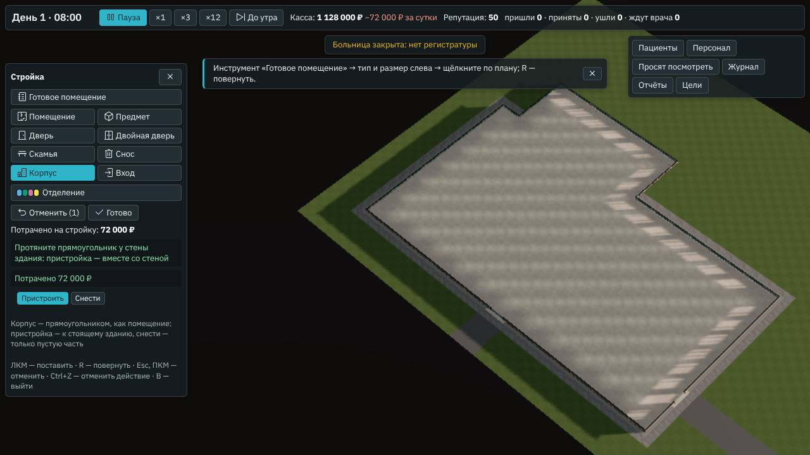

# Песочница

**Состояние:** спецификация, 10.11.2026 — предложение агента. Развилка — что даёт уровень больницы и где — вопрос владельцу
([#229](https://github.com/Nefeste/bolnitsa/issues/229)); до ответа часть 1 ждёт, остальное от ответа не зависит. Часть 2 — участок,
«Корпус» и «Вход» — сделана, [«Часть 2: как сделано»](#часть-2-как-сделано). Основа:

- геймдизайн §9 «Песочница» ([`../08-game-design.md`](../08-game-design.md)): «Свой участок и бюджет, все отделения и болезни
  открыты (или «только встреченные в кампании»), сложность по двум осям (§10), бесконечные дни. Цель — уровень больницы и
  достижения»; §3: «Участок — от 30 × 20 клеток (амбулатория) до 90 × 60 (большая больница); в песочнице — на выбор… в
  песочнице — с пустого участка: стены корпуса рисуются так же, как помещения»; §4: «Уровень больницы — амбулатория →
  районная → городская → областная. Уровень растёт, когда выполнены требования (отделения, койки, круглосуточная диагностика,
  качество за 7 дней), и даёт: коэффициент тарифа (как уровень учреждения в настоящих тарифах), более тяжёлых больных от
  скорой, больше направлений. В песочнице это главная лестница роста»; §7: «Чем выше репутация и уровень больницы, тем больше
  кандидатов и тем они сильнее»; §9, «Энциклопедия»: отметка «встречалось»; кампания: сценарий 8 — цель «уровень «городская»»;
- путь к 1.0 ([`2026-10-v1.md`](2026-10-v1.md)): песочница простая на этапе Б, полная — к 1.0 (этап Д); ворота 1.0, «Надёжность»:
  «20 часов автоигры в песочнице без ошибок и роста памяти».

## Зачем

- **Песочница сейчас — три начала и бесконечные дни, без цели.** Пустое здание, поликлиника и городская больница на экране
  начала; дальше игрок строит, сколько хочет, но расти некуда: уровня больницы нет.
- **Уровень — лестница роста и цель кампании:** от амбулатории до областной больницы; сценарию 8 он нужен как цель.

## Что есть сейчас

По разбору кода 10.11.2026:

- **Начало песочницы** — «Пустое здание» (участок 60 × 40, корпус 48 × 28, два входа), «Поликлиника», «Городская больница»;
  второй шаг — уровень «Управления», мягкий режим и «Кто вы». Касса начала — по уровню: 600 000, 1 200 000 или 2 500 000 ₽
  (`economy.sandbox.budgets`), у готовой больницы — её доля. В демо песочницы нет.
- **Участок один**, корпус задан: игрок строит помещения внутри, а стены корпуса не рисует. Движок корпус из нескольких
  прямоугольников уже знает (`Site.inside` — список; стены — по краю, `outline`): так устроены свободная земля городской
  больницы и расширение корпуса сценария 3 (`widerLot`).
- **Отделения и болезни** — по тому, что работает (`admits`): терапия всегда, хирургия и травма — со смотровой приёмного,
  неврология — с КТ или МРТ, инфекционное — с боксом.
- **«Уровень амбулатории для ОМС»** (`economy.level`: 50 % тарифа за обращение и по 25 % за работающие лабораторию и рентген) —
  доля тарифа, а не уровень больницы. **Уровня больницы нет.**
- **Найм** — на ПК сразу человек навыка 3 (геймдизайн §7, «В срезе»); списка кандидатов по дням, как в «Анамнезе», на ПК нет.
- **Достижения** — 24 записи «Анамнеза» (`content/achievements/`); на ПК их не показывают, связь со Steam — этап Д (ADR 0003).
- **Энциклопедия** — без отметки «встречалось»: что игрок встречал, игра не помнит.
- **Долгая игра:** снимок движка выходит на полку к седьмым суткам (город — 2,9–3,3 МБ), растёт только история суток — 3,5 КБ в
  сутки; долгий прогон окна — трое суток ([`../reports/2026-10-soak.md`](../reports/2026-10-soak.md)).

## Замер

Проба [`tools/bench/levels.ts`](../../tools/bench/levels.ts), 10.11.2026: готовые больницы зимой, никто не играет — кабинеты
ведут нанятые терапевты днём и ночью; 7 суток, зёрна 1–2. Что работает — в 14:00 и в 02:00 третьих суток; отделения — те, что
больница принимает, и те, чьи помещения работают (операционная — хирургия, бокс — инфекционное, ПИТ и реанимация —
реанимация).

| Больница | Отделения, кроме приёмного и терапии | Коек: палаты, ПИТ, реанимация, боксы | Ночью из диагностики | Верных диагнозов | Ушли, не дождавшись | Отказы в сутки: мест нет; своих нет |
|---|---|---|---|---|---|---|
| Поликлиника | — | 0 | — | 86–87 % | 1–2 % | 0; 5–8 |
| Амбулатория сценария 1 | — | 0 | — | 85 % | 2–3 % | 0; 3–4 |
| Начало сценария 2 | хирургия | 8 | лаборатория, рентген | 88–90 % | 6–8 % | 2–3; 2–3 |
| Начало сценария 3 | хирургия | 12 | лаборатория, рентген | 87–90 % | 7–9 % | 5–6; 2–3 |
| Сценарий 4 с КТ и ПИТ | хирургия, неврология, реанимация | 12, 4 | лаборатория, рентген, КТ | 89 % | 7–8 % | 6–8; 0,3–0,4 |
| Районная (глава 2 «Анамнеза») | хирургия | 8 | лаборатория, рентген | 89–93 % | 6–10 % | 2; 1–3 |
| Районная с сосудистым отделением | хирургия, неврология, реанимация | 8, 4 | лаборатория, рентген, КТ | 91 % | 9 % | 2–3; 0,3 |
| Городская | хирургия, неврология, инфекционное, реанимация | 12, 4, 6, 3 | лаборатория, рентген, КТ | 88–89 % | 11 % | 19–20; 0 |

Отказ в госпитализации — отправлен в другую больницу, а по базе ему нужна койка, и свободной годной не было: «мест нет» — такие у
больницы есть, «своих нет» — таких нет (`tools/bench/refused.ts`, как в сценарии 5). Репутация по утрам — 53–70 у всех (начало —
50).

Что из этого следует:

1. **Готовые больницы ложатся на лестницу сами:** поликлиника и амбулатория — без коек и ночной диагностики; больницы сценариев
   2–4 и районные — приёмное, рентген и лаборатория круглые сутки, 8–16 коек; городская — четыре отделения и 25 коек; областной
   нет ни одной: ни у кого нет 48 коек, УЗИ, эндоскопии и МРТ ночью.
2. **Точность врачей и репутация почти не различают больницы** (85–93 % и 53–70): «качество за 7 дней» из них — порог против
   плохой игры, а не ступень лестницы.
3. **Койки не успевают за потоком везде,** где они есть: 2–20 отказов «мест нет» в сутки, у городской — 19–20 со вторых суток
   (подробно — сценарий 5, [`2026-11-scenario-5.md`](2026-11-scenario-5.md)); поликлиника и амбулатория отправляют 3–8 в сутки —
   своих коек нет. Требование «коек» уровня ведёт игрока туда, где больнице тесно.
4. **Помещения ночью иногда не работают:** у сценария 4 на втором зерне ПИТ в 02:00 стоял — анестезиолог-реаниматолог ночной
   смены болел. Поэтому «круглосуточно» — места на обе смены, а не «работает в эту минуту».

## Что предлагаем

### Начало

- **Участок на выбор:** S — 40 × 30, M — 60 × 40, как сейчас, L — 90 × 60 (§3). На нём — пустой корпус по размеру участка, как
  сейчас у M (решение агента 1).
- **Инструмент «Корпус»:** прямоугольник корпуса — так же, как помещение, — к уже стоящему корпусу или отдельно; снести пустую
  часть; «Вход» — перенести главный вход или вход скорой на другую наружную стену. Цена клетки корпуса — игровое число, по
  симулятору.
- **Касса** — по уровню «Управления», как сейчас.
- **Болезни:** «все» или «только встреченные в кампании» — переключатель на втором шаге (решение агента 2).
- **«Поликлиника»** и **«Городская больница»** остаются готовыми началами.

### Уровень больницы

| | Районная | Городская | Областная |
|---|---|---|---|
| Отделения, кроме приёмного и терапии | одно | три | все четыре: хирургия, неврология, инфекционное, реанимация |
| Коек всего (палаты, ПИТ, реанимация, боксы) | 8 | 24 | 48 |
| Места на обе смены | смотровая приёмного, лаборатория, рентген | и КТ, ПИТ | и реанимация, УЗИ, эндоскопия, МРТ |
| Качество за 7 суток | верных диагнозов от 80 %, ушедших не больше 15 % | так же | так же |

- **Растёт и падает на планёрке в 08:00:** выполнены все требования следующего уровня — новый уровень с этого утра; три утра
  подряд не выполнены требования своего — уровень ниже; каждое такое утро — строка «чего не хватает» (решение агента 3).
- **Что даёт** — по ответу на развилку; предложение агента (числа игровые, по симулятору):

  | | Амбулатория | Районная | Городская | Областная |
  |---|---|---|---|---|
  | Коэффициент тарифа ОМС — обращение и стационар | ×1 | ×1 | ×1,1 | ×1,2 |
  | Направления — поток по записи к специалистам | ×1 | ×1 | ×1,25 | ×1,5 |
  | Скорая | — | как сейчас | тяжелее: больше «красных» и «жёлтых» | ещё тяжелее |
  | Кандидаты (с наймом по кандидатам, §7) | — | — | больше и сильнее | ещё |

  Амбулатория и районная — ×1: баланс сценариев 1–4, где выше районной не бывает, остаётся прежним.
- **В окне:** уровень — в верхней строке рядом с кассой; окно «Уровень больницы» — что есть и чего не хватает до следующего, с
  галочками; на планёрке — «Новый уровень» и «чего не хватает».

### Развилка — что даёт уровень и где ([#229](https://github.com/Nefeste/bolnitsa/issues/229))

1. **Везде на ПК, как в геймдизайне** (предложение агента): кампания, песочница, испытания. Амбулатория и районная — ×1, поэтому
   сценарии 1–4 не меняются; городская больница песочницы и испытания «В долг» с первого утра — «городская», ×1,1 к оплате;
   сценарии 5–8 и «В долг» перепроверяет симулятор. Цель сценария 8 «уровень «городская»» — то же правило.
2. **Только в песочнице:** в кампании и испытаниях уровень виден и бывает целью, но ничего не меняет — баланс сценариев и
   испытаний прежний; в песочнице та же больница зарабатывает иначе.
3. **Только звание:** уровень — цель и строка в верхней панели, без чисел ни в одном режиме; песочница растёт стройкой и
   репутацией, как сейчас.

### Достижения и 20 часов автоигры

- **Достижения** — своя спецификация вместе со Steam (этап Д, ADR 0003): около 30, за цели кампании, испытания, медицину (§16).
  Песочница даёт им поводы: новый уровень, все отделения, областная больница.
- **Автоигра** для ворот 1.0: «виртуальный главврач» — стройка симулятора экономики растёт на участке L уровень за уровнем, пока
  хватает кассы; долгий прогон окна (`tools/app/soak.mjs`) играет его 20 часов: без ошибок, без вставших часов, память окна — без
  роста со вторых суток (решение агента 4).

## Чего здесь нет

- Нескольких этажей — в 1.0 этаж один (§3).
- Счёта без денег («бесконечная касса») — в геймдизайне его нет.
- Найма по кандидатам — своя задача к 1.0 (§7); уровень даст им число и навык, когда она будет.
- Достижений — своя спецификация (выше).

## Части работы

1. **Движок: уровень больницы** — требования, проверка на планёрке, что даёт — по ответу на развилку; строка итогов суток.
   Режимы «Анамнеза» — те же до байта.
2. **Движок и окно: участок и корпус** — участок S, M, L; команды стройки «Корпус» и «Вход»; экран начала с участком и
   переключателем болезней; поток песочницы — только из встреченных болезней (генератор берёт список, как волна испытания).
3. **Окно: уровень** — верхняя строка, окно «Уровень больницы», строки планёрки; отметка «встречалось» в энциклопедии.
4. **Симулятор и долгий прогон:** стройка по уровням на участке L, 20 часов автоигры; сценарий в браузере.

## Решения агента

1. **Пустой участок — с корпусом по размеру, как сейчас, и инструмент «Корпус»:** геймдизайн обещает стены корпуса как у
   помещений; начинать с пустой земли и сразу рисовать стены — лишний шаг для того, кто пришёл строить больницу. Переделать:
   участок без корпуса — одна строка записи участка.
2. **«Встреченные» — главные болезни закрытых случаев кампании,** ваших и нанятых врачей, на этом компьютере (как рекорды
   испытаний, `bolnitsa.*`); та же отметка — «встречалось» в энциклопедии. Пока ни одной — переключатель недоступен.
   Переделать: только ваши случаи — один фильтр.
3. **Требования — по замеру,** чтобы готовые больницы легли на свои ступени: поликлиника и амбулатория — амбулатория,
   больницы сценариев 2–4 и районные — районная, городская — городская; «круглосуточно» — места на обе смены (замер, пункт 4);
   качество — одно для всех уровней: верных от 80 % и ушедших не больше 15 % за 7 суток (замер, пункт 2); падает — после трёх
   утр подряд, чтобы болезнь одного человека не роняла больницу. Переделать: числа — запись уровней.
4. **Автоигра — симулятор экономики, а не новый бот:** он уже строит больницы сценариев по плану; песочнице нужен его план до
   областной. Переделать: свой план — запись симулятора.

## Часть 2: как сделано

Версия 0.87.0, ветка `claude/sandbox-lots`, движок и окно вместе; «встреченные» болезни — часть 2б, ниже.

- **Участки** (`LOTS` в `src/engine/hospital/site.ts`): S — 40 × 30 с корпусом 30 × 20, M — прежнее пустое здание до байта (`LOTS.M`
  — тот же `EMPTY_LOT`), L — 90 × 60 с корпусом M у южного края; главный вход — посередине южной стены (`Lot.mid`), вход скорой —
  в восточной. Окно: второй шаг «Пустого здания» — участок S, M или L; ключ адреса `lot=S|L`, M — без ключа.
- **«Корпус»** — команда стройки `shell`: прямоугольник не меньше 3 × 3 на участке со стеной вокруг, к стоящему зданию (клетка
  внутри или рядом); вплотную к стене — вместе со стеной (`shellRect`), и пристройка с корпусом — одно здание; входы остаются на
  стене. Клетка — 400 ₽ (`SHELL_CELL`). `shell` с `remove` — снести пустую часть: без помещений и скамей, здание одним куском, двери
  и вход скорой достижимы; половина цены назад только за пристроенное (`Site.shell` — сколько клеток пристроено), корпус начала —
  без денег.
- **«Вход»** — команда `entrance`: главный или вход скорой на две соседние клетки наружной стены одной линией, за каждой — коридор,
  снаружи — улица; не на другом входе; двери и вход скорой достижимы. 20 000 ₽ (`ENTRANCE_PRICE`).
- **Только в песочнице:** у сценария и испытания здание задано — отказ `scenario`; в окне — кнопок нет. Отмена — как у скамьи:
  помещение на перестройку не закрывает (`KEEPS`).
- **Окно** (`src/app/build.ts`, `src/ui/App.tsx`): «Корпус» — «Пристроить» и «Снести», прямоугольник протягивают, как помещение;
  призрак — новые клетки или клетки, что снесут, и цена; «Вход» — «Главный» и «Скорой», призрак — две клетки стены. Значки —
  Carbon `building` и `login` (`tools/app/icons.mjs`). Сцена пересобирается, когда меняются корпус или входы (`onlyDeptsChanged`
  их сравнивает).

### Проверки части 2

- `npm run typecheck`; `npm test` — 1361 из 1361; новый `tools/test/sandbox-lots.test.ts` — 10 тестов: участки (M — прежнее пустое
  здание до байта), пристройка со стеной и её цена, отказы «Корпуса», снос двора и пристройки (половина цены назад), главный вход
  на северную стену S, отказы «Входа», другая сцена окна после пристройки и переноса входа, касса и отмена, у сценария — нельзя.
- Замер движка (`bench.ts --mode flow --quick`): отпечатки — те же, что у отказов в госпитализации (`f9a68e1bc529a71b`,
  `18a782c6dd5b932`, `f9e1dd8ddf8d89e4`, `44d6031e0fcd9e0f`): участки и команды стройки ход смены не трогают.
- Сценарий в браузере — 571 проверка, все зелёные; новая часть 46 — экран начала с участком L, пристройка 20 × 9 у северной стены
  (призрак «Корпус 20 × 9: новых клеток 180 — 72 000 ₽», касса 1 200 000 → 1 128 000, Ctrl+Z), снос двора в пустом здании, вход
  скорой на восточной стене, у сценария «Корпуса» и «Входа» нет.

## Часть 2б: как сделано

Версия 0.88.0, ветка `claude/sandbox-met`: «только встреченные в кампании» болезни.

- **Встреченные** (решение агента 2) — главные болезни закрытых случаев сценария кампании ПК, ваших и нанятых врачей. Поток
  расчёта отдаёт окну новые вместе со срезом (`met`, `MetDesk` в `src/sim/met.ts`: каждую один раз, после загрузки сохранения —
  заново), окно копит их в хранилище страницы этого компьютера (`bolnitsa.met`, `src/app/met.ts`), как рекорды испытаний. Правду
  больного окно так получает только болезнью уже закрытого случая — как «Итог» его карты.
- **Начало:** второй шаг «Пустого здания» — «Болезни»: «Только встреченные в кампании: N болезней»; встреченных нет — выбора
  нет и подпись «Все болезни базы…». Выбор — ключ адреса `met=1`; новая игра берёт список из хранилища (`Game.met`), сообщение
  `start` несёт его в `only`. У сохранения список — в его состоянии.
- **Движок** (`meta.only`, `newFlowShift(…, { only })`): только болезни базы, по алфавиту, без повторов; пустой или из одних
  неизвестных — как без него. Пришедший сам, записанный (из болезней профиля специалиста — встреченные) и привезённый скорой — с
  главной болезнью из списка (`metPatient`): генератор берёт её из списка (его `only`, как волна испытания); если этому человеку
  ни одна из них не бывает — другой человек, ключ с номером попытки, до `MET_TRIES` (8); не вышло или в списке нет ни одной
  болезни отделений, которые больница принимает (пришедшему сам — и не только со скорой), — этот не пришёл, следующий — в свой
  час. Без списка — тот же вызов генератора, до байта.
- **Чего нет:** отметки «встречалось» в энциклопедии — она в части 3, с окном уровня. Прогноз потока на планёрке (`inflowDay`)
  считает всех, как без списка: со встреченными пришедших может быть меньше прогноза.

## Проверки

- **Тесты движка:** уровень растёт и падает по требованиям; готовые больницы — на своих ступенях; что даёт уровень — по ответу;
  без уровня (режимы «Анамнеза») — те же до байта; корпус и вход — проверки стройки, отмена; поток из встреченных болезней.
- **Симулятор экономики:** сценарии 1–4 и испытания — прежние итоги (вариант 1: амбулатория и районная ×1); стройка до областной
  на участке L — за сколько суток и с какой кассой.
- **Долгий прогон** — 20 часов автоигры; **сценарий в браузере** — экран начала с участком, корпус, вход, уровень в верхней
  строке, его окно, «Новый уровень» на планёрке.

## Проверка по обещаниям студии

- **Без давления:** уровень падает только после трёх утр подряд и с предупреждением каждое утро; таймера на экране нет.
- **Медицина** не тронута: болезни, их отделения и места — из базы.
- **Деньги, сеть, данные:** «встреченные болезни» — на компьютере игрока, как рекорды; в сеть ничего не уходит.
