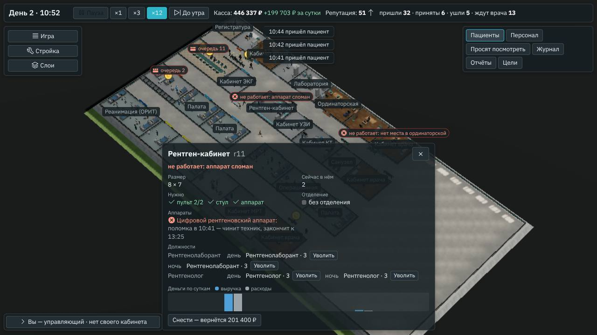
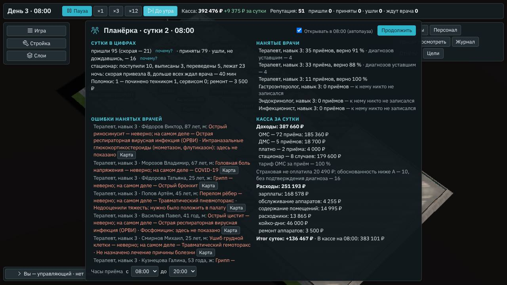

# Техники и поломки в работе

**Состояние:** спецификация и части 1–3, 09.11.2026 — предложение агента. Часть 1 (движок) — версия 0.80.0, [«Часть 1: как
сделано»](#часть-1-как-сделано); часть 2 (окно) — 0.81.0, [«Часть 2: как сделано»](#часть-2-как-сделано); часть 3 (испытание
«Рентген сломался») — 0.82.0, [«Часть 3: как сделано»](#часть-3-как-сделано). Основа:

- геймдизайн §3 «Поломки» ([`../08-game-design.md`](../08-game-design.md)): «Аппарат может сломаться в работе; шанс растёт без
  обслуживания. Чинит техник больницы — за часы, по навыку — или вызванный сервис: к утру и дороже. Техники в свободное время
  обходят аппараты и снижают шанс поломки. У монитора, наркозного и дыхательного аппарата и операционного стола есть запасной —
  они не встают»; §7 — «техник (чинит и обслуживает аппараты)»;
- путь к 1.0 ([`2026-10-v1.md`](2026-10-v1.md)): «Техники, поломки в работе, чистота (§3, §4)» — к 1.0, этап Д; чистота —
  своя спецификация;
- испытание «Рентген сломался» ([`2026-11-challenges.md`](2026-11-challenges.md)) ждёт этой механики: поломка на сутки почти
  ничего не меняет; сценарий 7 «Кризис» — «сломанные аппараты» (геймдизайн §9);
- поломки «Анамнеза» FR-EQ-3 (его `docs/specs/2026-10-walk-breakdowns.md`): с утра аппарат может не включиться — до конца
  дня его нет, к утру починят, ремонт — 2 % цены.

## Зачем

- **Сейчас поломка — погода, а не решение.** Она случается с утра, длится сутки и стоит 2 % цены; игроку нечего с ней делать.
- **Техник даёт выбор:** нанять и держать аппараты в порядке — или платить сервису и терять сутки снимков. Обслуживание —
  забота главврача, как зарплаты и смены.

## Что есть сейчас

- **Поломки FR-EQ-3** (`breakdowns` в `src/engine/shift/engine.ts`): каждое утро у каждого аппарата обследований — свой жребий
  по «надёжности» каталога (`breakdown`: 0,5–1,5 % рабочего дня); сломанный — до конца суток (`s.broken`), обследование —
  на другом таком же или нигде; ремонт — 2 % цены в расходах (`repairs`, `REPAIR_PCT`). Уровень «Управления» множит шанс
  (×0,5 и ×1,5).
- **Персонал** — смены, усталость, настроение, рост, резерв; должности без своего помещения (санитар — `optional`).
- **Слой «Проблемы»** — что не работает и почему; **планёрка** — узкие места суток.

## Замер

Проба [`tools/bench/repairs.ts`](../../tools/bench/repairs.ts), 09.11.2026: готовые больницы зимой, никто не играет, 7 суток,
зёрна 1–3.

| Больница | Аппаратов, что ломаются | Поломка в среднем | Обследований в сутки на аппарат |
|---|---|---|---|
| Поликлиника | 3: два анализатора, электрокардиограф | раз в 40 суток | биохимия 20, гематология 8, ЭКГ 11 |
| Районная | 6: четыре анализатора, ЭКГ, рентген | раз в 18 суток | рентген 5, биохимия 4–5, ЭКГ 3 |
| Городская | 10: и УЗИ, КТ, видеоэндоскоп, МРТ | раз в 9–10 суток | биохимия 15, иммунохимия 13, эндоскоп 9, рентген 9, ЭКГ 8, УЗИ 3, КТ 2 |

За 21 сутки городской — одни сутки с ремонтом (4 667 ₽ в неделю в среднем), у районной и поликлиники — ни одних. Поломка
сейчас редка, а когда случается, больные этого аппарата остаются без обследования до утра: у рентгена городской — 9 снимков.

## Что предлагаем

### Поломка в работе

- **В случайную минуту рабочего времени аппарата,** а не с утра: шанс суток каталога делится на часы, когда аппаратом
  работают. Начатое обследование доделывают; следующие — на другом таком же или ждут.
- **Износ:** у каждого аппарата — сутки без обслуживания; шанс растёт на 1/14 за сутки, до втрое за четыре недели. Новый аппарат
  и обслуженный — как в каталоге.
- **Без запасного ломаются только аппараты обследований,** как сейчас.

### Техник

- **Должность «Техник»** — в комнате персонала, как санитар — у смотровой: помещение работает и без него. Смена — день или ночь;
  растёт, устаёт и настроен, как весь нанятый штат.
- **Ремонт:** сломалось, а техник в смене — идёт к аппарату и чинит; часы — по навыку (от 3,5 часа на первом навыке до 1,5 на
  пятом — игровые числа), детали — 1 % цены. Двое сломанных — по очереди, ближний первым.
- **Обслуживание:** в свободное время техник обходит аппараты — дольше всех без обслуживания первым, 20 минут на аппарат — и
  сбрасывает износ.
- **Без техника** — вызванный сервис: к утру и 2 % цены, как сейчас.

### В окне

- **Карточка помещения:** у аппарата — «Сломан с 10:40 — чинит техник, к 13:10» или «Ждёт сервис — к утру»; «Обслужен:
  N суток назад».
- **Слой «Проблемы»** — сломанные аппараты и их помещения; **планёрка** — строка «Поломки: N — техник починил M, сервис K;
  ремонт — X ₽».
- **Найм** — «Техник» в карточке комнаты персонала; его карточка — где он сейчас и что делает.

## Чего здесь нет

- Чистоты и комфорта (геймдизайн §4) — своя спецификация.
- Сервисного договора, аренды аппаратов, гарантий.
- Поломок мебели, дверей и того, что не делает обследований.

## Части работы

1. **Движок:** поломка в работе, износ, должность техника, ремонт и обслуживание, сервис без техника; проба — частота поломок с
   техником и без; режимы «Анамнеза» — те же до байта (поломки с утра остаются у них).
2. **Окно:** состояние аппарата в карточке, «Проблемы», строка планёрки, найм техника, его путь по больнице; сценарий в браузере.
3. **Испытание «Рентген сломался»** — запись `content/challenges/`: рентген ломается в работе утром; техник, сервис или второй
   рентген — выбор игрока.

## Часть 1: как сделано

Версия 0.80.0, 09.11.2026.

- **Где:** поток для ПК со штатом по сменам (`repairOf` в `src/engine/shift/repair.ts`) — все готовые больницы ПК, сценарии и
  испытания. Без смен — режимы «Анамнеза» и замер движка — поломки с утра на сутки, как в FR-EQ-3: отпечатки замера движка те
  же (`9bbf0dc878cc7a6a`, `106ad537cb17b4ef`, `dcdb791936f77591`, `5fb317f6be372181`).
- **Поломка в работе** (`planRepairs`, событие `breakdown` в `src/engine/shift/engine.ts`): утром у каждого аппарата
  обследований — жребий суток из той же ветви зерна, что у поломки с утра, по надёжности каталога, уровню «Управления» и износу;
  выпал — поломка в случайную минуту с 08:00 до 20:00 (ветвь `breakdown-at`). Сломанный — в `s.broken`, как прежде: обследование
  назначают на другом таком же, а нет его — нельзя до ремонта; кого уже записали к аппарату, тех доделывают. `breakAt` ставит
  поломку в любой час — для тестов и испытания «Рентген сломался» (часть 3).
- **Износ** (`s.wear`): сутки без обслуживания у каждого аппарата, каждое утро +1; шанс — `wearPct`: 100 % и ещё 100 % за
  каждые 14 суток, не больше 300 % (`staff.repair` в `content/hospital/economy.yaml`: `wear`, `max`).
- **Техник** — `role.technician` (`content/hospital/roles/technician.yaml`): место — в ординаторской обоих размеров, помещение
  работает и без него (`optional`); смена — день или ночь; 1 200–1 900 ₽ за смену; растёт и настроен, как весь нанятый штат. В
  готовой больнице его нет (`ready: false`, `siteOfPlan`), готовая ординаторская «С персоналом» его не нанимает — нанимает
  игрок, в карточке ординаторской.
- **Ремонт и обход** (`nextJob` в `repair.ts`; `techDispatch`, событие `fixed` в `engine.ts`): свободный техник смены идёт к
  ближнему сломанному, которого никто не чинит; нет такого — обходит аппарат, что дольше всех без обслуживания (не меньше
  суток; при равных — ближний). Время — дорога (`walkPc`) и работа: ремонт — 210, 180, 150, 120 и 90 минут на навыке 1–5, обход —
  20 минут (`minutes`, `maintain`). Кончил ремонт — аппарат в строю, детали — 1 % цены в «Ремонт» кассы суток и помещения
  (`payRepair`); ремонт и обход обнуляют износ. Сломалось, пока он в обходе, — бросает обход. Кто что чинит — `s.fixing`; где
  техник и когда освободится — `s.techs`. Кончилась смена посреди ремонта — доделывает; посреди ремонта его не уволить и не
  отправить учиться — «занят» (`occupied` в `src/engine/shift/site.ts`); уволенный в обходе, ушедший сам и заболевший бросают
  работу (`dropGone`).
- **Сервис** — без техника и когда техники заняты: к утру и 2 % цены, как прежде (`repairsOf`: в итогах суток — сломанное, что
  не чинит техник).
- **В окне уже сейчас:** «Техник» на день и на ночь в карточке ординаторской — «без него помещение работает, а сломанный аппарат
  чинит сервис — к утру и дороже»; «аппарат сломан» у помещения без другого такого аппарата; у обследования — «… в ремонте — чинит техник, к 13:10» или «… в ремонте — сервис починит к утру». «Сломалось с утра»
  на планёрке — только у поломок с утра. Карточка аппарата, «Проблемы», строка планёрки и путь техника — часть 2.
- **Изменено против предложения:** минута поломки — с 08:00 до 20:00, а не по часам работы аппарата; записанных к сломавшемуся
  аппарату доделывают, новые ждут ремонта; техник не устаёт; в готовых больницах техника нет (решения агента 6–9).

### Проверки части 1

- **Проба** `bun tools/bench/repairs.ts --days 14`: готовые больницы зимой, никто не играет, 14 суток, зёрна 1–3, в среднем:

| Больница | Без техника | Техник на дневной смене |
|---|---|---|
| Поликлиника, 3 аппарата | поломок 0,7, все — сервис к утру; аппараты стояли 3,4 ч рабочего дня; ремонт 567 ₽ | поломок 0,3, все чинит техник; стояли 0,8 ч; детали 50 ₽ и зарплата 21 700 ₽ |
| Районная, 6 | 0,7, сервис; 2,8 ч; 1 467 ₽ | 0,7, техник; 1,1 ч; 733 ₽ и 21 700 ₽ |
| Городская, 10 | 2, сервис; 8,2 ч; 59 800 ₽ | 2, техник; 4,3 ч; 29 900 ₽ и 21 700 ₽ |

  В городской техник окупается: сервис для томографов дороже его зарплаты; в поликлинике и районной он стоит дороже сервиса, но
  аппараты стоят втрое меньше. Это и есть выбор: деньги или часы обследований.
- **Тесты** (`tools/test/technicians.test.ts`, 7): износ и минуты ремонта; без техника поломка — в свою минуту, а не с утра, стоит
  до утра, сервис — 2 % цены в итогах суток; без смен износа нет; техник нанимается в ординаторскую, а в готовых больницах его
  нет; чинит за минуты своего навыка, детали — 1 %, износ — с нуля; в свободное время обходит аппараты; посреди ремонта занят, на
  обходе уволить можно — обход брошен.
- **Симулятор экономики** (`bun tools/sim/economy.ts --seeds 1,2,3`): критерии те же, что до поломок в работе; у поликлиники, как
  и прежде, не выполнено «за 7 суток не окупается целиком» (`docs/specs/2026-10-real-hospital.md`, решение владельца 3); сервис
  городской — 14 000 ₽ за 7 суток у одного зерна из трёх, у двух — ни одной поломки.
- **Замер движка** (`npm run bench -- --mode flow --quick`): отпечатки — те же.
- **`npm test`** — 1319 из 1319; тест поликлиники ждёт людей на всех должностях, кроме техника.
- **Сценарий в браузере** (`node tools/app/e2e.mjs`) — 519 проверок, все зелёные. В части 6 сценарий закрывает карточку нового
  помещения перед следующим: у ординаторской с местом техника она выше и закрывала соседнюю клетку. Часть 36 («Приёмное»)
  дважды из 15 прогонов не дождалась планёрки: «До утра» вставало после шести сортировок привезённых. На базовой ветке — 5 из 5
  зелёные, на этой — 11 последних подряд; поломок и техников в первые сутки сценария нет. Если цикл снова встанет, сценарий
  напишет, что держит часы, и сохранит снимок.

## Часть 2: как сделано

Версия 0.81.0, 09.11.2026.

- **Движок для окна:** у работы техника — когда он вышел и когда дойдёт (`since`, `reach` в `s.fixing`), у поломки в работе — её
  час (`s.brokeAt`), у суток — сколько сломалось, сколько починил техник и сколько ждало сервиса к утру (`DaySummary.repairs`).
  Отпечатки замера движка — те же.
- **Поток расчёта** (`src/sim/repairs.ts`, поле `repairs` среза): аппараты, что ломаются, — сломан ли и с какого часа, кто у него
  работает, когда дойдёт и кончит, сколько суток без обслуживания; шлёт, когда что-то изменилось. Без поломок в работе — ничего.
- **Карточка помещения** — «Аппараты»: «поломка в 10:41 — чинит техник, закончит к 13:25», «… — ждёт сервис, к утру», «работает ·
  техник обслуживает, до …», «работает · без обслуживания 3 суток», «работает · обслуживали сегодня». Шапка карточки —
  «не работает: аппарат сломан», как значок над картой; у поломки с утра там раньше стояло «работает».
- **«Проблемы»:** помещение, что не работает из-за поломки, — с тем, кто чинит и к какому часу; сломанный аппарат там, где есть
  другой такой же, — жёлтая строка.
- **Планёрка:** «Поломки: N — починено техником M, сервисом K; ремонт — X ₽» (`#meet-repairs`); в подсказке — как устроены поломки.
- **Техник:** в «Персонале» — «ремонт до 13:25» или «обслуживание до …»; в его карточке — «идёт на ремонт цифрового
  рентгеновского аппарата (рентген-кабинет), закончит к 13:25», на месте — «ремонт …». Фигура идёт к аппарату по часам движка,
  стоит у него, пока работает, и возвращается в ординаторскую (`techStep`, `deviceStop` в `src/render/population.ts`).
- **Изменено против предложения:** строка планёрки — «починено техником M, сервисом K», а не «техник починил M»: техником бывает и
  женщина. Аппарат в словах — в родительном падеже («ремонт цифрового рентгеновского аппарата»): у аппаратов разный род,
  «видеоэндоскопическая стойка» — женский. «Обслужен N суток назад» — «без обслуживания N суток».

### Проверки части 2

- **Сценарий в браузере, часть 43** (`tools/app/e2e-technicians.mjs`): готовая городская больница, «Управляющий», зерно 447 —
  рентген ломается в 10:41 вторых суток. «Техник» в карточке ординаторской на день и на ночь, нанят на день; в 10:41 — поломка,
  карточка кабинета «не работает: аппарат сломан» и «поломка в 10:41 — чинит техник, закончит к 13:25», строка «Проблем»,
  «Персонал», фигура техника в кабинете у аппарата, его карточка; к 13:25 — «работает · обслуживали сегодня»; планёрка третьих
  суток — «Поломки: 1 — починено техником 1, сервисом 0; ремонт — 3 500 ₽». При зерне 231 рентген ломается в 08:11, но нанятый
  там техник болеет вторые сутки (болезнь — раз в 60 смен), — поэтому 447.
- **Тесты:** `technicians.test.ts` — час поломки, путь техника и счёт суток (сломалось, починил техник, ждало сервиса); без смен
  окну аппаратов не шлют; `problems.test.ts` — строки поломки в «Проблемах». `npm test` — 1323 из 1323.
- **Весь сценарий в браузере** — 531 проверка (часть 43 — 12 новых), все зелёные; **замер движка** — отпечатки те же.

## Часть 3: как сделано

Версия 0.82.0, 09.11.2026.

- **Запись** `content/challenges/xray.yaml` (`challenge.xray`, шестое на экране начала): главврач, готовая городская больница, зима,
  08:00–20:00, поток от больницы, касса 1 000 000 ₽ — хватит и на второй рентген; поломка — `breaks: [{ eq: eq.xray_digital, at:
  9 }]`; итог — `by: xrays`, пороги 7, 5 и 3 снимка.
- **Движок:** поле испытания `breaks` — аппарат этого вида ломается в этот час, каждый такой в больнице (`breakAt` в `newFlowShift`);
  дальше — поломка в работе части 1: есть техник — чинит, нет — сервис к утру. Загрузчик проверяет: аппарат обследований, час —
  во время испытания, такой аппарат бывает в помещениях больницы начала, испытание — главврача.
- **Итог** (`xraysOf` в `src/sim/challenge.ts`): назначенных обследований кабинета рентгена у всех карт за испытание; в окне —
  «Рентгеновских снимков за смену: N», в строке рекорда — «снимков N».
- **Изменено против предложения:** итог — снимки за смену, а не «верные у тех, кому нужен снимок»: кому снимок был нужен, видно
  только сравнением с теми же сутками без поломки (так считала проба), а в одной партии — нет.

### Проверки части 3

- **Проба** `bun tools/bench/challenges.ts --only engine --challenge xray --seeds 1,2,3,4,5` (`--plan` — техник на дневную смену в
  08:00, `--plan --alt` — второй рентген M на свободной земле в 08:00):

| Главврач | Снимков за смену по зёрнам 1–5 | Итог |
|---|---|---|
| никто не играет | 0, 0, 0, 1, 1 | D во всех |
| техник в 08:00 (навык 3: рентген снова в строю к 11:35) | 3, 7, 2, 5, 5 | C, A, D, B, B — пройдено в трёх |
| второй рентген в 08:00 | 5, 9, 3, 9, 7 | B, A, C, A, A — пройдено в четырёх |

  В обычные сутки городская делает 7–10 снимков; разброс итога — сколько снимков нужно в эти сутки: с техником и вторым
  рентгеном вместе — ближе всего к обычным.
- **Тесты** (`tools/test/challenges.test.ts`): шесть испытаний по порядку; в 09:00 рентген встаёт, без техника — до конца смены, итог
  — снимков за смену, D; техник, нанятый в 08:00, чинит к полудню; загрузчик — поломка не во время испытания.
- **Сценарий в браузере, часть 42**: «Испытания» — шесть; «Рентген сломался» за «Главврача» — в 09:00 рентген встал, в 20:00 —
  «Итог испытания» со снимками за смену. Весь сценарий — 533 проверки, все зелёные; `npm test` — 1325 из 1325; замер движка —
  отпечатки те же.

## Решения агента

1. **Поломка — в случайную минуту работы, а не с утра:** так в геймдизайне, и так поломка становится событием дня, на которое
   можно ответить. Переделать: часы поломки — одно число в коде.
2. **Износ — +1/14 за сутки, до ×3:** без обслуживания четыре недели городская ломается раз в 3–4 суток вместо 9–10 — заметно,
   но не каждый день. Переделать: два числа в `content/hospital/economy.yaml`.
3. **Техник — в комнате персонала, без своей мастерской:** геймдизайн ставит его к общим помещениям; мастерская — ещё одно
   помещение без нового выбора. Переделать: помещение — строка должности.
4. **Сервис без техника — как сейчас, к утру и 2 % цены;** детали техника — 1 %: техник дешевле, но ему платят каждый день.
   Переделать: числа — `REPAIR_PCT` и строка должности.
5. **Режимы «Анамнеза» не меняются:** у них поломки — с утра, как в FR-EQ-3; поломка в работе — только в потоке для ПК.
6. **В готовой больнице техника нет** (часть 1), и готовое помещение «С персоналом» его не нанимает: нанять его или платить
   сервису — выбор игрока, ради него техник и нужен. Переделать: строка `ready: false` должности.
7. **Записанное к сломавшемуся аппарату доделывают, новые ждут ремонта** (часть 1): движок записывает к аппарату со временем
   сразу, при назначении, и результат известен тогда же; очередь у аппарата обычно 1–3 человека. Переделать: снимать записи,
   что начнутся после поломки, — переделка записи к аппаратам.
8. **Минута поломки — с 08:00 до 20:00** (часть 1), а не по часам работы аппарата: днём аппаратами работают все, ночью — один
   приёмный, и чинить ночью может только ночной техник. Переделать: одно число в `planRepairs`.
9. **Техник не устаёт** (часть 1) — как регистратор и медсестра палаты: устают те, кто принимает и делает обследования, а у
   техника работа — не каждый час. Переделать: техник в `crewList`.

## Проверки

- **Тесты движка:** поломка в минуту работы; начатое обследование доделано; износ растёт и сбрасывается обслуживанием; техник
  чинит за свои часы, без техника — к утру; режимы «Анамнеза» — те же до байта, отпечатки замера движка — те же у потока без
  поломок.
- **Проба и симулятор экономики:** поломок за 14 суток с техником и без; что стоит техник и что стоит сервис.
- **Сценарий в браузере:** карточка сломанного аппарата, найм техника, ремонт к сроку, строка планёрки.

## Проверка по обещаниям студии

- **Медицина** — та же: что можно сделать без аппарата, решают те же модель и разумный врач.
- **Без давления:** поломка — событие игры, а не таймер; пропущенный день ничего не отнимает.
- **Деньги, сеть, данные** — не тронуты.
