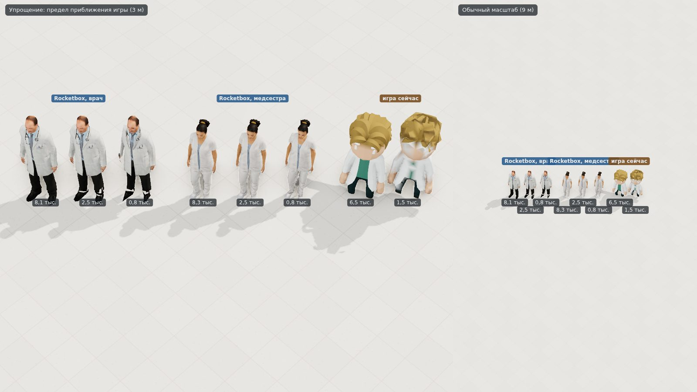

# Проба: реалистичные люди — Rocketbox и MakeHuman

Владелец (24.10.2026) попросил людей **реалистичнее, не мультяшных**, **реалистичное лицо в карточке человека** (врач,
медсестра, пациент), а позже — **редактор лица и персонажа с ползунками**. Проба проверяет два бесплатных источника,
лицензии которых сверены по первоисточникам:

- **Microsoft Rocketbox** (MIT) — 115 готовых людей с фототекстурами, среди них 8 медиков, у лиц — формы для выражений;
- **MakeHuman** (данные — CC0) — параметрический человек: одна базовая сетка и цели-сдвиги, основа для ползунков.

Вопросы пробы: **как Rocketbox выглядит на карте рядом с нынешними людьми и сколько стоит** (треугольники, текстуры,
упрощение); **годится ли он для лица в карточке и работают ли выражения**; **можно ли своим кодом собрать человека из
данных MakeHuman и менять лицо ползунками**.

Код пробы в игру как есть не переносится ([`docs/05-process.md`](../../docs/05-process.md), «Пробы»). Нынешних людей игры
на снимках рисует код самой игры — проба импортирует `src/render/bake.ts`, `people.ts`, `view.ts`, `post.ts`,
`textures.ts`, `cast.ts` без копий: камера, свет, пресет «высокое» и рост людей те же, что в игре.

## Источники и лицензии

| Что | Откуда | Лицензия | Дословно |
|---|---|---|---|
| 6 человек Rocketbox (4 медика, 2 горожанина), 2 анимации покоя | [github.com/microsoft/Microsoft-Rocketbox](https://github.com/microsoft/Microsoft-Rocketbox), коммит `0943055`; репозиторий в архиве (только чтение) | **MIT** | `LICENSE.md`: «Permission is hereby granted, free of charge, to any person obtaining a copy of this software and associated documentation files (the "Software"), to deal in the Software without restriction…»; `README.md`: «The library of avatars is now released under MIT License.» |
| Базовая сетка hm08, 48 целей, глаза | [github.com/makehumancommunity/makehuman](https://github.com/makehumancommunity/makehuman), коммит `a8bc2d5`, папка `makehuman/data` | **CC0 1.0** (ресурсы); код MakeHuman — **AGPL** | `LICENSE.md`, §C: «These assets have been released under CC0 1.0 Universal.»; §B: «The MakeHuman source (as defined per the above) is released under AGPL.»; шапка `base.obj`: «This asset was explicitly released as CC0 in september 2020.» |
| Кожа (6), брови (2), ресницы, волосы (3), одежда (2) | архив «MakeHuman system assets» ([страница](https://static.makehumancommunity.org/assets/assetpacks/makehuman_system_assets.html), [архив](https://files.makehumancommunity.org/asset_packs/makehuman_system_assets/makehuman_system_assets_cc0.zip), 280 737 770 байт, 14.04.2024) | **CC0** | страница: «System assets and materials for system assets, shared under CC0»; в описи архива (`packs/makehuman_system_assets.json`) у каждой вещи `"license": "CC0"` |

**Кода MakeHuman и MPFB (AGPL/GPL) и makehuman.js (AGPL) в пробе нет.** Разбор `.obj`, `.target`, `.mhclo`, правило
сложения целей и подгонка прокси написаны заново по самим файлам (`src/mh/`). MIT требует приложить к копиям строку
авторства и текст лицензии — в игре это титры и файл лицензий. Игровых ресурсов из других игр нет.

## Как запустить

```bash
npm ci                                            # в корне репозитория: three, esbuild, playwright-core, typescript — версии игры
node spikes/realistic-people/tools/fetch.mjs       # 149 файлов, 428 МБ → spikes/realistic-people/assets/ (в git нет), сверка SHA-256
node spikes/realistic-people/tools/prepare.mjs     # TGA Rocketbox → PNG: полный размер и 512² (браузер TGA не читает)
node spikes/realistic-people/tools/build.mjs       # src/ → dist/app.js (esbuild)
npx tsc --noEmit -p spikes/realistic-people        # типы
node spikes/realistic-people/tools/serve.mjs       # http://127.0.0.1:8095/ — меню видов
node spikes/realistic-people/tools/shots.mjs       # шесть снимков → results/*.jpg, числа → results/stats.json (в git нет)
```

Виды: `?view=map`, `lod`, `portrait`, `expression`, `makehuman`, `sliders`; отладочный `?view=shapes&id=Medical_Male_03`
— формы лица по одной (по нему подбирались выражения). Сеть нужна только `fetch.mjs`: 43 файла Rocketbox (368 МБ, из них
почти всё — несжатые TGA) и 58 файлов MakeHuman (9 МБ) — с `raw.githubusercontent.com` на закреплённых коммитах, а 48
нужных файлов (51 МБ) из архива системных ресурсов (281 МБ) — запросами Range: сначала оглавление в конце архива, потом
сжатые данные только нужных файлов. Страница ходит только на свой сервер: `shots.mjs` на всех шести видах насчитал
0 запросов наружу и 0 ошибок в консоли. Снимки сняты в контейнере: Chromium 141 без окна (Playwright 1.56.1), WebGL
программный (SwiftShader), three 0.186.1, meshoptimizer 1.3.0.

## Что на снимках

### 1. Rocketbox на карте рядом с нынешними людьми


Камера, свет (11:00), мягкое затенение (GTAO), сглаживание MSAA ×4 и тени 4096² — как в игре на «высоком»: перспектива
20°, наклон 52°, поворот 45°. Слева — обычный рабочий масштаб (половина кадра 9 м, как «лететь к человеку»), справа —
предел приближения игры (3 м). Столбцы — должности: **сзади люди игры** (Quaternius, одежда в цвете должности из
`cast.ts`), **спереди Rocketbox**: врач Medical_Male_03, врач Medical_Female_02, медсестра Medical_Female_01, хирург
Medical_Male_04, пациент Male_Adult_14, пациентка Female_Adult_09. Рост — по таблице игры (1,76 / 1,64 / 1,72 м). Поза —
кадр анимации покоя из той же библиотеки (`m_`/`f_idle_neutral_01`, только повороты костей). Текстуры на карте — 512²,
только цвет (без нормалей и блеска).

### 2. Упрощение до ~2,5 и ~0,8 тыс. треугольников



Врач и медсестра Rocketbox: полная сетка (8,1 и 8,3 тыс.), упрощённые до ~2,5 и ~0,8 тыс.; справа — врач игры, полный
(6,5 тыс.) и дальний (1,5 тыс. — 25 %, как в игре). На пределе приближения 2,5 тыс. почти не отличить от полной; у 0,8
тыс. «плывёт» текстура на стыке халата и брюк, у подошв и лица. На обычном масштабе все три одинаковы.

### 3. Лицо в карточке


Карточка 360×440 (кадр рисуется вдвое крупнее и уменьшается — сглаживание). Текстуры 2048²: цвет, нормали и карта блеска
набора (`specularColorMap` у `MeshPhysicalMaterial`: ткань и волосы блестят меньше кожи), волосы — срез по альфе со
сглаживанием (alphaToCoverage). Свет — ключевой тёплый с тенью, заполняющий, контровой и RoomEnvironment; тон — Khronos PBR
Neutral (`?tm=agx` — AgX). Пациент с карты (Male_Adult_14) здесь заменён пациенткой: у него то же лицо, что у врача
Medical_Male_03 (см. «Риски»).

### 4. Выражения из форм лица


Формы из `*_facial.fbx`: **улыбка** — HB_07 MouthSmile 0,6, AU6 CheekRaiser 0,55, ARKit MouthSmile 0,5, EyeSquint 0,25;
**озабоченность** — ARKit BrowInnerUp 1, AU1 0,3, AU15 LipCornerDepressor 0,6, AU17 ChinRaiser 0,35; **боль** — по FACS:
AU4 BrowLowerer 0,85, AU7 LidTightener 0,75, AU9 NoseWrinkler 0,55, AU10 0,4, AU20 LipStretcher 0,5, AU43 0,3. Нормали
форм проба считает сама: FBXLoader берёт из FBX только сдвиги вершин, и без нормалей свет на лице с выражением не
меняется (морщины на переносице, щёки при улыбке).

### 5. MakeHuman: три человека из одной сетки


Одна базовая сетка и одни цели — разные только ползунки и вещи: молодая женщина 25 лет (пол 0, полнота −0,1, глаза +0,2,
губы +0,3, нос −0,2), мужчина 48 лет (пол 1, полнота +0,3, челюсть +0,4, нос +0,2, лицо +0,2), пожилой мужчина 78 лет
(пол 1, нос длиннее и с горбинкой, черты старше, седина). Кожа — смесь текстур CC0 по полу и возрасту, глаза, брови,
ресницы, волосы и одежда — прокси, подогнанные к телу по `.mhclo`. Свет и карточка — те же, что у Rocketbox.

### 6. Ползунки


14 ползунков: пол, возраст, полнота и 11 черт лица (полнота лица, ширина, длина и горбинка носа, ширина челюсти,
подбородок вперёд и в ширину, скулы, размер глаз, полнота губ, «возраст» черт). Лицо меняется сразу, на каждое движение.
Смена пола меняет и вещи (волосы, брови, одежду), с 55 лет волосы седеют. Снимок — после того как `shots.mjs` выставил
10 ползунков (мужчина 52 лет с широким лицом).

## Замеры

> **Кадров в секунду здесь нет.** WebGL в контейнере программный (SwiftShader) — его скорость ничего не говорит о
> видеокарте игрока (см. [`spikes/render-3d`](../render-3d/README.md)). Ниже — объём работы для видеокарты (треугольники,
> память текстур) и время на процессоре (разбор файлов, упрощение, пересчёт ползунков): оно переносится на ПК с
> поправкой на процессор (здесь — 4 виртуальных ядра Intel Xeon @ 2,3 ГГц).

### Rocketbox: один человек

| Человек | Треугольников | Вершин после слияния | Костей | FBX | Видеопамять: полный набор 2048² | На карте: 512², цвет |
|---|---:|---:|---:|---:|---:|---:|
| Medical_Male_03, врач | 8 126 | 5 212 | 81 | 0,57 МБ (с формами лица 1,93) | 137 МБ (8 текстур) | 3,1 МБ |
| Medical_Female_02, врач | 9 264 | 5 968 | 81 | 0,63 МБ | — | 3,8 МБ |
| Medical_Female_01, медсестра | 8 328 | 5 274 | 81 | 0,58 МБ (2,14) | 157 МБ (7) | 4,2 МБ |
| Medical_Male_04, хирург | 8 240 | 4 973 | 81 | 0,58 МБ | — | 4,2 МБ |
| Male_Adult_14, пациент | 6 842 | 4 090 | 81 | 0,49 МБ | — | 2,8 МБ |
| Female_Adult_09, пациентка | 9 032 | 5 712 | 81 | 0,61 МБ (2,14) | 157 МБ (7) | 4,2 МБ |
| люди игры (Quaternius), для сравнения | 5 432–8 530, дальние 1 271–2 532 | | 23 | glb 0,39–0,48 МБ | текстур нет — цвет в вершинах | |

- **Видеопамять** — RGBA8 с мипмапами (×4/3), так Three.js держит PNG. Со сжатием BC7/ASTC (1 байт на точку) — вчетверо
  меньше: 34–39 МБ полный набор, ~1 МБ на карте (расчёт, не замер). У Rocketbox каждая часть — своя текстура 2048²
  (тело, голова, волосы, у врачей — стетоскоп, у хирургов — шапка и маска) и к каждой — нормали и блеск. В наборе текстуры
  лежат несжатыми TGA: 12,6 МБ (RGB) и 16,8 МБ (с альфой); в PNG — 1,2–6,2 МБ.
- **Сетка.** В каждом FBX — одна сетка: уровней детализации, о которых пишет README библиотеки (hipoly … ultralowpoly), в
  выложенных FBX нет. FBXLoader отдаёт каждую грань тремя своими вершинами (24–28 тыс.); после слияния одинаковых — 4,1–6
  тыс. Скелет Biped: 23 кости тела, 30 — пальцев, 28 — лица.
- **Формы лица** (`*_facial.fbx`): 175 — 15 визем, 52 ARKit, 48 FACS, 17 Headbox, 42 Vive (SRanipal) и «нейтральная».
  На видеокарте — 29–32 МБ на голову (сдвиги позиций и нормалей, vec4 float). Для карты не нужны: там — FBX без форм.
- **Загрузка** (Chromium, свой сервер): разбор FBX без форм — 75–230 мс, с формами — 1,2–1,5 с; нормали форм — 0,2–0,3 с;
  шесть человек с текстурами 512² и кадром покоя — 2,4 с вместе; люди игры — 0,1–0,3 с. Перевод TGA → PNG заранее (Node)
  — 0,3–1,1 с на текстуру.
- **Кадр 1-map** (12 человек полной сеткой, пол, тени, GTAO): 112 вызовов отрисовки и 184 тыс. треугольников вместе с
  проходом теней. Rocketbox здесь — обычные `SkinnedMesh`: по 3–4 вызова на человека (по материалам) и столько же в
  тенях. В игре их надо свести в одну текстуру-атлас и рисовать экземплярами, как сейчас (один вызов на вид).

### Упрощение (meshoptimizer 1.3.0)

| Человек | Цель | Вышло | Время |
|---|---:|---:|---:|
| Medical_Male_03 | 2 500 | 2 498 | 21 мс |
| Medical_Male_03 | 800 | 790 | 17 мс |
| Medical_Female_01 | 2 500 | 2 489 | 16 мс |
| Medical_Female_01 | 800 | 819 | 16 мс |

Каждая группа материала упрощается отдельно в своей доле. Сравнивал три способа на тех же сетках: обычное `simplify`
держит швы развёртки и доходит до цели везде, кроме прядей волос (у медсестры группа волос остаётся 106 треугольниками
при цели 20 — пряди сплошь края); «грубое» `simplifySloppy` доходит, но рвёт развёртку — текстура размазывается по
телу. Взят третий: `simplifyWithAttributes` с развёрткой и нормалями в оценке ошибки, вершины на швах развёртки
защищены (Protect), прочие швы можно схлопывать (Permissive) — цели достигнуты без «грубого». Оставшаяся порча на 0,8
тыс. — границы рисунка внутри одного куска развёртки (халат → брюки); её убирает только своя, перерисованная текстура
для дальней модели.

### MakeHuman

- `base.obj`: 19 158 вершин (вместе со вспомогательными: глаза, зубы, ресницы, «колготки», суставы), тело — 13 378
  четырёхугольников = 26 756 треугольников; разбор — 0,1 с. 48 файлов целей (6,5 МБ текстом) — 0,2 с.
- Бюст с прокси (глаза, брови, ресницы, волосы, одежда): 33,9 тыс. треугольников (женщина в блузке) и 42,6 тыс. (мужчина в
  рубашке).
- **Пересчёт при движении ползунка** (все цели, подгонка прокси, нормали — на процессоре): медиана **2,8 мс**, 95 % — 6,9
  мс (цели 0,6, тело 1,0, прокси 1,2 мс) на 40 случайных наборах после разогрева; первые пересчёты — 7–30 мс (JIT).
- Текстуры: кожа, волосы и одежда — 2048², глаза — 1024², брови и ресницы — 512². На странице редактора 17 текстур (шесть
  кож — для смешивания по полу и возрасту) — 225 МБ RGBA без сжатия.

## Как устроено

**Rocketbox** (`src/rocketbox.ts`). FBX читает `FBXLoader` из three r186; текстуры, на которые ссылается FBX (TGA по путям
3ds Max), подменяются пустыми без запросов, материалы ставятся свои из PNG `tools/prepare.mjs`. Сетка сливается
(`mergeVertices`), поза — кадр анимации покоя из библиотеки (только повороты: длины костей у каждого свои), лицом к +Z
по костям глаз, рост — по таблице игры. Упрощение — см. выше. Формы лица — `morphTargetInfluences` по именам; нормали
форм: нормаль сетки со сдвигом минус нормаль без него (обе посчитаны одинаково), прибавленная к нормалям из файла.

**MakeHuman** (`src/mh/`) — всё своё, по файлам:

- `formats.ts` — `.obj` (v, vt, четырёх- и треугольники, группы), `.target` («номер dx dy dz» — только сдвинутые вершины),
  `.mhclo`: на вершину прокси — три вершины тела, веса и сдвиг; сдвиг масштабируется по осям отношением нынешнего
  расстояния между двумя опорными вершинами тела к записанному (`x_scale`, `y_scale`, `z_scale`); `delete_verts` —
  вершины тела под одеждой. Номера — с нуля (проверено по опорным расстояниям на `base.obj`).
- `human.ts` — правило сложения, выведенное из имён файлов: пол и возраст несут цели `<раса>-<пол>-<возраст>` (сдвиги всей
  сетки), полноту — `universal-<пол>-<возраст>-averagemuscle-<min|max>weight` поверх (файлы `…-averageweight` пустые:
  средняя полнота — это и есть сетка). Вес цели — произведение долей: пол (женщина ↔ мужчина), возраст (опорные 25 и 90
  лет, между ними линейно — свой выбор), полнота, раса (в пробе вся — `caucasian`). Цели лица — парами `-decr`/`-incr`,
  левая и правая — вместе.
- `mesh.ts` — сетка Three из `.obj`: вершина — пара (вершина, координата текстуры), нормали считаются по исходным вершинам,
  поэтому на швах развёртки свет не рвётся; дециметры MakeHuman → метры.
- `character.ts` — тело (группа `body` без граней, целиком закрытых одеждой) и прокси; кожа — смесь четырёх текстур
  (женская и мужская пары по возрасту) своим шейдером; седина — свой шейдер по яркости волос; у глаз роговица — круг
  текстуры с нулевой альфой (без среза по альфе она закрывает радужку белым).

## Честно о реализме

**Rocketbox — заметно реалистичнее всего, что есть в игре сейчас, и лучшее из двух.** Вблизи и в карточке это люди, а не
куклы: фототекстуры, нормальные пропорции, морщины, щетина, ткань со складками. Выражения из форм лица читаются сразу —
улыбка, тревога, боль. Слабые места: волосы — пластины с альфой (кудри у медсестры хороши, гладкие причёски на макушке —
нарисованная «шапочка»); кожа без подповерхностного рассеяния под нашим светом слегка восковая; заметен возраст набора —
это уровень игр начала 2010-х, а не нынешних; кое-где виден шов на шее.

**На карте** (половина кадра 9 м) человек — около 80 точек ростом, лица не видно. Нормальные пропорции и одежда дают вид
«симулятора», ближе к Project Hospital, но маленькие головы читаются хуже больших голов Quaternius: кто есть кто, видно
только по цвету одежды — хирург в зелёном выделяется, врач и медсестра оба в белом. Значки над людьми становятся важнее.

**Разнобой стилей.** Рядом с мультяшными людьми Quaternius реалистичные смотрятся из другой игры — смешивать нельзя,
менять — так всех. И рядом с мебелью Kenney/KayKit и оборудованием из коробок кода реалистичные люди делают обстановку
ещё более игрушечной: следом придётся поднимать до того же уровня мебель и оборудование (генераторы по ADR 0020).

**MakeHuman — механизм работает, вид — «из 3D-редактора».** Ползунки меняют лицо правдоподобно, три человека из одной
сетки различимы, пересчёт мгновенный. Но кожа гладкая, без пор и нормалей (пластмасса), волосы-прокси — шлем (`short02`), а
седые — парик; брови и ресницы после полупрозрачности — нормально. Рядом с Rocketbox MakeHuman заметно проигрывает в
реализме и отличается по стилю: если на карте Rocketbox, а в редакторе MakeHuman, «свой» человек в карточке не похож
на себя на карте.

## Оценка работ

Дни — работы агента, без ожидания проверки владельцем.

**(а) Rocketbox вместо нынешних людей — 8–11 дней.**

| Работа | Дней |
|---|---:|
| Конвертер FBX → glb (Node, как `tools/app/assets.mjs`): FBXLoader без браузера, как в пробе; слияние, кости пальцев и лица — к кисти и голове (для карты 23 кости, как сейчас); упрощение 2,5 и 0,8 тыс.; тело, голова и волосы — в один атлас 1024² и 512² на вид; сжатие meshopt, текстуры — KTX2, если в CI добавить KTX-Software (Apache-2.0) | 3–4 |
| Анимации из библиотеки Rocketbox (471 файл, MIT): стоит, идёт (есть «медленно» и «с травмой»), бежит, садится на стул и встаёт, сидит — в имена `bake.ts`; движение корня у клипов с перемещением — вычесть; точки опоры сидя и лёжа — по костям Biped | 2–3 |
| `PeopleView`: материал с атласом и срезом по альфе (волосы) вместо цвета в вершинах; цвета должностей — подбором видов (белые халаты, зелёные костюмы хирургов в наборе есть) или перекраской по маске | 2 |
| Тесты (`tools/test/people.test.ts`: голова 1/7–1/8 роста, опоры), сценарий и снимки, лицензия MIT в титрах, перерисовать красный крест на бейдже врача, выбор видов владельцем (~30 из 115) | 1–2 |

**(б) Редактор v1 — ~15 ползунков и цвета.**

| Вариант | Что входит | Дней |
|---|---|---:|
| Портрет в карточке | базовая сетка и ~60 целей одним двоичным файлом (≈ 2–3 МБ сжатым); код пробы — в игру с тестами; панель: 15 ползунков и цвета кожи (смесь текстур CC0 + оттенок), волос, глаз, одежды; сохранение в сейв; «случайное лицо» для пациентов; карточка человека | 6–8 |
| Тот же человек и на карте | скелет и веса MakeHuman (CC0, `data/rigs`) под сетку с целями, веса прокси — через `.mhclo`; лёгкое тело для карты (прокси низкой детализации из системных ресурсов); перенос клипов на скелет MakeHuman; своя сетка у каждого человека — без общих экземпляров (вызов на человека) | +15–25, с риском |
| Больничная одежда | халатов, костюмов и пижам в CC0-наборах MakeHuman нет — генератор по ADR 0020 или моделирование | вопрос владельцу |

## Риски

1. **Одни и те же лица.** У врача Medical_Male_03 и пациента Male_Adult_14 — одна голова: на развёртках `m153_head_color`
   и `m012_head_color` то же лицо, у врача дорисованы усы (сравнивал глазом; у трёх взятых женщин лица разные). В
   библиотеке 115 людей, разных лиц меньше; на 200 пациентов повторы вблизи будут видны.
2. **Набор.** Медиков 8, из них 2 — фельдшеры скорой; взрослых в своей одежде 40, но для больницы годятся ~30 (вечерние
   платья, паранджа, национальная одежда — нет); детей 4. Одежда — западная, 2010-х.
3. **Знаки.** На бейдже врача Medical_Male_03 — красный крест, охраняемая эмблема (Женевские конвенции); перерисовать.
   Остальные текстуры на знаки и надписи не проверены.
4. **Репозиторий Rocketbox в архиве** — исправлений не будет; MIT обязывает к строке авторства и тексту лицензии.
5. **Анимаций лёжа, осмотра, каталки нет** (есть ходьба, в том числе с травмой, бег, сесть и встать, сидеть, говорить,
   телефон, документы). Лёжа — как сейчас, поворотом позы «стоит».
6. **Видеопамять.** Полный набор 2048² — 137–157 МБ на человека без сжатия: только уменьшать и сжимать; 30 видов по 512²
   — ~130 МБ без сжатия, ~30 МБ со сжатием.
7. **Запекание.** 81 кость против 23 — текстура костей в 3,5 раза больше, если не свести пальцы и лицо к кисти и голове.
8. **Читаемость** на общем плане хуже (см. выше), **разнобой стилей** с мебелью сильнее нынешнего.
9. **MakeHuman:** код AGPL — брать нельзя (проба и не берёт; при переносе — то же правило); тело тяжёлое (27 тыс.
   треугольников, с вещами 34–43 тыс.) — для карты нужно лёгкое; волосы слабые; медицинской одежды нет.
10. **Числа видеокарты** — программные; на ПК владельца проба не запускалась.

## Вопросы владельцу

1. **Путь.** (А) Rocketbox для всех людей на карте и в карточках, редактор — позже или никогда; (Б) MakeHuman для всех —
   разнообразие и редактор из одного источника, но вид «из 3D-редактора» и 4–6 недель; (В) Rocketbox на карте и в
   карточках, а редактор MakeHuman — только для портрета своих персонажей (дёшево, но портрет не совпадёт с фигурой).
2. Лица в карточке нужны **всем пациентам** или только персоналу и «своим» персонажам?
3. **Цвета должностей**: оставить свои (медсёстры голубые, хирурги зелёные) — это перекраска текстур Rocketbox, — или
   принять одежду набора (белые халаты, зелёные костюмы хирургов)?
4. Если люди реалистичные — переводим ли **мебель и оборудование** в тот же реализм (генераторы по ADR 0020)?
5. Для MakeHuman: можно ли брать пакеты сообщества **под CC-BY** (лучшие волосы — «Hair 02», CC-BY) или только CC0?

## Файлы

- `tools/fetch.mjs`, `tools/sources.json` — что скачивается и суммы; `tools/prepare.mjs` — TGA → PNG; `tools/build.mjs`,
  `tools/serve.mjs`, `tools/shots.mjs` — сборка, сервер, снимки.
- `src/mapview.ts` (виды 1–2), `src/portrait.ts` и `src/studio.ts` (3–4), `src/mh/` (5–6), `src/rocketbox.ts`,
  `src/gamepeople.ts` (люди игры её же кодом), `src/shapes.ts` (отладка форм лица).
- `results/1-map.jpg` … `6-sliders.jpg` — снимки этого прогона.

<details>
<summary>SHA-256 всех скачанных файлов (149 файлов, 428 МБ)</summary>

**rocketbox** — https://raw.githubusercontent.com/microsoft/Microsoft-Rocketbox/0943055db6ec570bcef9f2c8b41c9e5467c808f9/…

| Файл | Байт | SHA-256 |
|---|---:|---|
| `Assets/Avatars/Professions/Medical_Male_03/Export/Medical_Male_03.fbx` | 573120 | `097cc7866954595ad3243d7ff060e7a4b68ac0f91232a4f19ad3b9e0041f2d17` |
| `Assets/Avatars/Professions/Medical_Male_03/Export/Medical_Male_03_facial.fbx` | 1934016 | `cf31f7700cf3278228c94726f8da2150092b698322afd29df267028d0e5503c4` |
| `Assets/Avatars/Professions/Medical_Male_03/Textures/m153_body_color.tga` | 12582956 | `0684fadbe2eae7f98a2dae333b495cc3321174c0c1e618523eef071b24efeb44` |
| `Assets/Avatars/Professions/Medical_Male_03/Textures/m153_body_normal.tga` | 12582956 | `a3918f4caa63dbedd604a93226a6744e1add5122b2b5e8ec0139b401e128da94` |
| `Assets/Avatars/Professions/Medical_Male_03/Textures/m153_body_specular.tga` | 12582956 | `1fb8daf505c1a6524e13f7511e2126237ecdf0f4dfd199512eb0082e767e999d` |
| `Assets/Avatars/Professions/Medical_Male_03/Textures/m153_head_color.tga` | 12582956 | `5fef414d2953b8b696fe065364089c695d8a3ef3ae2b55edd29afbc7992b4ce3` |
| `Assets/Avatars/Professions/Medical_Male_03/Textures/m153_head_normal.tga` | 12582956 | `26ec888ce56d5581666d94bd38d9d9cd138445a29f8e9073fcd7b697d25f5c96` |
| `Assets/Avatars/Professions/Medical_Male_03/Textures/m153_head_specular.tga` | 12582956 | `8f3a598f97f9e0f23d3c8600a46525df7ebb7a14234f4ceca0e51fc9222ed3f3` |
| `Assets/Avatars/Professions/Medical_Male_03/Textures/m153_stetoskop_color.tga` | 786476 | `d480d0e5da84ee1a2f5824d74078011eac9feaf37621cacf8e77f9631e1c63e7` |
| `Assets/Avatars/Professions/Medical_Male_03/Textures/m153_stetoskop_normal.tga` | 786476 | `739723dc4e05b104f7adaa1f3a989b2951e01dfa3976296857e1d80aac10a899` |
| `Assets/Avatars/Professions/Medical_Female_01/Export/Medical_Female_01.fbx` | 583200 | `e5aeed027bfc6da910fcc4fc5c3eaabc8881541c60673b9466e908f9513e9618` |
| `Assets/Avatars/Professions/Medical_Female_01/Export/Medical_Female_01_facial.fbx` | 2135088 | `4a0d0ed965b78c6112d55a3c9fbeba0bf3326492c7c209971239bb1412057ebe` |
| `Assets/Avatars/Professions/Medical_Female_01/Textures/f152_body_color.tga` | 12582956 | `4a77f4d66a566c535da9c6d10e79057e1a8dab30ff27c88f8613328ef6c323d8` |
| `Assets/Avatars/Professions/Medical_Female_01/Textures/f152_body_normal.tga` | 12582956 | `251bbafed5102b4972ff02afe1acb16a4e55e194b3470b5902dceda00974ec52` |
| `Assets/Avatars/Professions/Medical_Female_01/Textures/f152_body_specular.tga` | 12582956 | `aa706fa17ed391fccf7212e81ca9d1633871dd2e85b93d58a82637fc1d1cd946` |
| `Assets/Avatars/Professions/Medical_Female_01/Textures/f152_head_color.tga` | 12582956 | `8dd641084b5d856eb38d801c97ebd69d601efdc9a9720ba7f6bd556ddd03d0cc` |
| `Assets/Avatars/Professions/Medical_Female_01/Textures/f152_head_normal.tga` | 12582956 | `d07a8d6dd4c4589fe096029a7428fa08473baf874655dac5ed481a7547505e2d` |
| `Assets/Avatars/Professions/Medical_Female_01/Textures/f152_head_specular.tga` | 12582956 | `7a74a06da05bc119ef04fab184a4abbca76052149ae84389c836bf13a3f66bc1` |
| `Assets/Avatars/Professions/Medical_Female_01/Textures/f152_opacity_color.tga` | 16777260 | `07d5e246c49b95a15c336e4135d1d9a5cebfe2e3cb68b6041346ddf8c61b12f0` |
| `Assets/Avatars/Professions/Medical_Female_02/Export/Medical_Female_02.fbx` | 629008 | `ae96dd938340349bc643023b5838767f95f7cf63b026ecc3e5348fef00859115` |
| `Assets/Avatars/Professions/Medical_Female_02/Textures/f153_body_color.tga` | 12582956 | `9731d55e2bcf431edfa48d655b8d77a85fec4660ef227caaeb5115a8c73574aa` |
| `Assets/Avatars/Professions/Medical_Female_02/Textures/f153_head_color.tga` | 12582956 | `b4bd5494901c7a8cbc1c4df2083fed3091e8d00b57641ebfdd84a7951f623bc8` |
| `Assets/Avatars/Professions/Medical_Female_02/Textures/f153_opacity_color.tga` | 2097196 | `d6bb4ddde05c1dcddd829db99e0f0ef4416d05cdb94e1e6770779724aa3f696f` |
| `Assets/Avatars/Professions/Medical_Female_02/Textures/f153_stetoskop_color.tga` | 786476 | `d480d0e5da84ee1a2f5824d74078011eac9feaf37621cacf8e77f9631e1c63e7` |
| `Assets/Avatars/Professions/Medical_Male_04/Export/Medical_Male_04.fbx` | 580928 | `5f7cd19833e24039bdf313d3534579b366b5ad5e7288627ebf579edf953a0a85` |
| `Assets/Avatars/Professions/Medical_Male_04/Textures/m162_body_color.tga` | 12582956 | `e4c94f19f7f9ca05485f1786c92871e4eddb30633ab01c38b282194dd435572c` |
| `Assets/Avatars/Professions/Medical_Male_04/Textures/m162_head_color.tga` | 12582956 | `35f616c20e0b809605c9d63457e60af25e60e901bc19f2326d21cbc74d04904a` |
| `Assets/Avatars/Professions/Medical_Male_04/Textures/m162_protection_color.tga` | 12582956 | `32590d1f0de6155e936b189fd3ade5daa8cb1cdec8f9e5bb0f2be10222d1e1ba` |
| `Assets/Avatars/Adults/Male_Adult_14/Export/Male_Adult_14.fbx` | 486032 | `9d3ecf5c94a84e22b081ddadebf57da18d79541e48e792fa598335553f2dc399` |
| `Assets/Avatars/Adults/Male_Adult_14/Textures/m012_body_color.tga` | 12582956 | `04b656f0f0119ca6b5a4aa00fdccc19918fd18976a446f2f192753a4e73f0147` |
| `Assets/Avatars/Adults/Male_Adult_14/Textures/m012_head_color.tga` | 12582956 | `520e067d7c117af8471f32e6e66dd80b0e87717c1218f0a3759dfd6db504a729` |
| `Assets/Avatars/Adults/Female_Adult_09/Export/Female_Adult_09.fbx` | 611632 | `a578ec65cabf169d7b13c0bb0a6c472e898857e81f6207b2af7f846d8b0d8523` |
| `Assets/Avatars/Adults/Female_Adult_09/Textures/f009_body_color.tga` | 12582956 | `7e2a7688798489cb2a124947c581c1f5c0cd62b36303d5cee1d9b0baf320724b` |
| `Assets/Avatars/Adults/Female_Adult_09/Textures/f009_head_color.tga` | 12582956 | `b311e6f30a9b587d62e4fd301354b24ea7f58a6cdf2c39abb73d46d9d40e799a` |
| `Assets/Avatars/Adults/Female_Adult_09/Textures/f009_opacity_color.tga` | 16777260 | `868688524e4427758e716da5cc9bc3a6c6b35cf640e4fbe81c99618a750babf4` |
| `Assets/Avatars/Adults/Female_Adult_09/Export/Female_Adult_09_facial.fbx` | 2135024 | `4378899297e2acde9b331e6e55f83acff70ae5c26c86438231fb83770831f04a` |
| `Assets/Avatars/Adults/Female_Adult_09/Textures/f009_body_normal.tga` | 12582956 | `90e9d6392791536cb461ec213a92a5462c1d5dbe4c9c750a4518e9813f2ba6c6` |
| `Assets/Avatars/Adults/Female_Adult_09/Textures/f009_body_specular.tga` | 12582956 | `999f11385bfcd9a35dc864669066f72686b54124d3b1b8855557ab2a00662b15` |
| `Assets/Avatars/Adults/Female_Adult_09/Textures/f009_head_normal.tga` | 12582956 | `e64c9aecd08b5e872d06ed830e17dfa83d2095702ccb5cdab6870e82bfdaabb7` |
| `Assets/Avatars/Adults/Female_Adult_09/Textures/f009_head_specular.tga` | 12582956 | `6ade18e411a0b216966c25418a0c440ca73eea90da2e4e83bfcce2d2ea5c8385` |
| `Assets/Animations/all_animations_max_motextr_static/m_idle_neutral_01.max.fbx` | 2418544 | `818cc185af21390575f7fbfdeb3012ba2ce5969fbcb220ea725a2617b339a6e2` |
| `Assets/Animations/all_animations_max_motextr_static/f_idle_neutral_01.max.fbx` | 2959360 | `fd68b33ea9e290dc734ca8c3a71ef5842bb2dfe719853ff84f6336d06d39fdcb` |
| `LICENSE.md` | 1066 | `17474e386e0b9e1a700cc3d06b2b0882a2c376d9c6b49c7f8274409b8f8d2352` |

**makehuman** — https://raw.githubusercontent.com/makehumancommunity/makehuman/a8bc2d54ff0ac92e78ff71431b1023eda42bf482/…

| Файл | Байт | SHA-256 |
|---|---:|---|
| `LICENSE.md` | 3598 | `edd99571ca62698f78c943fd4fffb159a413c315fa0d4819d3cec5cadaf8b4f1` |
| `makehuman/data/3dobjs/base.obj` | 1749303 | `8e761e6624b8f54536409135d1636da63b32486a90d4897f84e121d144f6fb4c` |
| `makehuman/data/eyes/high-poly/high-poly.obj` | 100882 | `da2493215b708a344c33dc72f2a9a5b8fa985dcc5a70ad3b208995cf871da8e1` |
| `makehuman/data/eyes/high-poly/high-poly.mhclo` | 72490 | `b183cfe37120ab726f9b3f2ea6cd3a64c44ce7b4bd91a77c841cf70c04f83a0d` |
| `makehuman/data/eyes/materials/brown.mhmat` | 1247 | `4abad93ce50541c08127721e77bce035640c9f16bed16cd0f5524b1cd5908465` |
| `makehuman/data/eyes/materials/brown_eye.png` | 610817 | `4659691c7295ad6206c78b003e5fd0e5f91dcd53032fa914a229bb48cabe424b` |
| `makehuman/data/targets/macrodetails/universal-female-young-averagemuscle-minweight.target` | 147131 | `e53a4afc87ac2703460a59e8290b1111478aeee5c02ece6735328c1f8c62eb63` |
| `makehuman/data/targets/macrodetails/universal-female-young-averagemuscle-averageweight.target` | 604 | `4ba5396ddabda448ece15650a566fbebfbb10239256ccb201e8f883429e12249` |
| `makehuman/data/targets/macrodetails/universal-female-young-averagemuscle-maxweight.target` | 124481 | `3648e7f9b34d947726161b563b90ba92b29860bac4c4f82aea3cec37bad2bb4e` |
| `makehuman/data/targets/macrodetails/universal-female-old-averagemuscle-minweight.target` | 150212 | `ebb291456482aab827ca0d0bb3928553b422ee0fc6900ae9c9d5fa75195dc23a` |
| `makehuman/data/targets/macrodetails/universal-female-old-averagemuscle-averageweight.target` | 604 | `4ba5396ddabda448ece15650a566fbebfbb10239256ccb201e8f883429e12249` |
| `makehuman/data/targets/macrodetails/universal-female-old-averagemuscle-maxweight.target` | 157586 | `c7ff884ece15a4ea161bf9843c9668261e486135aa4c408ecc88dd7e5bc366b2` |
| `makehuman/data/targets/macrodetails/universal-male-young-averagemuscle-minweight.target` | 147071 | `fac0d53b7051f4d1f06230d0b419e916eb5bae5ce67c031a9998fdde05229755` |
| `makehuman/data/targets/macrodetails/universal-male-young-averagemuscle-averageweight.target` | 604 | `4ba5396ddabda448ece15650a566fbebfbb10239256ccb201e8f883429e12249` |
| `makehuman/data/targets/macrodetails/universal-male-young-averagemuscle-maxweight.target` | 155861 | `3e77ff5a07a9b870db5226507e1cf8a295f0e09c109fb72142770f5f50427b5e` |
| `makehuman/data/targets/macrodetails/universal-male-old-averagemuscle-minweight.target` | 148768 | `dd7cae80610fc806b424f0b26d43994060053c9dd15f141001ca4e60479ddd5e` |
| `makehuman/data/targets/macrodetails/universal-male-old-averagemuscle-averageweight.target` | 604 | `4ba5396ddabda448ece15650a566fbebfbb10239256ccb201e8f883429e12249` |
| `makehuman/data/targets/macrodetails/universal-male-old-averagemuscle-maxweight.target` | 154294 | `ac49086cf6a33f38fa3e0208c3036d335a70529e22f15f0836244b7c7448c10b` |
| `makehuman/data/targets/macrodetails/caucasian-female-young.target` | 420559 | `118379f6e8ba9266247fdb8788a20e1df40a239f97ced0b9905bcbcc74f6e820` |
| `makehuman/data/targets/macrodetails/caucasian-female-old.target` | 408930 | `6560982486c4b1a7a0b1d82b0ad3f09770c16b4f87c8f949537dc9cfc941a0b0` |
| `makehuman/data/targets/macrodetails/caucasian-male-young.target` | 396479 | `70e228ba7164737dae664454394536fc5935fa48d333c1a97d77e2dc6eacc5f5` |
| `makehuman/data/targets/macrodetails/caucasian-male-old.target` | 400125 | `b0d2b1d58cba0358af59833740e70229265f7da1c20a11240f4123b7192cfd6d` |
| `makehuman/data/targets/macrodetails/african-female-young.target` | 411735 | `92d61eeb3c164b421fd5a7c3537ee45e7e1a51de4d49bf312e19c3df2be1d8fc` |
| `makehuman/data/targets/macrodetails/african-female-old.target` | 408823 | `c165e7caf01aaf45511ebc78a441c8c73ead13231af1a8c6666941345f088b61` |
| `makehuman/data/targets/macrodetails/african-male-young.target` | 406170 | `894abc1fbb3d28543a51fef16f89d5d4bdf9aa2e1534413339811a3d47818b7d` |
| `makehuman/data/targets/macrodetails/african-male-old.target` | 411367 | `59ec94956b3525dbb30238d1239b2bce52adc3bfae091f12cd85d2570aa1933c` |
| `makehuman/data/targets/macrodetails/asian-female-young.target` | 435553 | `095fe79694fa19e1fe98d93009ec116199bd524e081c640351a10eccf2cca1eb` |
| `makehuman/data/targets/macrodetails/asian-female-old.target` | 426301 | `1a90cb281df640df55fbce3acd6588f27b28affeb96a7f693f6f038aefc204d8` |
| `makehuman/data/targets/macrodetails/asian-male-young.target` | 421040 | `ed2e8c191cb6b87b4a2d97c80486acb2604fa549316c7aa2a738a5d5a14334dc` |
| `makehuman/data/targets/macrodetails/asian-male-old.target` | 427966 | `36dc5a3a135ded33885e814806b0e3668ca5bf44bddcebdee48ae75ae68bc3d3` |
| `makehuman/data/targets/nose/nose-scale-horiz-decr.target` | 5074 | `1227e6f513d202585e40045fe4234778597bb591ac492e7f9313347cd9a9f2ec` |
| `makehuman/data/targets/nose/nose-scale-horiz-incr.target` | 7568 | `cc319e3ddb0523fa2b563dcfc840cf2f915a890abe5612009a0becebecd3c5ae` |
| `makehuman/data/targets/nose/nose-scale-vert-decr.target` | 5431 | `a154747135740f63f60df812024fcde24df2a6713effa3c6f27797aeee7d3311` |
| `makehuman/data/targets/nose/nose-scale-vert-incr.target` | 6648 | `b87163e4272d77bcdb7b51328504167f71a7a47b630dc9b13da9c68e0f06c20f` |
| `makehuman/data/targets/nose/nose-hump-decr.target` | 1114 | `036f94479be3cd896d01eb30916af67eaf37b9e1442b97bbffb524fcbe83a04b` |
| `makehuman/data/targets/nose/nose-hump-incr.target` | 6836 | `87f167e76cc908e8f28fed8623cf55e737f59499e8338cfe78f5d635382a5191` |
| `makehuman/data/targets/chin/chin-width-decr.target` | 2853 | `ac081bd1652c203fc8973f20988a868a423a49f1fe6449cb974727fd46c26af1` |
| `makehuman/data/targets/chin/chin-width-incr.target` | 3706 | `deef506bfe1883d9d4c38667332c9970785226566efbae4724fd3d60c02efcf4` |
| `makehuman/data/targets/chin/chin-bones-decr.target` | 3902 | `fc54c1572b2562b095e5a5e48882bab16c1b24e64b106b2d54e6be64ce20121c` |
| `makehuman/data/targets/chin/chin-bones-incr.target` | 11831 | `245b7a9506a10d5828531922ab2ec6da0e813f71bd995dae48c9a4dfad171a49` |
| `makehuman/data/targets/chin/chin-prominent-decr.target` | 3522 | `071afc623e6feb38afa5dde7abca83710c062bf1281e30a51fa42a6fbacfc00e` |
| `makehuman/data/targets/chin/chin-prominent-incr.target` | 2338 | `d2493ca5f69aabeb8557d77a56c49cfcf2062ff90c0cad03073d87990d11448b` |
| `makehuman/data/targets/cheek/l-cheek-bones-decr.target` | 2290 | `0da776725aabc2cbc602d805e50d0dfbc98b0519a0d65f21b7e6f133562e56f9` |
| `makehuman/data/targets/cheek/l-cheek-bones-incr.target` | 1519 | `244ffa39d2d2db94ff15130719346b4cae2236bf2a309c5682eac352da06be50` |
| `makehuman/data/targets/cheek/r-cheek-bones-decr.target` | 2123 | `a336b46fe613d85763fb01ca79758039b15daef1930600e36dc420e799b683d4` |
| `makehuman/data/targets/cheek/r-cheek-bones-incr.target` | 1514 | `a393f67acce21568ab832091daadab267685d464492647cb0c4e8cb5af58c4c9` |
| `makehuman/data/targets/eyes/l-eye-scale-decr.target` | 12544 | `a66719f1a42badd955fb0c725ac453969d7fda05cc6e4f4770d388b076703dc7` |
| `makehuman/data/targets/eyes/l-eye-scale-incr.target` | 13397 | `f35550dc3170ca1c0aacae0b598ca139e4f1f913f2ccea146ec6ea5b4e050dbb` |
| `makehuman/data/targets/eyes/r-eye-scale-decr.target` | 12118 | `f43ba41146723a192c755330aa8baa77b638bc28f3736c448e5ce72e8a588f32` |
| `makehuman/data/targets/eyes/r-eye-scale-incr.target` | 12192 | `e1f4cb48575b60a46589635b99a8b87587ba82d7524a8ac1445ace0ba002e918` |
| `makehuman/data/targets/mouth/mouth-upperlip-volume-decr.target` | 2649 | `20b285d94ecb62cf605907d65659ab11ff760dbb938ba9ae7fc13429b1e3ba16` |
| `makehuman/data/targets/mouth/mouth-upperlip-volume-incr.target` | 3600 | `b124cbd9b9be318264f61a143da603b42e0357ed92b4b6afd1b31a83daaf8568` |
| `makehuman/data/targets/mouth/mouth-lowerlip-volume-decr.target` | 1828 | `45f1fe355546cdaa86581512810ee1cd2c6971ac67ffb46d3391ac438e539d15` |
| `makehuman/data/targets/mouth/mouth-lowerlip-volume-incr.target` | 3585 | `dbdaf045b00c67bf8672d53bc8cf94eb3e3dea316de6fe18a278f7080564c65d` |
| `makehuman/data/targets/head/head-fat-decr.target` | 14347 | `00473b6069f9cf6c05a2f1fd0c0bae20bb4ec45e9552bb5695f1d1533f3cc119` |
| `makehuman/data/targets/head/head-fat-incr.target` | 14473 | `075d18cdfea9e781ae0152132bfea97ea9b901ffdece8d5e6866cb1744f10056` |
| `makehuman/data/targets/head/head-age-decr.target` | 75981 | `dce4ba0fcd18e7a4e5bc86d98785452ac5ca6d33b993d7c37ffdb339e50ff568` |
| `makehuman/data/targets/head/head-age-incr.target` | 59255 | `ff677345bd81e3f439bdf75496bbee620ca3c3f029955a546837afd283abf73a` |

**mh-system** — из архива https://files.makehumancommunity.org/asset_packs/makehuman_system_assets/makehuman_system_assets_cc0.zip

| Файл | Байт | SHA-256 |
|---|---:|---|
| `packs/makehuman_system_assets.json` | 39220 | `e86f1572432cfd062f372adddba4eb7c2e2e31280e96c29291a970320e0a5df0` |
| `skins/young_caucasian_female/young_caucasian_female.mhmat` | 1464 | `0bdea7786201f0b1132a24088336a97496ccdc54e9984db65d253a6a6d66f24f` |
| `skins/young_caucasian_female/young_lightskinned_female_diffuse.png` | 4391156 | `b2a6ac8cd4f9febdb447368e29c76cd68410bb66e46d9dcfa2d5f75126eea8fc` |
| `skins/young_caucasian_male/young_caucasian_male.mhmat` | 1462 | `6eda60b07ff2afbde078a2535ef3913593d84e9de92b2eb76c30f396a181fe2e` |
| `skins/young_caucasian_male/young_lightskinned_male_diffuse.png` | 3693828 | `862a26e335e958b70534cb5f0d7c47ef30ab148a56c42b3e9da969cf76f12963` |
| `skins/middleage_caucasian_female/middleage_caucasian_female.mhmat` | 1475 | `c01a42ea64ca4207558f5af8eb0991794934e3aaadebba1613c0a6e90d2afa29` |
| `skins/middleage_caucasian_female/middleage_lightskinned_female_diffuse.png` | 4363877 | `bcb9c2c8ace23880bc4407602a249abbcf4608b6ba0894e423b031913012a363` |
| `skins/middleage_caucasian_male/middleage_caucasian_male.mhmat` | 1469 | `113326b7670cb273610314b91e2597b228711adf5f0666660b16fef269bfbe72` |
| `skins/middleage_caucasian_male/middleage_lightskinned_male_diffuse.png` | 3668589 | `3f94f3f6a5cab92dedf5cce392a87332312fc435f1cb44c6e7b897daef9a5fbb` |
| `skins/old_caucasian_female/old_caucasian_female.mhmat` | 1457 | `a88440d9f1225d3b4c963259e6f434eb3be7d3a2932e46ea88cfc675ed20c387` |
| `skins/old_caucasian_female/old_lightskinned_female_diffuse.png` | 4716109 | `00c45246c145562b917371e92de44a1fe394bc5f4bd91418addf24b6adff5e9d` |
| `skins/old_caucasian_male/old_caucasian_male.mhmat` | 1449 | `001eccec34180d4eb7369933360116a7ea1022c72674c1b012b988af65002600` |
| `skins/old_caucasian_male/old_lightskinned_male_diffuse.png` | 4306141 | `dfb2310ed3e0ad024ea7a3ad321215e2e9e2994cca64043d9f3d07c6543ec847` |
| `eyebrows/eyebrow001/eyebrow001.obj` | 8227 | `88b13146395133f3901715e11706cdfd293e5d6087ad7c5e01efe1485a26b513` |
| `eyebrows/eyebrow001/eyebrow001.mhclo` | 9141 | `54c8892c2ba577f4152d779ce1f20f7cd323beb8cbd9cb701796165c221b4f5b` |
| `eyebrows/eyebrow001/eyebrow001.mhmat` | 1098 | `976e5f4f1d3922d7a11c6e2db233f8b4584b068d00619d5749687e81c92d61fc` |
| `eyebrows/eyebrow001/eyebrow001.png` | 89619 | `9940f7d0b1b223709a19b05156ba6f6e9e4dbdbced02d7574f4d51d72c58967b` |
| `eyebrows/eyebrow010/eyebrow010.obj` | 8227 | `db7a9747ffdc534b10de584f2d140f2006cc528ffffb6eff5071fef2ed94dce9` |
| `eyebrows/eyebrow010/eyebrow010.mhclo` | 9142 | `f007d2739463323d1398f20e6c77afd683da997956527ce5bc7cf9e56160e81e` |
| `eyebrows/eyebrow010/eyebrow010.mhmat` | 1099 | `5af8c410d415fc33bbb726245350cfd0ac7d6baec4a16ab07a2696c90539bfbb` |
| `eyebrows/eyebrow010/eyebrow010.png` | 72383 | `d0aca671c7d51008177a2a607dc8eba3d3e84935375c6fcac2f85841563e44f3` |
| `eyelashes/eyelashes01/eyelashes01.obj` | 18832 | `f78f5b93fea1946fcae103d32c4f082dd9612a1ec2e7e2f90b03ebe59b0baf20` |
| `eyelashes/eyelashes01/eyelashes01.mhclo` | 2265 | `5a86b29c15649273d723084954b7fa7bf199112571d4f58539b46734d397ee6b` |
| `eyelashes/eyelashes01/eyelashes01.mhmat` | 1074 | `8029c99d94f3d87a1e81825fad6b90eec773ae6955a5b2592222ef237377e190` |
| `eyelashes/eyelashes01/eyelashes01.png` | 91600 | `4b69c0fff2648874460e9caf80c31413c444218a5c50afebc425aeaa65484a35` |
| `hair/short02/short02.obj` | 139742 | `48f979114adfa712165a69cc55c45a70831af1fb3cba8e2a89120f0c87407b64` |
| `hair/short02/short02.mhclo` | 119240 | `625736cdb73e6d094df6e5a2df18f371781f1d2cd37b0ae15795c5d7051c3ec2` |
| `hair/short02/short02.mhmat` | 1323 | `2ed04c8aad9c1a35d858ca72091525d32b1da3b61b5a031634dd528fd8530f6d` |
| `hair/short02/short02_diffuse.png` | 3553543 | `47fe33831a3929567c733356dd66243116e05df2ace1f884ddca0080b728229f` |
| `hair/short02/short02_normal.png` | 1626745 | `2cfac7619f8eec77dd90df979d912415058f4f0fc16940cba40a8eb1ae6d74b5` |
| `hair/ponytail01/ponytail01.obj` | 264384 | `d9f5fe96fbedbc8006220d87aad0e4a33d15286eb6b21f5929661cdc490ebf5a` |
| `hair/ponytail01/ponytail01.mhclo` | 252080 | `97fc50b12bcb3b1c7b33edddd8d427a2604ffb06fe79b31132bf47f82d7afbac` |
| `hair/ponytail01/ponytail01.mhmat` | 1305 | `b145f5a7c9606859ad523f5113482a1cf989cf0e26dccc2ea95c377cb1c2557f` |
| `hair/ponytail01/ponytail01_diffuse.png` | 3910782 | `dcb364300cac06ce8bef91b2f7c0970baf310898bbdd06b0c6b884ee9306eb97` |
| `hair/bob02/bob02.obj` | 109498 | `30d44038836d786364eb4134a9259cf93ca0c707f883861b0135ebfb149caa08` |
| `hair/bob02/bob02.mhclo` | 112326 | `a48dcf87c6a618f9c6e90fcb00eed07cd59ab024d8d994606fa1b070da515b96` |
| `hair/bob02/bob02.mhmat` | 1319 | `32c1712308159f4f5b3775a633352070245bf1ea8b6f837ab4f4ba82b5e9fccd` |
| `hair/bob02/bob02_diffuse.png` | 3373723 | `38c88e6f71631356591f09b1f17a1bb5a99c3bb095b1a29003f1dc3d3e839b0d` |
| `clothes/male_casualsuit01/male_casualsuit01.obj` | 699545 | `001921d237e408c35103720d046aa37f9c5512db1a179a5ede6a065cd504ba89` |
| `clothes/male_casualsuit01/male_casualsuit01.mhclo` | 570419 | `78503ed7f56c149843d85e06e1164bc6871ce7319b2ef689237046352cc90de4` |
| `clothes/male_casualsuit01/male_casualsuit01.mhmat` | 1345 | `043b25cefd398261b893d3dae58c81fc3e9633a25a01eafe66963591f5ad6eb6` |
| `clothes/male_casualsuit01/male_casualsuit01_diffuse.png` | 5531728 | `3fd0bba5dcbdea0ac427f644a6c7c298938f7369b8f96626621ce1e88989394e` |
| `clothes/male_casualsuit01/male_casualsuit01_normal.png` | 1738660 | `ff029fc5a3350ebc72813cdf050afcffd23064c7701d99e664572713cfa98a5f` |
| `clothes/female_elegantsuit01/female_elegantsuit01.obj` | 174924 | `3b46cef6d63968954dc00c39ede649d76c05e5d36fe9f9c677349c88fd424de9` |
| `clothes/female_elegantsuit01/female_elegantsuit01.mhclo` | 151008 | `8ed657dbc49466e6a485993cfdcfd7b6ac30a0f44408dfd38de7a649477d8928` |
| `clothes/female_elegantsuit01/female_elegantsuit01.mhmat` | 1408 | `a0b1708efbff3c4ad96f8e7d8cc27fb1652719549455ce94b89bcf6294cfbed0` |
| `clothes/female_elegantsuit01/female_elegantsuit01_diffuse.png` | 1996561 | `ebe6f2afcbaadbe56d5cee6e00bab45e97ce482f0be0e34491d16ca5f98b38ac` |
| `clothes/female_elegantsuit01/female_elegantsuit01_normal.png` | 1549042 | `ae3650bce6678cd67d025ab70e68b22683176aeaabc06d8e5b2129af99c762e9` |

</details>
